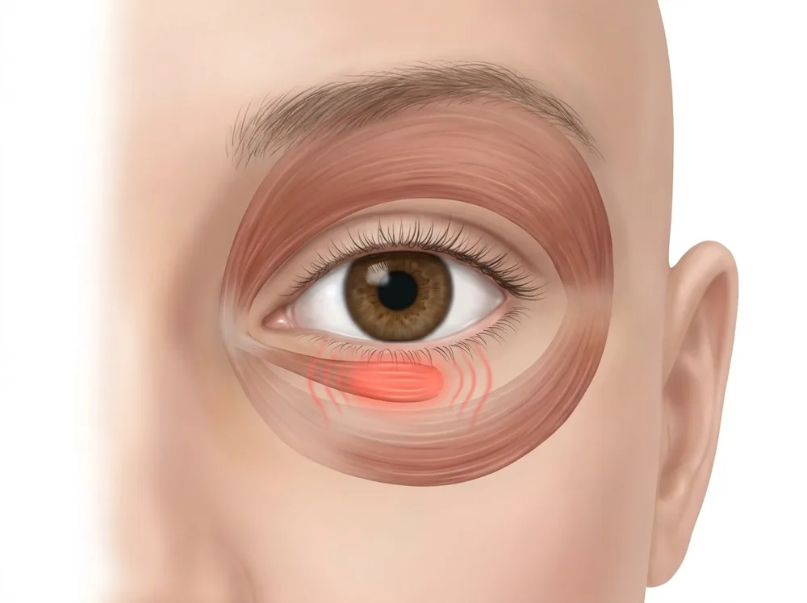

## 정의
눈밑떨림(안검 근간대경련, eyelid myokymia)은 **눈 둘레 근육(안륜근)의 일부 근섬유가 본인 의지와 무관하게 잘게 수축해 아래 눈꺼풀이 파르르 떨리는 증상**입니다. 대개 한쪽 아래 눈꺼풀에 국한되고 눈이 감기지는 않으며, 피로·카페인·수면 부족·스트레스와 함께 나타났다가 며칠에서 몇 주 안에 저절로 멎는 양성 경과가 대부분입니다 [^3].

<figure class="entity-figure">
  
  <figcaption markdown="span">눈밑떨림: 눈 둘레 근육(안륜근) 가운데 아래 눈꺼풀 일부 근섬유의 잔떨림(붉은 부분) · 눈은 감기지 않음AI로 생성한 교육용 그림 · Linkbase 편집(해부 검수)</figcaption>
</figure>

같은 「눈 떨림」이라도 같은 쪽 얼굴 전체로 번지는 **반측안면경련**(hemifacial spasm)과 양쪽 눈이 저절로 꽉 감기는 **안검경련**(blepharospasm)은 별개의 신경학적 질환이라 구분이 필요합니다 [^1][^2].

안검 근간대경련은 얼굴에 생기는 근간대경련 가운데 가장 흔한 형태로, 침범된 근육을 따라 퍼지는 저절로 일어나는 가볍고 지속적인 잔물결 모양의 수축으로 설명됩니다 [^6]. 가장 자주 침범되는 근육은 눈 둘레 근육이며, 대개 한쪽에 생기고 위 눈꺼풀보다 아래 눈꺼풀에 더 자주 나타납니다 [^6]. 눈 둘레 근육은 눈을 감게 하는 근육으로, 얼굴신경(안면신경)에서 갈라진 가지들이 지배합니다 [^6].

## 증상
- 한쪽 아래 눈꺼풀이 잔물결처럼 미세하게 떨리고, 본인은 크게 느끼지만 거울로는 잘 보이지 않는 경우가 많습니다
- 피로가 쌓인 날·카페인을 많이 마신 날·잠이 부족한 날에 심해지고, 쉬면 줄어듭니다
- 눈이 감기거나 뺨·입꼬리가 함께 당기지는 않습니다 — 이런 소견이 있으면 반측안면경련을 검토합니다 [^1]
- 양쪽 눈이 저절로 감기고 밝은 빛·운전·독서에서 심해지면 안검경련을 검토합니다 [^2]
- 눈밑떨림의 수축은 저절로 멎는 주기적 양상으로 몇 초에서 몇 시간 이어지며, 때로는 며칠에서 몇 주까지 계속된 뒤 멎기도 합니다. 드물게 같은 쪽 위·아래 눈꺼풀이 동시에 떨리기도 합니다 [^6]
- 반측안면경련에서 처음 침범되는 부위는 아래 눈꺼풀이 가장 흔하고, 그다음이 뺨과 입 주위입니다. 시야를 가리는 불수의적 눈 감김과 사회적 당혹감이 가장 흔한 호소입니다 [^7]
- 따라서 아래 눈꺼풀 떨림만 있는 초기에는 두 질환을 증상만으로 구분하기 어려울 수 있어, 떨림이 번지는지를 경과 중에 다시 확인합니다
- 안검경련은 눈 둘레 근육의 연축성 수축 때문에 눈꺼풀이 만성적으로, 간헐적이거나 지속적으로 저절로 감기는 질환이며, 두 번째로 흔한 국소 근긴장이상입니다 [^8]

## 병태
- **양성 안검 근간대경련**: 피로, 수면 부족, 카페인·알코올, 스트레스, 장시간 화면 사용, 눈 건조 등이 흔한 유발 요인입니다 [^3]
- **약물**: 항경련제(토피라메이트), 메트포르민 등 약물 복용과 연관된 눈밑떨림이 보고되어 있습니다 [^4][^5]
- **반측안면경련**: 안면신경이 뇌간에서 나오는 부위가 혈관에 눌리는 것이 흔한 원인이며, 드물게 종양·탈수초 질환이 관여합니다 [^1]
- **안검경련**: 눈 둘레 근육의 국소 근긴장이상으로, 기저핵 회로 이상과 관련된 운동장애입니다 [^2]
- **만성 경과의 위험 요인**: 여성과 추운 날씨가 만성 안검 근간대경련의 위험 요인으로 기술됩니다 [^6]
- **반측안면경련의 성격**: 같은 쪽 안면신경이 지배하는 근육에 불수의적이고 한쪽에 국한된 간헐적·불규칙한 긴장성 또는 간대성 수축이 일어나는 말초 기원 운동장애로 정의됩니다 [^7]
- **지속성 안면 근간대경련**: 끊임없이 이어지는 안면 근간대경련(facial myokymia)은 다발성경화증·교뇌 신경교종 같은 뇌간 내부 병변의 매우 드문 특징적 징후로 보고되며, 발생 기전은 아직 명확하지 않습니다 [^9]

## 진단
- **병력과 신경학적 진찰**: 한쪽인지 양쪽인지, 눈꺼풀에 국한되는지 뺨·입까지 번지는지, 눈이 실제로 감기는지, 유발·완화 요인, 복용 약물, 다른 뇌신경 증상(감각 저하·마비·복시)을 확인합니다 [^1][^3]
- 수 주 이상 지속되거나 얼굴 다른 부위로 번지는 근간대경련은 드물게 뇌간·소뇌 병변의 초기 징후일 수 있어 추가 평가가 권고됩니다 [^3]
- 반측안면경련이 의심되면 영상검사로 혈관에 의한 신경 압박 여부를 확인합니다 [^1]
- **안검경련 임상 진단 기준**: 눈꺼풀을 좁히거나 감기게 하는 양측성·동시적·정형화된 눈 둘레 근육 연축을 먼저 확인하고, 이어서 감각 속임수(sensory trick) 또는 눈 깜빡임 증가를 확인하는 알고리즘이 민감도 93%, 특이도 90%로 검증되었습니다 [^10]
- **눈꺼풀에 국한된 만성 근간대경련**: 12개월 이상 추적한 만성 단독 안검 근간대경련 환자 15명 가운데 13명이 신경영상 검사를 받았고 모두 이상 소견이 없었으며, 근간대경련이 신경학적 질환의 첫 증상으로 드러난 환자는 없었습니다 [^11]

## 치료
- **양성 근간대경련**: 수면·카페인·스트레스 등 유발 요인을 줄이면 대부분 저절로 멎습니다. 약물이 원인이면 처방 의사와 상의해 조정합니다 [^4][^5]
- **반측안면경련·안검경련**: 보툴리눔 톡신 주사가 표준 치료이며, 약물 치료와 (반측안면경련에서) 미세혈관감압술이 선택지로 보고되어 있습니다 [^1][^2]
- **만성 단독 안검 근간대경련**: 저절로 멎지 않은 환자에게 보툴리눔 톡신을 일정 간격으로 주사했을 때 대부분이 증상 호전을 보고했습니다 [^11]
- **안검경련**: 보툴리눔 톡신 A형이 1차 치료로 여겨지며, 위약과 비교한 무작위 대조시험 메타분석에서 1회 주사로 4~6주 시점의 안검경련 중증도와 기능 장애가 임상적으로 의미 있게 줄었습니다 [^8]. 시야 관련 불편과 눈꺼풀 처짐(안검하수) 위험은 높아졌고, 한 시험에서 효과 지속 기간은 약 10.6주로 추정되었습니다 [^8]
- **반측안면경련 — 보툴리눔 톡신**: 위약 대조 무작위 시험은 없지만, 관찰 연구 자료는 보툴리눔 톡신 A형 치료와 증상 호전 사이의 강한 연관성과 양호한 안전성을 보여 줍니다 [^12]
- **반측안면경련 — 미세혈관감압술**: 22편, 5,685명을 종합한 체계적 문헌고찰에서 중앙값 2.9년 추적 동안 91.1%에서 증상이 완전히 소실되었고, 재발은 2.4%였습니다 [^13]. 일시적 합병증으로 안면마비 9.5%, 청력 저하 3.2%, 뇌척수액 누출 1.4%가, 영구 합병증으로 청력 저하 2.3%, 안면마비 0.9%가 보고되었습니다 [^13]

## 예후
양성 안검 근간대경련은 대개 수일~수주 안에 멎고, 피로가 쌓이면 재발하기도 합니다. 떨림의 범위가 넓어지거나 눈이 감기거나 얼굴 근육 약화가 동반되면 성질이 달라진 것이므로 재평가가 필요합니다 [^1][^3].

몇 달 이상 이어지는 만성 단독 안검 근간대경련도 양성 질환으로 보고됩니다 [^11]. 12개월 이상 추적한 만성 단독 안검 근간대경련 15명은 첫 진찰 시점까지 증상이 평균 91개월(2.5개월~20년) 이어졌고, 4명은 저절로 멎었으며, 같은 쪽 반측안면경련으로 진행한 환자는 1명이었습니다 [^11]. 이 연구는 만성 단독 안검 근간대경련이 다른 얼굴 운동장애로 진행하거나 다른 신경학적 질환과 동반되는 경향이 낮다고 결론지었습니다 [^11].

반측안면경련은 만성 질환으로, 저절로 회복되는 경우는 매우 드뭅니다 [^12]. 지속성 안면 근간대경련은 원인 병변에 따라 경과가 달라, 다발성경화증에서는 수개월 동안만 이어지지만 교뇌 신경교종에서는 수년간 멎지 않는 것으로 보고되며, 치료와 예후도 원인 질환에 따라 결정됩니다 [^9].

## Citations
### 외부 권위 출처

[^1]: Yaltho TC, Jankovic J. The many faces of hemifacial spasm: differential diagnosis of unilateral facial spasms. *Mov Disord*. 2011. PMID: 21469208
[^2]: Defazio G, Hallett M, Jinnah HA, et al. Blepharospasm 40 years later. *Mov Disord*. 2017. PMID: 28186662
[^3]: Barmettler A, Dinkin MJ, Lelli GJ. Eyelid myokymia: not always benign. *Orbit*. 2011. PMID: 21957885
[^4]: Medrano-Martínez V, Pérez-Sempere A, Moltó-Jordá JM, et al. Eyelid myokymia in patients with migraine taking topiramate. *Acta Neurol Scand*. 2015. PMID: 25828425
[^5]: Ahsan M, Nizami DJ. Metformin-induced eyelid myokymia. *Indian J Pharmacol*. 2024. PMID: 39687960
[^6]: [Jafer Chardoub AA, Patel BC. Eyelid Myokymia. In: StatPearls. Treasure Island (FL): StatPearls Publishing; 2023. PMID 32809430](https://pubmed.ncbi.nlm.nih.gov/32809430/)
[^7]: [Wang A, Jankovic J. Hemifacial spasm: clinical findings and treatment. Muscle Nerve. 1998;21(12):1740-1747. PMID 9843077](https://pubmed.ncbi.nlm.nih.gov/9843077/)
[^8]: [Duarte GS, Rodrigues FB, Marques RE, et al. Botulinum toxin type A therapy for blepharospasm. Cochrane Database Syst Rev. 2020;11(11):CD004900. PMID 33211907. DOI 10.1002/14651858.CD004900.pub3](https://pubmed.ncbi.nlm.nih.gov/33211907/)
[^9]: [Sharma RR, Mathad NV, Joshi DN, et al. Persistent facial myokymia: a rare pathognomic physical sign of intrinsic brain-stem lesions: report of 2 cases and review of literature. J Postgrad Med. 1992;38(1):37-40. PMID 1512726](https://pubmed.ncbi.nlm.nih.gov/1512726/)
[^10]: [Defazio G, Hallett M, Jinnah HA, et al. Development and validation of a clinical guideline for diagnosing blepharospasm. Neurology. 2013;81(3):236-240. PMID 23771487. DOI 10.1212/WNL.0b013e31829bfdf6](https://pubmed.ncbi.nlm.nih.gov/23771487/)
[^11]: [Banik R, Miller NR. Chronic myokymia limited to the eyelid is a benign condition. J Neuroophthalmol. 2004;24(4):290-292. PMID 15662242. DOI 10.1097/00041327-200412000-00003](https://pubmed.ncbi.nlm.nih.gov/15662242/)
[^12]: [Duarte GS, Rodrigues FB, Castelão M, et al. Botulinum toxin type A therapy for hemifacial spasm. Cochrane Database Syst Rev. 2020;11(11):CD004899. PMID 33211908. DOI 10.1002/14651858.CD004899.pub3](https://pubmed.ncbi.nlm.nih.gov/33211908/)
[^13]: [Miller LE, Miller VM. Safety and effectiveness of microvascular decompression for treatment of hemifacial spasm: a systematic review. Br J Neurosurg. 2012;26(4):438-444. PMID 22168965. DOI 10.3109/02688697.2011.641613](https://pubmed.ncbi.nlm.nih.gov/22168965/)

## Changelog
- 2026-11-21 v2: 외부 근거 보강 — StatPearls(정의·증상·위험 요인), Wang & Jankovic 1998(반측안면경련 초기 침범 부위·성격), Defazio 2013(안검경련 진단 기준), Banik & Miller 2004(만성 단독 안검 근간대경련의 영상 소견·보툴리눔 톡신·예후), Cochrane 2020 2편(안검경련·반측안면경련 보툴리눔 톡신), Miller & Miller 2012(미세혈관감압술 성적), Sharma 1992(지속성 안면 근간대경련과 뇌간 병변)를 각 섹션에 새 문장으로 추가. 기존 본문·각주 [^1]~[^5] 무변경. source_count_external 5→13.
