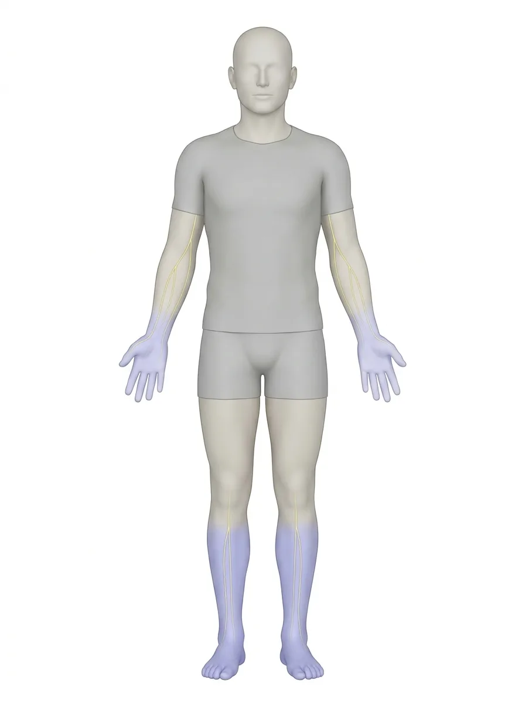

## 정의
말초신경병증(peripheral neuropathy)은 **뇌와 척수 밖의 말초신경이 손상되어 감각·운동·자율신경 기능에 이상이 생기는 질환군**입니다. 그중 가장 흔한 형태가 **원위 대칭성 다발신경병증**(distal symmetric polyneuropathy)으로, 가장 긴 신경의 끝부터 손상이 시작되어 양쪽 발끝에서 감각 이상이 대칭으로 나타나고 진행하면 손끝까지 올라옵니다 [^3].

<figure class="entity-figure entity-figure--portrait">
  
  <figcaption markdown="span">원위 대칭성 다발신경병증의 감각 이상 분포: 양쪽 발과 종아리(양말 모양) · 양손과 아래팔 끝(장갑 모양)AI로 생성한 교육용 그림 · Linkbase 편집(해부 검수)</figcaption>
</figure>

당뇨병은 말초신경병증의 가장 흔한 원인이며, 당뇨병성 신경병증은 다른 원인을 배제한 뒤 당뇨병 환자에서 나타나는 말초신경 기능 이상으로 정의됩니다 [^1][^2].

말초신경병증은 인구의 2~7%에서 나타나는 흔한 질환이며, 원위 대칭성 다발신경병증은 말초신경병증 가운데 가장 흔한 아형입니다 [^6]. 인구 기반 연구 29편을 검토한 체계적 문헌고찰에서 일반 인구의 다발신경병증 유병률은 약 1%였고, 고령층에서는 최대 7%까지 높아졌습니다 [^7]. 당뇨병성 말초신경병증은 1형·2형 당뇨병 환자의 최대 절반에서 발생합니다 [^8].

## 증상
- 양쪽 발끝부터 **양말을 신은 듯 감각이 둔해지고** 저리거나 화끈거리며, 진행하면 손끝에서도 **장갑을 낀 듯한** 이상 감각이 나타납니다 [^3]
- 밤에 증상이 더 두드러지는 경우가 많고, 통증성 신경병증에서는 타는 듯한 통증이 동반됩니다 [^4]
- 감각이 둔해진 발은 상처·화상을 늦게 알아차려 궤양으로 이어질 수 있어 발 관리가 함께 필요합니다 [^1]
- 한쪽 팔·다리의 특정 신경 분포를 따라 나타나는 저림은 신경뿌리나 말초신경의 **압박**(디스크, 손목터널·발목터널증후군)을 먼저 검토합니다
- 다발신경병증은 양쪽 대칭으로 원위부에 나타나는 무감각과 이상감각이 특징이며, 통증과 근력 약화가 흔히 동반됩니다 [^7]
- 말초신경병증 환자는 통증을 자주 겪고, 낙상·궤양·절단의 위험에 놓입니다 [^6]
- 당뇨병성 말초신경병증에서는 말초신경 기능이 먼 쪽에서 가까운 쪽으로 소실되며, 이것이 신체 장애와 때로 통증으로 이어져 삶의 질을 떨어뜨립니다 [^8]

## 병태
- **당뇨병**(가장 흔함) — 고혈당에 따른 대사·미세혈관 손상이 축삭과 슈반세포에 영향을 미칩니다 [^2][^5]
- 만성 음주, 비타민 B12 결핍, 갑상선 기능 저하, 신장 기능 저하
- 항암제 등 약물, 면역 매개 신경병증(길랭-바레 증후군, CIDP), 유전성 신경병증
- 원인을 찾지 못하는 특발성 다발신경병증도 일정 비율을 차지합니다 [^4]
- **지역별 위험 요인**: 인구 기반 연구를 종합한 체계적 문헌고찰에서 서구 국가는 당뇨병, 과음, 세포독성 항암제, 심혈관 질환이 다발신경병증과 흔히 연관되었고, 개발도상국은 한센병 같은 감염성 질환이 더 흔한 원인이었습니다 [^7]
- **특발성의 비율**: 같은 고찰에 포함된 모든 연구에서 다발신경병증의 20~30%가 원인을 찾지 못한 특발성으로 남았습니다 [^7]
- **당뇨병성 말초신경병증의 위험 요인**: 고혈당이 위험 요인이며, 2형 당뇨병 환자에게 흔한 동반 질환 가운데 대사증후군이 주요 위험 요인으로 꼽힙니다 [^8]
- **당뇨병성 말초신경병증의 기전**: 병태생리는 복잡하지만, 말초신경 고유의 해부 구조 때문에 생기는 생체에너지 대사 부전(bioenergetic failure)이라는 공통 주제로 수렴합니다 [^8]

## 진단
- **병력과 신경학적 진찰**: 증상의 분포(양측 대칭·원위부 우세)와 진행 양상, 감각·건반사·근력 이상을 확인합니다. 임상 연구용 정의는 증상, 신경학적 징후, 전기생리 검사의 조합으로 원위 대칭성 다발신경병증을 규정합니다 [^3]
- **신경전도 검사(NCS)·근전도(EMG)**: 어느 신경이, 축삭과 수초 중 어느 쪽이, 얼마나 손상됐는지 확인하고 압박성 병변과 구분합니다 [^3][^4]
- **혈액 검사**: 혈당·당화혈색소, 비타민 B12, 갑상선 기능, 신장 기능 등 원인 검색 [^4]
- 당뇨병 환자는 진단 시점부터 정기적으로 신경병증 선별검사(단일섬유 검사, 진동감각 등)를 받도록 권고됩니다 [^1]
- **원인 미상일 때의 기본 혈액 검사**: 원위 대칭성 다발신경병증에서 일상적인 혈액 검사는 범위를 제한해 시행하는 것이 근거에 부합하며, 원인이 알려지지 않은 환자에게는 일반혈액검사, 종합대사검사, 비타민 B12, 혈청 단백 전기영동과 면역고정, 공복혈당, 당부하 검사가 권고됩니다 [^6]
- **검출률이 높은 검사 항목**: 미국신경과학회 등 3개 학회의 진료 지침(practice parameter)은 다발신경병증에서 이상 소견 검출률이 가장 높은 혈액 검사로 혈당, 대사산물(메틸말론산 등)을 포함한 혈청 B12, 혈청 단백 면역고정 전기영동을 제시합니다. 일반 혈당 검사로 당뇨병이 확인되지 않으면 원위 대칭성 감각 다발신경병증에서 내당능 장애 검사를 고려할 수 있습니다 [^9]
- **유전자 검사**: 같은 지침은 유전성 신경병증의 정확한 진단과 분류에 유전자 검사를 권고합니다. 원인 불명 다발신경병증이 유전성 표현형을 보이면 임상 양상·유전 형태·전기진단 소견에 따라 CMT1A 중복/HNPP 결실, Cx32(GJB1), MFN2 같은 흔한 이상부터 확인하며, 유전성 표현형이 없는 원인 불명 다발신경병증에서 일상적 유전자 검사의 유용성은 근거가 불충분합니다 [^9]
- **전문의 의뢰가 필요한 비전형 양상**: 비대칭 분포, 길이 의존적이지 않은 분포, 운동 증상 우세, 급성·아급성 발병, 두드러진 자율신경 침범이 있으면 신경과 또는 신경근육 질환 전문의 진료가 권고됩니다 [^6]
- 한 리뷰는 원위 대칭성 다발신경병증에서 전기진단 검사와 신경축 MRI가 진단 비용의 상당 부분을 차지하지만 이들 검사의 사용을 뒷받침하는 근거는 부족하며, 전기진단 검사의 역할은 더 정립될 필요가 있다고 평가했습니다 [^6]
- **통증성 신경병증 평가**: 미국신경과학회 2022 지침은 당뇨병 환자에서 통증성 당뇨병성 신경병증 여부를 평가하고, 통증성 신경병증 환자에서는 동반된 기분 장애와 수면 장애를 함께 평가하도록 권고합니다 [^10]

## 치료
- **원인 교정**: 혈당 관리, 음주 중단, 결핍 영양소 보충, 원인 약물 조정이 진행을 늦추는 기본입니다 [^1][^2]
- **신경병증성 통증 조절**: 항경련제(프레가발린·가바펜틴), 세로토닌-노르에피네프린 재흡수 억제제, 삼환계 항우울제 등이 1차 약물로 권고됩니다 [^1][^4]
- **발 관리**: 감각 저하로 인한 궤양·절단을 예방하기 위한 정기 발 검진과 신발 관리 [^1]
- 국소 통증에 대한 신경차단 등 중재적 통증 치료는 개별 상황에 따라 검토됩니다
- **통증성 당뇨병성 신경병증의 약물 선택**: 미국신경과학회 2022 지침 업데이트는 통증 감소를 위해 삼환계 항우울제, 세로토닌-노르에피네프린 재흡수 억제제(SNRI), 가바펜티노이드, 나트륨 채널 차단제 중에서 투여하고 효과 외의 요인도 함께 고려하도록 권고합니다. 처음 쓴 계열로 의미 있는 호전이 없거나 부작용이 크면 효과가 입증된 다른 계열을 시도하고, 통증성 당뇨병성 신경병증 치료에 오피오이드는 쓰지 않도록 권고합니다 [^10]
- 같은 지침의 분석에서 가바펜티노이드, SNRI, 나트륨 채널 차단제, SNRI·오피오이드 이중기전 약물의 효과 크기는 서로 비슷한 중간 수준 경계였고, 삼환계 항우울제는 효과 크기가 컸지만 추정치의 신뢰도가 낮았습니다 [^10]
- **신경병증성 통증 약물치료 근거**: 국제통증학회 신경병증성 통증 특별위원회(NeuPSIG)의 무작위 이중맹검 연구 229편 메타분석은 삼환계 항우울제, SNRI, 프레가발린, 가바펜틴을 1차 치료로 강하게 권고했고, 리도카인 패치·고농도 캡사이신 패치·트라마돌을 2차, 강오피오이드와 보툴리눔 톡신 A를 3차로 약하게 권고했습니다. 국소 제제와 보툴리눔 톡신 A는 말초 신경병증성 통증에만 권고됩니다 [^11]
- 같은 메타분석에서 통증 50% 감소를 위한 치료 필요 수(NNT)는 SNRI 6.4, 프레가발린 7.7, 가바펜틴 7.2로 시험 결과는 전반적으로 크지 않았습니다 [^11]
- **단독 요법으로 부족할 때의 병용**: 당뇨병성 말초신경병증성 통증 환자를 대상으로 한 다기관 이중맹검 무작위 교차 시험(OPTION-DM)에서 아미트립틸린에 프레가발린 추가, 프레가발린에 아미트립틸린 추가, 둘로세틴에 프레가발린 추가의 세 치료 경로는 진통 효과가 비슷했습니다. 단독 요법으로 통증 조절이 충분하지 않은 환자에서 병용 요법은 내약성이 좋았고 통증 완화를 더 개선했습니다 [^12]
- **강화 혈당 조절**: 무작위 대조시험을 종합한 코크란 체계적 문헌고찰에서 강화 혈당 조절은 1형 당뇨병에서 임상적 신경병증 발생을 유의하게 줄였고, 2형 당뇨병에서는 발생을 줄였으나 통계적 유의성에는 이르지 못했습니다(P = 0.06). 두 유형 모두에서 신경전도와 진동 역치 이상은 유의하게 줄었지만, 중증 저혈당 발생 위험도 유의하게 높아져 이득과 위험을 함께 따져야 합니다 [^13]
- 2형 당뇨병에서는 혈당 조절의 이득이 적거나 없는 것으로 보고되며, 현재 당뇨병성 말초신경병증 관리는 당뇨병·대사증후군·통증 조절에 초점을 두지만 대부분의 환자에서 아직 충분하지 않은 것으로 평가됩니다 [^8]
- **항암제 유발 말초신경병증**: 미국임상종양학회(ASCO) 2020 지침은 항암제 유발 말초신경병증의 예방 목적으로 권고되는 약제가 없음을 재확인했고, 예방 목적의 아세틸-L-카르니틴 사용은 피하도록 권고합니다. 견디기 어려운 신경병증이나 기능 장애가 생기면 항암제 투여 연기·감량·대체·중단의 적절성을 평가하며, 이미 생긴 통증성 항암제 유발 신경병증에 근거가 있는 약제는 둘로세틴이 유일하지만 그 이득의 크기는 제한적입니다 [^14]

## 예후
당뇨병성 신경병증은 유병 기간과 혈당 조절 상태에 따라 서서히 진행하며, 손상된 축삭의 재생은 제한적이라 조기 발견과 원인 교정이 중요합니다 [^2][^5]. 발 감각 저하는 족부 궤양과 절단의 주요 위험 요인입니다 [^1].

당뇨병성 신경병증은 당뇨병 진단 시점에 환자의 약 10%, 10년 뒤에는 40~50%에서 나타나는 것으로 기술됩니다 [^13]. 조기 진단은 임상 결과를 개선하지만 여전히 많은 환자에서 신경병증이 생기며, 조기 진단과 예후 예측을 개선하기 위한 연구가 진행 중입니다 [^8].

신경병증성 통증에 효과가 입증된 약물이 여러 가지 있음에도 통증은 여전히 충분히 인지되거나 치료되지 못하는 경우가 많고, 말초신경병증을 예방하거나 치료하는 새로운 질병 조절 약물이 특히 2형 당뇨병에서 필요한 상황입니다 [^6].

원인을 찾지 못한 만성 특발성 축삭 다발신경병증 환자 75명을 5년간 추적한 연구에서 진행은 느렸고, 장애가 있더라도 심하지 않았습니다 [^15]. 추적 기간에 뚜렷한 원인이 새로 밝혀진 환자는 4명(유전성 운동감각 신경병증 2형 2명, 감각형 만성 염증성 탈수초성 다발신경병증 1명, 알코올성 신경병증 1명)뿐이었고, 추적 종료 시점에 악성 종양이나 감마글로불린병증(gammopathy)과의 관련은 없었습니다 [^15]. 혈액 검사를 일상적으로 반복하는 것은 새로운 정보를 주지 못해, 이런 검사는 임상적 근거가 있을 때만 시행하도록 제시되었습니다 [^15].

## Citations
### 외부 권위 출처

[^1]: Feldman EL, Callaghan BC, Pop-Busui R, et al. Diabetic neuropathy. *Nat Rev Dis Primers*. 2019. PMID: 31197153
[^2]: Zhu J, Hu Z, Luo Y, et al. Diabetic peripheral neuropathy: pathogenetic mechanisms and treatment. *Front Endocrinol (Lausanne)*. 2023. PMID: 38264279
[^3]: England JD, Gronseth GS, Franklin G, et al. Distal symmetric polyneuropathy: a definition for clinical research: report of the American Academy of Neurology, the American Association of Electrodiagnostic Medicine, and the American Academy of Physical Medicine and Rehabilitation. *Neurology*. 2005. PMID: 15668414
[^4]: Watson JC, Dyck PJ. Peripheral Neuropathy: A Practical Approach to Diagnosis and Symptom Management. *Mayo Clin Proc*. 2015. PMID: 26141332
[^5]: Callaghan BC, Cheng HT, Stables CL, et al. Diabetic neuropathy: clinical manifestations and current treatments. *Lancet Neurol*. 2012. PMID: 22608666
[^6]: [Callaghan BC, Price RS, Feldman EL. Distal Symmetric Polyneuropathy: A Review. JAMA. 2015;314(20):2172-2181. PMID 26599185. DOI 10.1001/jama.2015.13611](https://pubmed.ncbi.nlm.nih.gov/26599185/)
[^7]: [Hanewinckel R, van Oijen M, Ikram MA, et al. The epidemiology and risk factors of chronic polyneuropathy. Eur J Epidemiol. 2016;31(1):5-20. PMID 26700499. DOI 10.1007/s10654-015-0094-6](https://pubmed.ncbi.nlm.nih.gov/26700499/)
[^8]: [Elafros MA, Andersen H, Bennett DL, et al. Towards prevention of diabetic peripheral neuropathy: clinical presentation, pathogenesis, and new treatments. Lancet Neurol. 2022;21(10):922-936. PMID 36115364. DOI 10.1016/S1474-4422(22)00188-0](https://pubmed.ncbi.nlm.nih.gov/36115364/)
[^9]: [England JD, Gronseth GS, Franklin G, et al. Practice Parameter: evaluation of distal symmetric polyneuropathy: role of laboratory and genetic testing (an evidence-based review). Report of the American Academy of Neurology, American Association of Neuromuscular and Electrodiagnostic Medicine, and American Academy of Physical Medicine and Rehabilitation. Neurology. 2009;72(2):185-192. PMID 19056666. DOI 10.1212/01.wnl.0000336370.51010.a1](https://pubmed.ncbi.nlm.nih.gov/19056666/)
[^10]: [Price R, Smith D, Franklin G, et al. Oral and Topical Treatment of Painful Diabetic Polyneuropathy: Practice Guideline Update Summary: Report of the AAN Guideline Subcommittee. Neurology. 2022;98(1):31-43. PMID 34965987. DOI 10.1212/WNL.0000000000013038](https://pubmed.ncbi.nlm.nih.gov/34965987/)
[^11]: [Finnerup NB, Attal N, Haroutounian S, et al. Pharmacotherapy for neuropathic pain in adults: a systematic review and meta-analysis. Lancet Neurol. 2015;14(2):162-173. PMID 25575710. DOI 10.1016/S1474-4422(14)70251-0](https://pubmed.ncbi.nlm.nih.gov/25575710/)
[^12]: [Tesfaye S, Sloan G, Petrie J, et al. Comparison of amitriptyline supplemented with pregabalin, pregabalin supplemented with amitriptyline, and duloxetine supplemented with pregabalin for the treatment of diabetic peripheral neuropathic pain (OPTION-DM): a multicentre, double-blind, randomised crossover trial. Lancet. 2022;400(10353):680-690. PMID 36007534. DOI 10.1016/S0140-6736(22)01472-6](https://pubmed.ncbi.nlm.nih.gov/36007534/)
[^13]: [Callaghan BC, Little AA, Feldman EL, et al. Enhanced glucose control for preventing and treating diabetic neuropathy. Cochrane Database Syst Rev. 2012;(6):CD007543. PMID 22696371. DOI 10.1002/14651858.CD007543.pub2](https://pubmed.ncbi.nlm.nih.gov/22696371/)
[^14]: [Loprinzi CL, Lacchetti C, Bleeker J, et al. Prevention and Management of Chemotherapy-Induced Peripheral Neuropathy in Survivors of Adult Cancers: ASCO Guideline Update. J Clin Oncol. 2020;38(28):3325-3348. PMID 32663120. DOI 10.1200/JCO.20.01399](https://pubmed.ncbi.nlm.nih.gov/32663120/)
[^15]: [Notermans NC, Wokke JH, van der Graaf Y, et al. Chronic idiopathic axonal polyneuropathy: a five year follow up. J Neurol Neurosurg Psychiatry. 1994;57(12):1525-1527. PMID 7798984. DOI 10.1136/jnnp.57.12.1525](https://pubmed.ncbi.nlm.nih.gov/7798984/)

## Changelog
- 2026-11-21 v2: 외부 근거 보강 — Callaghan 2015 JAMA 리뷰(유병률·증상·혈액 검사·전문의 의뢰·예후), Hanewinckel 2016 역학 체계적 문헌고찰(유병률·증상·위험 요인·특발성 비율), Elafros 2022(당뇨병성 말초신경병증 빈도·기전·관리 한계·예후), AAN 2009 검사 지침(혈액·유전자 검사), AAN 2022 통증성 당뇨병성 신경병증 지침(평가·약물 선택), NeuPSIG 2015 메타분석(신경병증성 통증 약물 1~3차), OPTION-DM 2022(병용 요법), Cochrane 2012(강화 혈당 조절·빈도), ASCO 2020(항암제 유발 신경병증), Notermans 1994(특발성 축삭 다발신경병증 5년 추적)를 각 섹션에 새 문장으로 추가. Citations에 외부 권위 출처 헤딩 추가. 기존 본문·각주 [^1]~[^5] 무변경. source_count_external 5→15.
