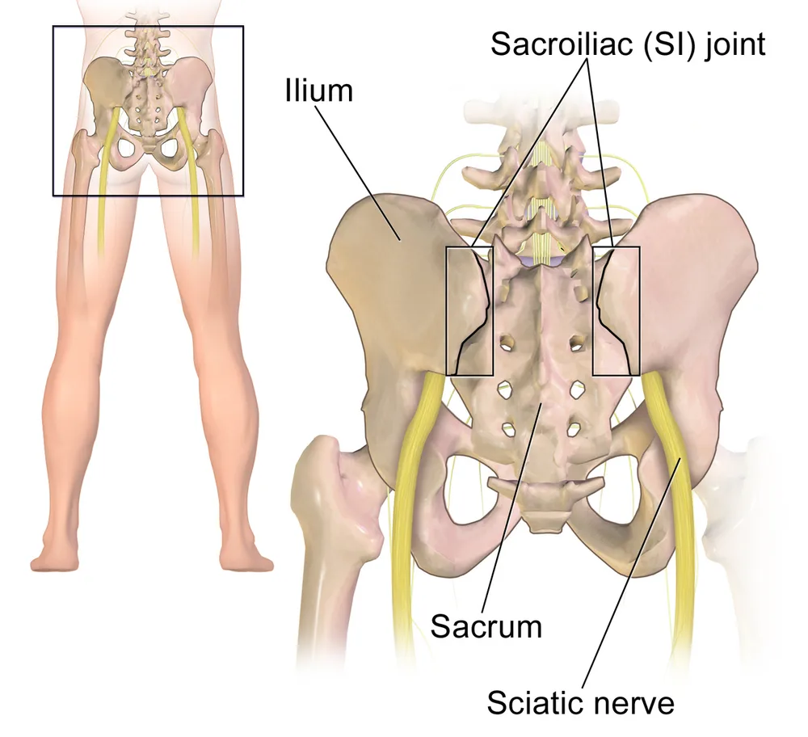

## 정의
천장관절증후군은 **골반 뒤쪽에서 천골과 장골을 잇는 천장관절과 그 주변 인대에서 오는 통증**입니다. 천장관절은 움직임이 작지만 상체의 체중을 다리로 넘기고 전단력을 버티는 자리라, 한쪽에 부하가 몰리면 관절과 인대가 아픕니다 [^1]. 만성 비방사통 요통 환자의 15~30%에서 통증의 근원이 천장관절로 보고됩니다 [^6].

투시 유도 천장관절 차단술 연구에서는 L5-S1 아래쪽 통증이 가장 심한 만성 요통 환자 43명 중 13명(30%)이 차단 후 뚜렷한 통증 완화를 보여, 천장관절이 만성 요통의 의미 있는 통증원으로 평가됐습니다 [^7].

<figure class="entity-figure">
  
  <figcaption markdown="span">천장관절 위치(뒤에서 본 골반): 가운데 엉치뼈(Sacrum)와 양옆 엉덩뼈(Ilium)가 맞닿는 천장관절(Sacroiliac joint, 네모 표시) · 골반 아래로 내려가는 좌골신경(Sciatic nerve)그림: BruceBlaus (Blausen.com staff), <a href="https://commons.wikimedia.org/wiki/File:Sacroiliac_Joint.png" rel="nofollow noopener" target="_blank">Wikimedia Commons</a>, <a href="https://creativecommons.org/licenses/by/3.0" rel="nofollow noopener" target="_blank">CC BY 3.0</a></figcaption>
</figure>

## 증상
- 엉치뼈(후상장골극) 한 점을 누르면 아프고, 통증이 엉덩이·사타구니·허벅지로 퍼지되 대개 **무릎 위까지**입니다 [^1][^6]
- 앉았다 일어설 때, 침대에서 돌아누울 때, 계단을 오를 때, 한쪽 다리로 설 때 심해집니다 [^1]
- 다리 저림·감각 저하·힘 빠짐 같은 신경 증상은 없는 것이 원칙이며, 있으면 신경뿌리 압박을 먼저 봅니다 [^6]
- 진단적 주사로 확인된 환자 50명의 통증 부위를 분석한 연구에서는 엉덩이 통증이 94%, 아래 허리 통증이 72%, 사타구니 통증이 14%였고, 무릎 아래까지 내려가는 다리 통증도 28%에서 보고돼 연관통이 허리와 엉덩이에만 국한되지 않았습니다. 젊은 환자일수록 무릎 아래 통증을 호소하는 경향이 있었습니다 [^8]
- 투시 유도 차단술 연구에서 차단 반응과 관련된 통증 양상은 사타구니 통증뿐이었습니다 [^7]

## 병태
- 짝다리·다리 꼬기·한쪽으로 가방 메기 같은 비대칭 부하, 실제 또는 겉보기 다리 길이 차이, 골반 틀어짐 [^1][^6]
- 임신·출산(인대 이완), 외상(낙상·교통사고), 이전 척추 유합술 뒤 인접 부하 증가 [^6]
- 강직성 척추염 등 염증성 관절염 — 야간통·아침 강직·발열이 있으면 따로 감별합니다 [^6]
- 요추·요천추 기기 고정 후외방 유합술 환자를 5년간 추적한 전향적 코호트에서 천장관절 퇴행 발생률은 유합군 75%로 나이를 맞춘 대조군 38.2%보다 높았고, 천골(S1)까지 고정한 경우에 더 흔했습니다 [^9]
- 골반대 통증(pelvic girdle pain)은 주로 임신·외상·관절염·골관절염과 관련해 생기며, 임신부의 시점 유병률은 약 20%이고 이전 요통과 골반 외상 병력이 임신 중 발생의 위험 요인일 가능성이 높습니다 [^10]

## 진단
- **통증 유발검사 묶음**: 압박·이완(distraction/compression)·대퇴 밀기(thigh thrust)·Gaenslen·FABER 등 여러 검사 중 다수가 양성이면 천장관절 통증을 강하게 시사합니다 [^2]
- **진단적 차단술**: 영상 유도로 관절 안에 국소마취제를 넣어 통증이 줄면 확정하는 기준 검사입니다 [^3][^6]
- 영상은 골반 정렬·다리 길이 차이·골절·염증성 변화를 보는 보조 역할이며, 단순 X-ray 소견만으로 확정하지 않습니다 [^1]
- **유발검사 조합의 정확도**: 환자 48명을 대상으로 한 맹검 연구에서 6개 유발검사 중 3개 이상이 양성일 때 관절 내 국소마취 주사 반응 대비 민감도 94%, 특이도 78%였고, 6개 검사 모두에서 평소 통증이 재현되지 않으면 천장관절을 현재 요통의 원인에서 배제할 수 있다고 보고됐습니다 [^11]
- 투시 유도 관절 내 주사 문헌 45편을 검토한 체계적 고찰에서는 단일 신체검사 소견으로는 비교 국소마취 차단 반응을 예측하지 못했고, 소견이 3개 이상일 때 민감도와 특이도가 크게 높아졌습니다. 병력과 진찰로 천장관절 통증이 의심되는 환자 중 실제 유병률은 20~30%로 추정되며, 고령자나 척추 유합술 환자에서는 더 높을 수 있습니다 [^12]
- 골반대 통증에 대한 유럽 가이드라인은 P4/thigh thrust, Patrick(FABER), Gaenslen, 변형 Trendelenburg 같은 유발검사와 긴 등쪽 인대 압통 검사를 진단에 쓰고, 기능 검사로 능동 하지 직거상(ASLR) 검사를 권고합니다. 골반대 통증 진단에 촉진 가동성 검사, X-ray·CT·골스캔, 진단적 주사는 권고하지 않으며, MRI는 강직성 척추염 배제나 red flag가 있을 때 쓸 수 있습니다 [^10]

## 치료
- **보존 치료**: 비대칭 부하를 만드는 자세·동작 교정, 골반·고관절 주변 근육 운동, 도수치료 [^1][^3]
- **영상 유도 관절 내 주사(신경차단술)**: 투시(C-arm) 또는 초음파 유도로 관절 안에 정확히 넣으며, 진단과 치료를 겸합니다 [^3][^5]
- **인대 프롤로테라피**: 진단적 차단에 반응한 환자에서 관절 내 고농도 포도당 주사가 스테로이드보다 통증 완화가 오래 유지됐다는 무작위 연구가 있습니다 [^4]
- **고주파 신경절제술 등 중재 시술**: 보존 치료와 주사에 반응이 짧을 때 검토합니다 [^3]
- **관절 내 주사의 근거 수준**: 투시 유도 관절 내 주사 체계적 고찰에서 무작위 대조연구 2편과 여러 관찰 연구가 치료 목적 관절 내 주사의 효과를 지지했고 전체 근거 수준은 중등도로 평가됐으나, 진단적 국소마취 주사 반응이 치료 약물 반응을 예측하는지는 불분명했습니다 [^12]
- **고주파 신경절제술의 근거**: 주사로 진단된 천장관절 통증 환자 28명을 무작위 배정한 위약 대조 연구에서 L4·L5 일차 후지와 S1~S3 외측지를 냉각 탐침 고주파로 차단한 군은 1·3·6개월에 각각 79%·64%·57%가 50% 이상 통증 감소와 의미 있는 기능 개선을 보였고, 위약군에서는 3개월 시점에 효과를 본 환자가 없었습니다 [^13]
- **최소 침습 천장관절 유합술**: 관절 퇴행이나 파열로 인한 만성 천장관절 통증 환자 103명을 무작위 배정한 다기관 연구에서 삼각 티타늄 임플란트를 이용한 최소 침습 유합술은 2년 동안 보존 치료보다 통증·기능장애·삶의 질 개선이 컸습니다 [^14]
- **골반대 통증 가이드라인 권고**: 충분한 설명과 안심시키기를 바탕으로 임신부에게는 개인별 운동을, 그 밖의 환자에게는 개인별 다요인 치료 프로그램을 권고하며, 필요하면 진통 약물을 쓰되 임신부는 제외합니다 [^10]

## 예후
부하 요인을 고치면 대부분 보존 치료로 호전되며, 인대 이완이 원인인 출산 후 통증은 골반 안정화와 함께 회복됩니다. 야간통·아침 강직·발열이 동반되면 염증성 관절염을 재평가합니다 [^6].

임신 관련 골반 관절 통증 여성을 출산 후 2년간 추적한 코호트에서는 62.5%가 출산 한 달 안에 통증이 사라졌고, 2년 뒤에도 통증이 남은 경우는 8.6%였습니다. 다만 세 골반 관절이 모두 아픈 골반대 증후군은 다른 유형보다 예후가 뚜렷이 나빴고, 양성 검사 수가 많고 가동성 지수가 낮을수록 장기 통증 위험이 높았습니다 [^15].

고주파 신경절제술의 효과도 시간이 지나며 줄어, 위약 대조 연구에서 1년 뒤까지 통증 완화가 유지된 환자는 치료군의 14%였습니다 [^13].

만성 천장관절 통증 무작위 연구에서 보존 치료군의 2년 시점 허리 통증 점수 개선은 평균 11점으로 유합술군의 45점보다 작았고, 보존 치료군에서 수술로 전환한 환자는 처음부터 유합술을 받은 군과 비슷한 개선을 보였습니다 [^14].

## 관련 항목
- [허리디스크](/conditions/lumbar-disc-herniation/)
- [좌골신경통](/conditions/sciatica/)
- [척추관협착증](/conditions/spinal-stenosis/)

## Citations
### 외부 권위 출처
[^1]: [Gartenberg A, Nessim A, Cho W. Sacroiliac joint dysfunction: pathophysiology, diagnosis, and treatment. Eur Spine J. 2021;30(10):2936-2943. PMID 34272605](https://pubmed.ncbi.nlm.nih.gov/34272605/)
[^2]: [Saueressig T, Owen PJ, Diemer F, et al. Diagnostic Accuracy of Clusters of Pain Provocation Tests for Detecting Sacroiliac Joint Pain: Systematic Review With Meta-analysis. J Orthop Sports Phys Ther. 2021;51(9):422-431. PMID 34210160](https://pubmed.ncbi.nlm.nih.gov/34210160/)
[^3]: [McCormick ZL, Hurley RW, Anitescu M, et al. Consensus practice guidelines on sacroiliac joint complex pain from a multispecialty, international working group. Pain Med. 2025;26(12):817-917. PMID 41318933](https://pubmed.ncbi.nlm.nih.gov/41318933/)
[^4]: [Kim WM, Lee HG, Jeong CW, et al. A randomized controlled trial of intra-articular prolotherapy versus steroid injection for sacroiliac joint pain. J Altern Complement Med. 2010;16(12):1285-1290. PMID 21138388](https://pubmed.ncbi.nlm.nih.gov/21138388/)
[^5]: [Bresnahan JJ, Ng AT. Review of Sacroiliac Joint Injection Techniques. Curr Pain Headache Rep. 2022;26(5):385-390. PMID 35239155](https://pubmed.ncbi.nlm.nih.gov/35239155/)
[^6]: [Cohen SP, Chen Y, Neufeld NJ. Sacroiliac joint pain: a comprehensive review of epidemiology, diagnosis and treatment. Expert Rev Neurother. 2013;13(1):99-116. PMID 23253394](https://pubmed.ncbi.nlm.nih.gov/23253394/)
[^7]: [Schwarzer AC, Aprill CN, Bogduk N. The sacroiliac joint in chronic low back pain. Spine (Phila Pa 1976). 1995;20(1):31-7. PMID 7709277. DOI 10.1097/00007632-199501000-00007](https://pubmed.ncbi.nlm.nih.gov/7709277/)
[^8]: [Slipman CW, Jackson HB, Lipetz JS, et al. Sacroiliac joint pain referral zones. Arch Phys Med Rehabil. 2000;81(3):334-8. PMID 10724079. DOI 10.1016/s0003-9993(00)90080-7](https://pubmed.ncbi.nlm.nih.gov/10724079/)
[^9]: [Ha KY, Lee JS, Kim KW. Degeneration of sacroiliac joint after instrumented lumbar or lumbosacral fusion: a prospective cohort study over five-year follow-up. Spine (Phila Pa 1976). 2008;33(11):1192-8. PMID 18469692. DOI 10.1097/BRS.0b013e318170fd35](https://pubmed.ncbi.nlm.nih.gov/18469692/)
[^10]: [Vleeming A, Albert HB, Ostgaard HC, et al. European guidelines for the diagnosis and treatment of pelvic girdle pain. Eur Spine J. 2008;17(6):794-819. PMID 18259783. DOI 10.1007/s00586-008-0602-4](https://pubmed.ncbi.nlm.nih.gov/18259783/)
[^11]: [Laslett M, Aprill CN, McDonald B, et al. Diagnosis of sacroiliac joint pain: validity of individual provocation tests and composites of tests. Man Ther. 2005;10(3):207-18. PMID 16038856. DOI 10.1016/j.math.2005.01.003](https://pubmed.ncbi.nlm.nih.gov/16038856/)
[^12]: [Kennedy DJ, Engel A, Kreiner DS, et al. Fluoroscopically Guided Diagnostic and Therapeutic Intra-Articular Sacroiliac Joint Injections: A Systematic Review. Pain Med. 2015;16(8):1500-18. PMID 26178855. DOI 10.1111/pme.12833](https://pubmed.ncbi.nlm.nih.gov/26178855/)
[^13]: [Cohen SP, Hurley RW, Buckenmaier CC 3rd, et al. Randomized placebo-controlled study evaluating lateral branch radiofrequency denervation for sacroiliac joint pain. Anesthesiology. 2008;109(2):279-88. PMID 18648237. DOI 10.1097/ALN.0b013e31817f4c7c](https://pubmed.ncbi.nlm.nih.gov/18648237/)
[^14]: [Dengler J, Kools D, Pflugmacher R, et al. Randomized Trial of Sacroiliac Joint Arthrodesis Compared with Conservative Management for Chronic Low Back Pain Attributed to the Sacroiliac Joint. J Bone Joint Surg Am. 2019;101(5):400-411. PMID 30845034. DOI 10.2106/JBJS.18.00022](https://pubmed.ncbi.nlm.nih.gov/30845034/)
[^15]: [Albert H, Godskesen M, Westergaard J. Prognosis in four syndromes of pregnancy-related pelvic pain. Acta Obstet Gynecol Scand. 2001;80(6):505-10. PMID 11380285](https://pubmed.ncbi.nlm.nih.gov/11380285/)

## Changelog
- 2026-09-11 v0.1: stub 신규 작성 — thq 9/19 홈피 spoke(천장관절증후군) 선결. 외부 PMID 6건 eutils 대조.
- 2026-11-28 v2: 외부 근거 보강 — 6개 섹션에 새 문장만 추가(기존 줄 무수정). 외부 PMID 9건(Schwarzer 1995 차단술 유병률·사타구니 통증, Slipman 2000 연관통 분포, Ha 2008 유합술 후 천장관절 퇴행, Vleeming 2008 유럽 골반대 통증 가이드라인, Laslett 2005 유발검사 조합, Kennedy 2015 관절 내 주사 SR, Cohen 2008 고주파 RCT, Dengler 2019 유합술 RCT, Albert 2001 산후 골반통 예후) eutils esummary·초록 대조, source_count_external 6→15.
