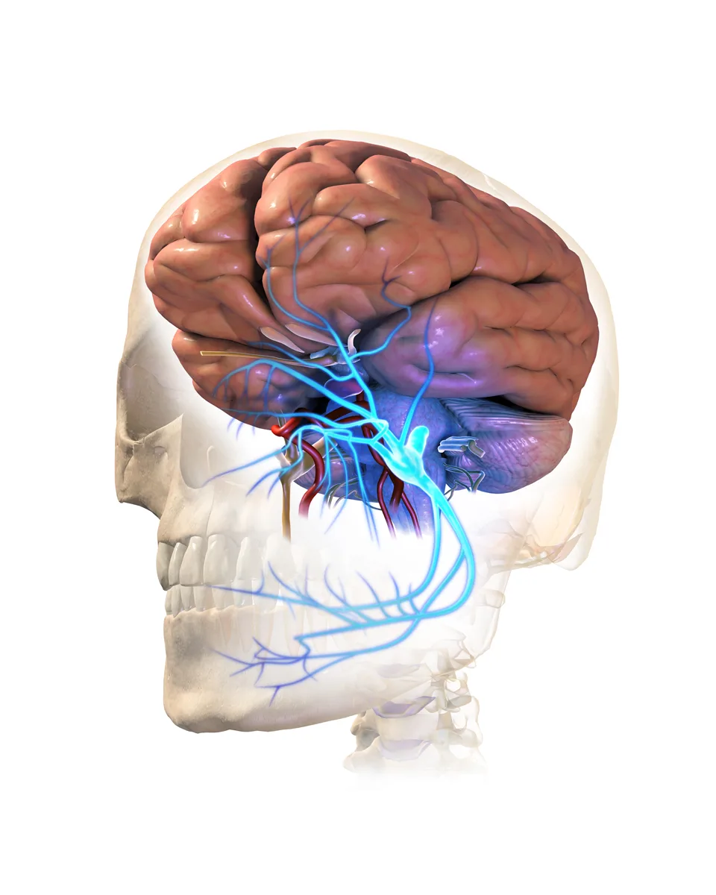

## 정의
삼차신경통은 **얼굴 감각을 맡는 삼차신경(5번 뇌신경)의 한 갈래 이상에서, 가벼운 접촉에 유발되는 한쪽 얼굴의 짧고 전기가 튀는 듯한 발작성 통증**입니다 [^2][^3]. 삼차신경은 이마(안신경)·뺨(상악신경)·턱(하악신경) 세 갈래로 나뉘며, 통증은 대개 뺨과 턱 갈래에 옵니다. 국제두통질환분류(ICHD-3)는 원인에 따라 고전적(혈관 압박으로 신경 변형)·특발성·이차성(다발성경화증·종양 등)으로 나눕니다 [^4].

독일 한 도시 주민 3,336명을 설문으로 선별한 뒤 신경과 전문의의 면담·진찰로 확인한 인구 기반 연구에서 삼차신경통의 평생 유병률은 0.3%로 추정돼, 드문 얼굴 통증 질환으로 평가됐습니다 [^8]. 네덜란드 일차 진료 기록을 분석한 연구에서는 조사한 얼굴 통증 질환 가운데 삼차신경통과 군발두통이 가장 흔했고, 얼굴 통증 전체 발생률은 여성에서 더 높았으며, 삼차신경통의 발생률은 나이가 들수록 증가했습니다 [^9].

<figure class="entity-figure entity-figure--portrait">
  
  <figcaption markdown="span">삼차신경의 주행: 뇌간 옆에서 나와 얼굴로 갈라지는 삼차신경(파란색) · 신경 뿌리 가까이 지나는 혈관(붉은색)그림: BruceBlaus, <a href="https://commons.wikimedia.org/wiki/File:Trigeminal_Neuralgia.png" rel="nofollow noopener" target="_blank">Wikimedia Commons</a>, <a href="https://creativecommons.org/licenses/by-sa/4.0" rel="nofollow noopener" target="_blank">CC BY-SA 4.0</a></figcaption>
</figure>

## 병태
- **혈관 압박**: 뇌간에서 신경이 나오는 자리(root entry zone)를 동맥·정맥이 눌러 신경 수초가 벗겨지고, 그 자리에서 비정상 신호가 생깁니다 [^3]. 다만 압박 자체는 증상이 없는 사람에게도 흔해, MRI에서 압박이 보인다는 것만으로 진단하지 않습니다 [^1][^6]
- **이차성**: 다발성경화증, 뇌간 근처 종양·낭종, 혈관 기형 등 — 임상 소견만으로는 배제할 수 없어 MRI가 권고됩니다 [^1]
- 약 절반의 고전적 삼차신경통 환자에서만 신경 변형(위축·전위)이 확인돼, 아직 밝혀지지 않은 요인도 있습니다 [^3]
- **탈수초와 비정상 신호 전달**: 병리 연구를 정리한 종설에 따르면 삼차신경통은 대개 신경뿌리(드물게 뇌간) 안 감각 섬유의 탈수초로 생깁니다. 혈관이 누르는 자리에서는 수초가 벗겨진 축삭들이 사이에 신경교 조직 없이 맞닿아 있어, 자발적인 신경 흥분과 인접 섬유로의 비정상 전달(ephaptic conduction)이 일어나기 쉬운 구조가 됩니다. 감압술 뒤 증상이 빠르게 좋아지는 것은 탈수초된 축삭이 서로 떨어지고 국소 변형에서 풀리기 때문으로 해석됩니다 [^10]
- **압박의 정도**: 한쪽에만 증상이 있는 고전적 삼차신경통 환자 135명을 3.0T MRI로 맹검 평가한 연구에서 신경-혈관 접촉 자체는 아픈 쪽(89%)과 아프지 않은 쪽(78%) 모두에서 흔했지만, 신경을 밀어내거나 위축시키는 심한 접촉은 아픈 쪽 53%, 반대쪽 13%로 아픈 쪽과 강하게 연관됐습니다. 심한 접촉의 98%는 동맥에 의한 것이었습니다 [^11]
- **다발성경화증 동반**: 다발성경화증 성인의 통증을 다룬 체계적 문헌고찰·메타분석에서 삼차신경통 유병률은 3.8%(95% 신뢰구간 2~6%)로 집계됐으며 [^12], 다발성경화증 환자의 삼차신경통에서도 신경뿌리에 비슷한 국소 탈수초가 관찰됩니다 [^10]

## 증상
- 세수·양치·면도·씹기·말하기·찬바람처럼 얼굴을 스치는 자극에 **수초에서 2분 이내**의 찌르는 통증이 반복됩니다 [^2][^3]
- 발작 사이에는 통증이 없는 것이 원칙이나, 일부 환자는 둔한 지속통이 함께 있습니다 [^3]
- 통증이 시작되는 유발점(trigger zone)이 입 주위·코 옆·잇몸에 있어 치통으로 오인돼 발치를 받는 경우가 있습니다 [^5]
- 양쪽에 오거나 감각 저하가 동반되면 이차성 원인을 먼저 봅니다 [^1][^4]
- 고전적 삼차신경통 환자 158명을 전향적으로 조사한 연구에서 평균 발병 나이는 52.9세였고, 여성(60%)과 오른쪽(56%)에 더 많았습니다. 69%는 두 번째·세 번째 갈래에만 통증이 있었고, 첫 번째 갈래만 침범된 경우는 4%였습니다 [^13]
- 같은 연구에서 49%는 발작성 통증과 함께 지속통을 겪었고, 31%는 자율신경 증상이 있었으며, 수술을 받지 않은 환자의 29%에서 신경학적 진찰상 감각 이상이 확인됐습니다 [^13]

## 진단
- **병력이 중심**입니다. 통증의 지속 시간(수초~2분)·성격(전기·칼)·유발 자극·갈래 분포·발작 사이 무통 여부를 확인합니다 [^2][^4]
- **감별**: 치통(지속통·냉온 반응·치아 압통), 턱관절 통증(입 벌릴 때·관절음·저작근 압통), 대상포진 후 신경통(발진 이력·지속 작열통), 군발두통·SUNCT 같은 자율신경 두통(눈물·코막힘 동반)과 나눕니다 [^3][^5]
- **MRI**: 유럽신경과학회 지침은 이차성 원인 배제와 혈관 압박 평가를 위해 고해상도 MRI를 권고합니다 [^1]. 압박이 신경 위축·전위와 함께 있을 때 증상성일 가능성이 높습니다 [^6]
- **전기생리검사**: MRI가 어려우면 삼차신경 반사검사(blink reflex 등)로 이차성 여부를 보조 판단할 수 있습니다 [^1]. 말초 신경전도·근전도는 안면 감각 저하나 다른 신경 침범이 의심될 때 감별 목적으로 씁니다
- **진단 등급**: 국제통증학회 신경병증성 통증 분과(NeuPSIG) 연구진이 제안한 분류는 삼차신경 갈래 분포에 발작성 통증이 있으면 '가능(possible)', 유발 자극으로 생기는 발작이 확인되면 '임상적으로 확립된(clinically established)' 삼차신경통으로 보고, 영상·신경생리 검사로 고전적 또는 이차성 원인이 밝혀지면 '확정(definite)' 신경병증성 통증으로 등급을 매깁니다. 고전적 삼차신경통은 혈관 압박에 의한 신경뿌리의 형태 변화가 입증돼야 하며, 원인 신경 질환이 확인되면 이차성, 원인을 찾지 못하면 특발성으로 분류합니다 [^14]
- **이차성 감별 단서**: 미국신경과학회·유럽신경학회연합(AAN-EFNS) 지침은 삼차신경 감각 저하, 양측 침범, 삼차신경 반사 이상을 이차성 삼차신경통을 가려내는 데 유용한 소견으로 보고, 젊은 발병 나이, 첫 번째 갈래 침범, 치료 무반응, 삼차신경 유발전위 이상은 이차성과 고전적 삼차신경통을 구분하는 데 유용하지 않다고 평가했습니다. MRI는 구조적 원인이 있는 환자를 찾기 위해 고려할 수 있다고 권고했습니다 [^15]

## 치료
- **약물이 1차**: 카바마제핀 또는 옥스카바제핀이 첫 선택이며, 라모트리진·가바펜틴·프레가발린·바클로펜 등을 단독 또는 병용합니다 [^1][^2]. 급성 악화기에는 정맥 포스페니토인·리도카인이 쓰입니다 [^1]
- **수술**: 약물로 조절되지 않거나 부작용을 견디기 어려우면 수술을 제안합니다. 고전적 삼차신경통에서는 미세혈관감압술이 1차 수술이며, MRI에서 압박이 없으면 신경절 차단·고주파·방사선수술 같은 신경파괴적 시술을 우선합니다 [^1][^2]
- **보조**: 유발 자극을 줄이는 생활 조정, 심리·간호 지원이 권고됩니다 [^1]
- **1차 약물 권고**: AAN-EFNS 지침은 통증 조절의 1차 치료로 카바마제핀(근거가 더 강함) 또는 옥스카바제핀(내약성이 더 좋음)을 권고하며, 약물 치료에 반응하지 않는 환자에서는 이른 수술 치료를 고려할 수 있다고 봅니다 [^15]
- **1차 약물의 반응과 부작용**: 카바마제핀 또는 옥스카바제핀으로 치료를 시작한 고전적 삼차신경통 외래 환자를 분석한 후향 연구에서 초기 반응률은 카바마제핀 98%(중앙 용량 600mg), 옥스카바제핀 94%(중앙 용량 1,200mg)였습니다. 다만 반응자 가운데 카바마제핀 27%, 옥스카바제핀 18%는 부작용 때문에 약을 끊거나 효과가 부족한 수준으로 용량을 줄였습니다 [^16]
- **수술 방법 선택**: AAN-EFNS 지침은 약물 불응 환자에게 가세르 신경절 경피 시술, 감마나이프, 미세혈관감압술을 고려할 수 있다고 보고, 통증 없는 기간을 가장 길게 얻기 위해 다른 수술보다 미세혈관감압술을 고려할 수 있다고 권고했습니다. 다발성경화증 환자에서 수술과 약물 치료의 역할은 불확실하다고 평가했습니다 [^15]
- **미세혈관감압술 장기 성적**: 약물로 조절되지 않는 삼차신경통으로 미세혈관감압술을 받은 1,185명을 추적한 연구에서 수술 10년 뒤 70%가 약 없이 통증이 없었습니다. 주요 합병증은 수술 직후 사망 2명(0.2%), 뇌간 경색 1명(0.1%)이었고, 16명(1%)에서 같은 쪽 청력 저하가 있었습니다 [^17]
- **감마나이프 방사선수술**: 약물 불응 고전적 삼차신경통 환자 497명을 추적한 코호트에서 91.75%가 중앙값 10일 만에 통증이 사라졌고, 약 없이 통증 없는 상태가 유지될 확률은 3년 71.8%, 10년 45.3%였습니다. 5년 시점 감각 저하 발생률은 20.4%였으나 매우 불편한 얼굴 감각 저하는 3명(0.6%)에 그쳤습니다 [^18]
- **수술 근거의 질**: 고전적 삼차신경통의 신경외과적 치료를 다룬 코크란 체계적 문헌고찰은 시험의 질이 낮아 대부분의 시술 효과에 대한 근거 수준이 매우 낮고, 통증 완화 정도가 다양하며 감각 관련 부작용이 흔하다고 결론지었습니다. 미세혈관감압술을 다룬 연구는 포함 기준을 충족하지 못했으며, 관찰 자료상 통증 완화가 가장 오래가는 시술로 제시됐습니다 [^19]

삼차신경통 관리는 통증을 부르는 일상 자극을 조절하는 데서 시작합니다[^7].

## 예후
발작은 몇 주~몇 달 지속되다 저절로 잦아드는 시기를 반복할 수 있으며, 시간이 지나면서 발작이 길어지거나 지속통이 더해지는 경향이 있습니다 [^3]. 약물 반응이 좋으면 장기 조절이 가능하지만, 용량 증가에 따른 어지럼·졸림·저나트륨혈증 같은 부작용이 치료 지속의 제한 요인입니다 [^2].

카바마제핀·옥스카바제핀으로 치료한 고전적 삼차신경통 외래 환자 연구에서는 초기 반응 뒤 늦게 약물 내성이 생긴 환자가 카바마제핀 3명, 옥스카바제핀 2명에 그쳤습니다. 경과 중 발작 강도가 심해진 환자는 3%, 발작 지속 시간이 길어진 환자는 2%였고, 임상적으로 뚜렷한 감각 저하가 새로 생긴 환자는 없어, 시간이 지나며 통증이 악화되는 경우는 매우 적은 소수에 그쳤습니다 [^16].

일부 환자에서 신경통이 저절로 관해되는 것은 신경뿌리의 재수초화와 관련될 수 있다고 해석되며, 재수초화는 감압술 뒤 통증 완화가 유지되는 데에도 도움이 될 수 있습니다 [^10].

미세혈관감압술 뒤에는 추적 기간 중 30%에서 재발이 있었고 11%가 재수술을 받았습니다. 재발은 대부분 수술 후 첫 2년 안에 일어났고, 수술 10년 뒤 연간 재발률은 1% 미만이었습니다. 여성, 8년을 넘긴 증상 기간, 신경뿌리 진입부의 정맥 압박, 수술 직후 통증이 멎지 않은 경우가 재발 예측 인자였습니다 [^17].

감마나이프 치료 뒤 처음 통증이 사라진 환자의 34.4%가 한 번 이상 재발했고 재발까지 걸린 기간은 중앙값 24개월이었으나, 10년 시점에 추가 수술 없이 통증 완화가 유지될 확률은 67.8%였습니다 [^18].

## 관련 항목
- [편두통](/conditions/migraine/)
- [후두신경통](/conditions/occipital-neuralgia/)
- [대상포진 후 신경통](/conditions/postherpetic-neuralgia/)
- [두통](/symptoms/headache/)

---

## Citations
### 자사 임상 자료
<!-- LINKARE:CLINIC-CITATIONS (자동관리·편집금지) -->
[^7]: [더웰스의원 — 삼차신경통 증상, 세수할 때 얼굴이 찌릿한 통증과 치통의 차이](https://thewells.kr/blog/trigeminal-neuralgia-symptoms-facial-pain) · 근거: "삼차신경통 관리는 통증을 부르는 일상 자극을 조절하는 데서 시작합니다."
<!-- /LINKARE:CLINIC-CITATIONS -->

### 외부 권위 출처
[^1]: [Bendtsen L, Zakrzewska JM, Abbott J, et al. European Academy of Neurology guideline on trigeminal neuralgia. Eur J Neurol. 2019;26(6):831-849. PMID 30860637](https://pubmed.ncbi.nlm.nih.gov/30860637/)
[^2]: [Cruccu G, Di Stefano G, Truini A. Trigeminal Neuralgia. N Engl J Med. 2020;383(8):754-762. PMID 32813951](https://pubmed.ncbi.nlm.nih.gov/32813951/)
[^3]: [Maarbjerg S, Di Stefano G, Bendtsen L, Cruccu G. Trigeminal neuralgia - diagnosis and treatment. Cephalalgia. 2017;37(7):648-657. PMID 28076964](https://pubmed.ncbi.nlm.nih.gov/28076964/)
[^4]: [Headache Classification Committee of the International Headache Society (IHS). The International Classification of Headache Disorders, 3rd edition. Cephalalgia. 2018;38(1):1-211. PMID 29368949](https://pubmed.ncbi.nlm.nih.gov/29368949/)
[^5]: [Zakrzewska JM, Linskey ME. Trigeminal neuralgia. BMJ. 2014;348:g474. PMID 24534115](https://pubmed.ncbi.nlm.nih.gov/24534115/)
[^6]: [Antonini G, Di Pasquale A, Cruccu G, et al. Magnetic resonance imaging contribution for diagnosing symptomatic neurovascular contact in classical trigeminal neuralgia: a blinded case-control study and meta-analysis. Pain. 2014;155(8):1464-1471. PMID 24785270](https://pubmed.ncbi.nlm.nih.gov/24785270/)
[^8]: [Mueller D, Obermann M, Yoon MS, et al. Prevalence of trigeminal neuralgia and persistent idiopathic facial pain: a population-based study. Cephalalgia. 2011;31(15):1542-8. PMID 21960648. DOI 10.1177/0333102411424619](https://pubmed.ncbi.nlm.nih.gov/21960648/)
[^9]: [Koopman JS, Dieleman JP, Huygen FJ, et al. Incidence of facial pain in the general population. Pain. 2009;147(1-3):122-7. PMID 19783099. DOI 10.1016/j.pain.2009.08.023](https://pubmed.ncbi.nlm.nih.gov/19783099/)
[^10]: [Love S, Coakham HB. Trigeminal neuralgia: pathology and pathogenesis. Brain. 2001;124(Pt 12):2347-60. PMID 11701590. DOI 10.1093/brain/124.12.2347](https://pubmed.ncbi.nlm.nih.gov/11701590/)
[^11]: [Maarbjerg S, Wolfram F, Gozalov A, et al. Significance of neurovascular contact in classical trigeminal neuralgia. Brain. 2015;138(Pt 2):311-9. PMID 25541189. DOI 10.1093/brain/awu349](https://pubmed.ncbi.nlm.nih.gov/25541189/)
[^12]: [Foley PL, Vesterinen HM, Laird BJ, et al. Prevalence and natural history of pain in adults with multiple sclerosis: systematic review and meta-analysis. Pain. 2013;154(5):632-642. PMID 23318126. DOI 10.1016/j.pain.2012.12.002](https://pubmed.ncbi.nlm.nih.gov/23318126/)
[^13]: [Maarbjerg S, Gozalov A, Olesen J, et al. Trigeminal neuralgia--a prospective systematic study of clinical characteristics in 158 patients. Headache. 2014;54(10):1574-82. PMID 25231219. DOI 10.1111/head.12441](https://pubmed.ncbi.nlm.nih.gov/25231219/)
[^14]: [Cruccu G, Finnerup NB, Jensen TS, et al. Trigeminal neuralgia: New classification and diagnostic grading for practice and research. Neurology. 2016;87(2):220-8. PMID 27306631. DOI 10.1212/WNL.0000000000002840](https://pubmed.ncbi.nlm.nih.gov/27306631/)
[^15]: [Cruccu G, Gronseth G, Alksne J, et al. AAN-EFNS guidelines on trigeminal neuralgia management. Eur J Neurol. 2008;15(10):1013-28. PMID 18721143. DOI 10.1111/j.1468-1331.2008.02185.x](https://pubmed.ncbi.nlm.nih.gov/18721143/)
[^16]: [Di Stefano G, La Cesa S, Truini A, et al. Natural history and outcome of 200 outpatients with classical trigeminal neuralgia treated with carbamazepine or oxcarbazepine in a tertiary centre for neuropathic pain. J Headache Pain. 2014;15(1):34. PMID 24912658. DOI 10.1186/1129-2377-15-34](https://pubmed.ncbi.nlm.nih.gov/24912658/)
[^17]: [Barker FG 2nd, Jannetta PJ, Bissonette DJ, et al. The long-term outcome of microvascular decompression for trigeminal neuralgia. N Engl J Med. 1996;334(17):1077-83. PMID 8598865. DOI 10.1056/NEJM199604253341701](https://pubmed.ncbi.nlm.nih.gov/8598865/)
[^18]: [Régis J, Tuleasca C, Resseguier N, et al. Long-term safety and efficacy of Gamma Knife surgery in classical trigeminal neuralgia: a 497-patient historical cohort study. J Neurosurg. 2016;124(4):1079-87. PMID 26339857. DOI 10.3171/2015.2.JNS142144](https://pubmed.ncbi.nlm.nih.gov/26339857/)
[^19]: [Zakrzewska JM, Akram H. Neurosurgical interventions for the treatment of classical trigeminal neuralgia. Cochrane Database Syst Rev. 2011;2011(9):CD007312. PMID 21901707. DOI 10.1002/14651858.CD007312.pub2](https://pubmed.ncbi.nlm.nih.gov/21901707/)

## Changelog
- 2026-09-21 v0.1: stub 신규 작성 — thq 10/3 홈피 spoke(삼차신경통) 선결. 외부 PMID 6건 PubMed 메타데이터 대조(제목·저널·권호 일치 확인).
- 2026-10-26 v2: 치료 enrich
- 2026-11-28 v3: 외부 근거 보강 — 6개 섹션에 새 문장만 추가(기존 줄 무수정). 외부 PMID 12건(Mueller 2011 평생 유병률, Koopman 2009 발생률, Love & Coakham 2001 탈수초 병리, Maarbjerg 2015 심한 신경-혈관 접촉, Foley 2013 다발성경화증 동반 유병률, Maarbjerg 2014 임상 특징 158명, Cruccu 2016 NeuPSIG 분류·진단 등급, AAN-EFNS 2008 지침, Di Stefano 2014 카바마제핀·옥스카바제핀 경과, Barker 1996 미세혈관감압술 장기 성적, Régis 2016 감마나이프 장기 성적, Zakrzewska 2011 코크란 신경외과 치료) eutils esummary·초록 대조, source_count_external 6→18.
