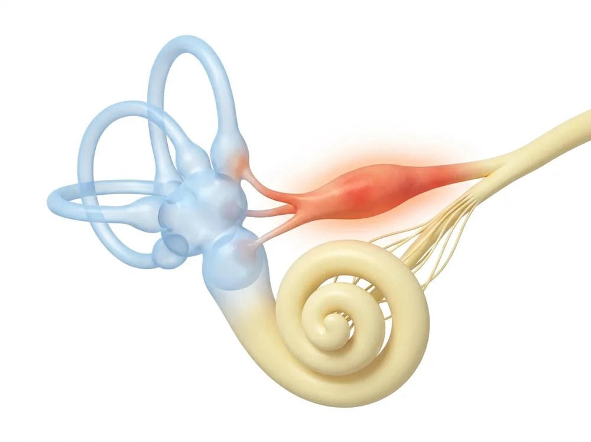

## 정의
전정신경염(vestibular neuritis)은 **한쪽 전정신경의 기능이 급성으로 떨어지면서 회전성 어지럼이 지속되는 상태**입니다. 급성 전정 증후군(acute vestibular syndrome)의 대표적인 말초성 원인으로 분류되며, 같은 임상 양상이 후순환계 뇌졸중에서도 나타날 수 있어 급성기에는 중추성 원인과의 구분이 함께 필요합니다 [^2].

자세를 바꿀 때마다 짧게 반복되는 [이석증](/conditions/bppv/)과 달리, 어지럼이 **자세와 무관하게 이어진다**는 점이 임상에서 두 질환을 가르는 출발점입니다.

Bárány 학회 전정질환 분류위원회는 전정신경염을 **급성 일측 전정병증(acute unilateral vestibulopathy)**과 같은 뜻으로 보고, 급성 중추 신경학적 증상·징후나 급성 청각 증상 없이 한쪽 말초 전정 기능이 급성으로 소실되어 나타나는 급성 전정 증후군으로 정의합니다 [^6]. 저절로 시작되는 급성 어지럼(acute spontaneous vertigo)의 가장 흔한 원인으로 꼽힙니다 [^7].

## 병태
전정신경염은 바이러스 감염 후 발생하는 전정신경의 신경염증 반응으로 여겨지며, 급성기에는 가돌리늄 조영 증강 소견이 관찰됩니다 [^1].

원인으로는 전정신경절에 잠복해 있던 단순포진 바이러스(herpes simplex virus)의 재활성화가 추정됩니다 [^7]. 전정신경염은 주로 **상부 전정 미로와 그 구심 신경**을 침범하므로, 하부 전정 미로를 이루는 후반고리관과 구형낭의 기능은 대부분 보존됩니다 [^7].

발병 3~10일째 환자의 3차원 안구운동 기록에서도 병변 쪽 수평·전반고리관을 자극하는 회전에서만 비대칭이 나타나고 후반고리관 자극에서는 비대칭이 없어, 전정신경염이 한쪽 전정신경 전체가 아닌 **부분 병변**이며 수평·전반고리관 구심 신경을 포함하는 상부 전정신경 분지를 침범한다는 소견이 보고되었습니다 [^8]. 드물게 하부 전정신경만 침범하는 아형은 전형적인 소견이 없어 중추성 전정 질환으로 오인될 수 있습니다 [^7].

<figure class="entity-figure">
 
 <figcaption markdown="span">전정신경염의 병변 위치: 반고리관·난형낭·구형낭에서 나오는 전정신경(붉게 부은 부분) · 달팽이관에서 나오는 와우신경(노란색, 정상) · 두 신경이 합쳐진 줄기AI로 생성한 교육용 그림 · Linkbase 편집(해부 검수)</figcaption>
</figure>

급성기 이후에는 뇌가 적응하는 중추 보상 과정이 일어납니다. 이 보상 기간 동안 나타나는 기능적 뇌 영상의 변화는 구조적인 뇌 변화로 이어지며, 이 두 과정은 모두 임상적 회복과 밀접한 연관이 있습니다 [^1].

장기적인 예후는 남은 말초 손상의 크기보다 시각 의존성과 같은 시전정 요인, 불안이나 신체화 성향 등의 심리적 특성, 전정 지각 이상과 더 관련되어 있습니다 [^1].

## 증상
- 회전성 어지럼이 **몇 시간에서 며칠간 지속**되며, 가만히 있어도 남아 있습니다
- 오심·구토와 균형 장애가 동반되어 걷기 어려운 경우가 흔합니다
- 머리를 움직이면 어지럼이 더 심해지지만, 움직임이 원인이 아니라 이미 있던 어지럼이 악화되는 형태입니다
- **청력 저하나 이명은 전형적인 소견이 아닙니다** — 동반되면 다른 내이 질환을 함께 검토합니다

Bárány 학회 진단 기준은 급성(드물게 아급성)으로 시작하는 회전성 또는 비회전성 어지럼과 함께 불안정감, 오심·구토, 동요시(oscillopsia, 주변이 흔들려 보이는 증상)를 주 증상으로 제시합니다 [^6]. 병변 쪽으로 쏠려 넘어지려는 불안정도 특징적인 소견 중 하나입니다 [^7].

## 진단
급성 전정 증후군에서 말초성과 중추성을 가르기 위해 침상에서 시행하는 **HINTS**(머리충동검사·안진 방향·수직 편위) 3단계 안구운동 검사가 보고되어 있습니다. 이 검사는 응급 진료 환경에서 후두와 경색을 놓치는 문제를 줄이기 위한 접근으로 제시되었습니다 [^2].

- **안진 관찰**: 방향과 양상을 확인합니다
- **신경학적 동반 증상 확인**: 복시, 발음 장애, 편측 위약 등이 있으면 중추성 원인을 우선 검토합니다

진단의 특징 소견으로는 병변 반대쪽으로 향하는 수평·회선성 자발 안진, 침범된 반고리관의 머리충동검사 이상, 병변 쪽 온도 안진 검사(caloric test) 마비, 병변 쪽 자극 시 전정유발근전위(VEMP) 반응 감소가 제시됩니다 [^7].

### 진단 기준
Bárány 학회 진단 기준은 다음 요건을 모두 갖출 때 급성 일측 전정병증(전정신경염)으로 진단합니다 [^6].

- 중등도 이상의 회전성 또는 비회전성 어지럼이 급성·아급성으로 시작해 **최소 24시간 이상 지속**
- 침범된 반고리관 구심 신경 방향과 맞는(대개 수평·회선성) **방향 고정형 자발 안진**이 있고, 시선 고정을 없애면 더 강해짐
- 자발 안진 빠른 성분의 반대쪽에서 **전정안반사(VOR) 기능 저하**가 분명하게 확인됨
- 급성 중추 신경학적·이과적·청각 증상이 없고, 뚜렷한 수직 편위나 주시유발 안진 같은 중추성 징후가 없음
- 다른 질환으로 더 잘 설명되지 않음

증상이 3시간 이상 이어졌으나 진찰 시점에 아직 24시간이 되지 않은 경우는 '진행 중인 급성 일측 전정병증'으로 따로 분류하며, 이 범주는 급성 중추성 전정 증후군과의 감별과 특정 치료 시작에 쓰입니다 [^6]. 전정신경염을 확정하는 단일 검사는 없으므로, 진단에는 중추성 병변과 다른 말초 전정 질환의 배제가 필요합니다 [^6].

### 영상 검사와 중추성 감별
전형적인 자발 안진 양상을 보이더라도 처음 겪는 두통, 머리충동검사 정상, 심한 불안정, 1~2일 안에 회복되지 않는 경과가 있으면 뇌 영상 검사가 필요합니다 [^7].

학술응급의학회(Society for Academic Emergency Medicine)의 응급실 급성 어지럼 진료 지침(GRACE-3)은 급성 전정 증후군에서 중추성과 말초성을 가르기 위해, 안진이 있는 환자에게는 HINTS(검사 훈련을 받은 임상의의 경우)를 쓰고 뇌졸중 배제를 돕기 위해 손가락 비비기 청력 확인(finger rub)을 함께 쓰도록 권고합니다 [^10]. 같은 지침은 뇌 CT를 쓰지 말고, HINTS 훈련을 받은 임상의가 있으면 MRI를 일차 검사로 일상적으로 시행하지 말며, HINTS 결과가 중추성이거나 애매할 때 확인 검사로 MRI를 쓰도록 권고합니다 [^10]. 또한 특별한 훈련 없이 일상 진료에서 시행한 HINTS는 부정확하다고 지적합니다 [^10].

## 치료
- **급성기**: 어지럼과 구토에 대한 대증적 처치가 이루어집니다
- **스테로이드**: 전정신경염의 임상적 회복과 전정 기능 회복에 대한 스테로이드 치료 효과는 **근거가 충분하지 않다**고 보고되었습니다 [^4]
- **전정 재활**: 전정신경염에서 전정 재활의 효과를 평가한 체계적 문헌고찰과 메타분석이 있습니다 [^3]

급성기에 눈을 뜨기 힘들 정도로 방이 돌고 토할 것 같은 어지럼과 구역 증상을 가라앉히기 위해 약물 치료를 시행합니다[^5].

어지럼과 오심·구토를 줄이는 대증 약물은 급성기에만 사용합니다 [^7].

### 스테로이드와 항바이러스제
스테로이드 효과에 대해서는 연구 결과가 엇갈립니다. 급성 전정신경염 환자 141명을 대상으로 한 무작위 이중맹검 시험에서는 메틸프레드니솔론이 12개월 시점의 말초 전정 기능 회복을 유의하게 개선했고, 항바이러스제 발라시클로비르는 효과가 없었으며 두 약물의 병용도 스테로이드 단독보다 낫지 않았습니다 [^9]. 응급실 급성 어지럼 진료 지침(GRACE-3)은 전정신경염으로 진단된 환자에게 **단기 스테로이드를 치료 선택지로 고려**하도록 권고합니다 [^10]. 반면 전신·국소 스테로이드의 효과는 추가 검증이 필요하다는 견해도 있습니다 [^7].

### 전정 재활
전정 재활은 회복을 앞당기는 것으로 제시됩니다 [^7]. 말초 전정 기능 저하에 대한 미국물리치료학회(APTA) 신경물리치료 분과의 임상진료지침은 전정 기능 저하와 관련된 손상·활동 제한·참여 제약이 있는 성인에게 전정 재활을 제공하도록 강한 근거로 권고합니다 [^11].

- 급성·아급성 일측 전정 기능 저하에서는 주 1회 외래 방문과 함께, 하루 3회 이상·하루 합계 최소 12분의 시선 안정화 운동을 가정 운동으로 처방할 수 있다고 제시합니다 [^11]
- 머리 움직임 없이 눈만 움직이는 단속·추종 안구운동을 단독으로 시선 안정화 목적에 쓰지 않도록 권고합니다 [^11]
- 환자 선호를 고려해 감독하에 시행하는 전정 재활을 제공하도록 권고합니다 [^11]

## 예후
전정신경염 이후의 장기 임상 경과와 회복을 예측하는 요인에 대한 검토가 이루어져 왔습니다 [^1]. 급성기 어지럼이 가라앉은 뒤에도 균형감의 불안정이 한동안 남을 수 있어, 경과 관찰과 재활을 함께 고려합니다.

재발은 드문 편입니다. 전정신경염 환자 103명을 평균 9.8년(5.7~20.5년) 추적한 연구에서 다시 발생한 경우는 2명(1.9%)에 그쳤고, 두 사례 모두 첫 발병 29~39개월 뒤 **반대쪽 귀**에서 생겼으며 같은 쪽 재발은 없었습니다 [^12]. 재발했을 때의 어지럼과 자세 불균형은 첫 발병보다 덜 심했습니다 [^12].

---

## Citations
### 자사 임상 자료
<!-- LINKARE:CLINIC-CITATIONS (자동관리·편집금지) -->
[^5]: [구리탑본의원 — 전정신경염, 가만히 누워도 빙글 도는 어지럼증 언제 가라앉나요?](https://guritopbone.com/blog/vestibular-neuritis) · 근거: "급성기에 눈을 뜨기 힘들 정도로 방이 돌고 토할 것 같은 어지럼과 구역 증상을 가라앉히기 위해 약물 치료를 시행합니다."
<!-- /LINKARE:CLINIC-CITATIONS -->

### 외부 권위 출처
[^1]: Bronstein AM, Dieterich M. Long-term clinical outcome in vestibular neuritis. *Curr Opin Neurol*. 2019. PMID: 30566414
[^2]: Kattah JC, Talkad AV, Wang DZ, et al. HINTS to diagnose stroke in the acute vestibular syndrome: three-step bedside oculomotor examination. *Stroke*. 2009. PMID: 19762709
[^3]: Huang HH, Chen CC, Lee HH, et al. Efficacy of Vestibular Rehabilitation in Vestibular Neuritis: A Systematic Review and Meta-analysis. *Am J Phys Med Rehabil*. 2024. PMID: 37339059
[^4]: Wegner I, van Benthem PPG, Aarts MCJ, et al. Insufficient evidence for the effect of corticosteroid treatment on recovery of vestibular neuritis. *Otolaryngol Head Neck Surg*. 2012. PMID: 22910304
[^6]: [Strupp M, Bisdorff A, Furman J, et al. Acute unilateral vestibulopathy/vestibular neuritis: Diagnostic criteria. J Vestib Res. 2022;32(5):389-406. PMID 35723133. DOI 10.3233/VES-220201 (Bárány Society 국제 진단 기준)](https://pubmed.ncbi.nlm.nih.gov/35723133/)
[^7]: [Jeong SH, Kim HJ, Kim JS. Vestibular neuritis. Semin Neurol. 2013;33(3):185-194. PMID 24057821. DOI 10.1055/s-0033-1354598](https://pubmed.ncbi.nlm.nih.gov/24057821/)
[^8]: [Fetter M, Dichgans J. Vestibular neuritis spares the inferior division of the vestibular nerve. Brain. 1996;119(Pt 3):755-763. PMID 8673488. DOI 10.1093/brain/119.3.755](https://pubmed.ncbi.nlm.nih.gov/8673488/)
[^9]: [Strupp M, Zingler VC, Arbusow V, et al. Methylprednisolone, valacyclovir, or the combination for vestibular neuritis. N Engl J Med. 2004;351(4):354-361. PMID 15269315. DOI 10.1056/NEJMoa033280](https://pubmed.ncbi.nlm.nih.gov/15269315/)
[^10]: [Edlow JA, Carpenter C, Akhter M, et al. Guidelines for reasonable and appropriate care in the emergency department 3 (GRACE-3): Acute dizziness and vertigo in the emergency department. Acad Emerg Med. 2023;30(5):442-486. PMID 37166022. DOI 10.1111/acem.14728](https://pubmed.ncbi.nlm.nih.gov/37166022/)
[^11]: [Hall CD, Herdman SJ, Whitney SL, et al. Vestibular Rehabilitation for Peripheral Vestibular Hypofunction: An Updated Clinical Practice Guideline From the Academy of Neurologic Physical Therapy of the American Physical Therapy Association. J Neurol Phys Ther. 2022;46(2):118-177. PMID 34864777. DOI 10.1097/NPT.0000000000000382](https://pubmed.ncbi.nlm.nih.gov/34864777/)
[^12]: [Huppert D, Strupp M, Theil D, et al. Low recurrence rate of vestibular neuritis: a long-term follow-up. Neurology. 2006;67(10):1870-1871. PMID 17130428. DOI 10.1212/01.wnl.0000244473.84246.76](https://pubmed.ncbi.nlm.nih.gov/17130428/)

## Changelog
- 2026-11-06 v2: 치료 enrich
- 2026-11-28 v3: 외부 근거 보강 — Bárány 진단 기준(Strupp 2022)·Jeong 2013 review·Fetter 1996·Strupp 2004 RCT·GRACE-3(2023)·APTA 전정 재활 CPG(2022)·Huppert 2006 추적 연구로 정의·병태·증상·진단·치료·예후 6섹션 보강, source_count_external 4→11.
