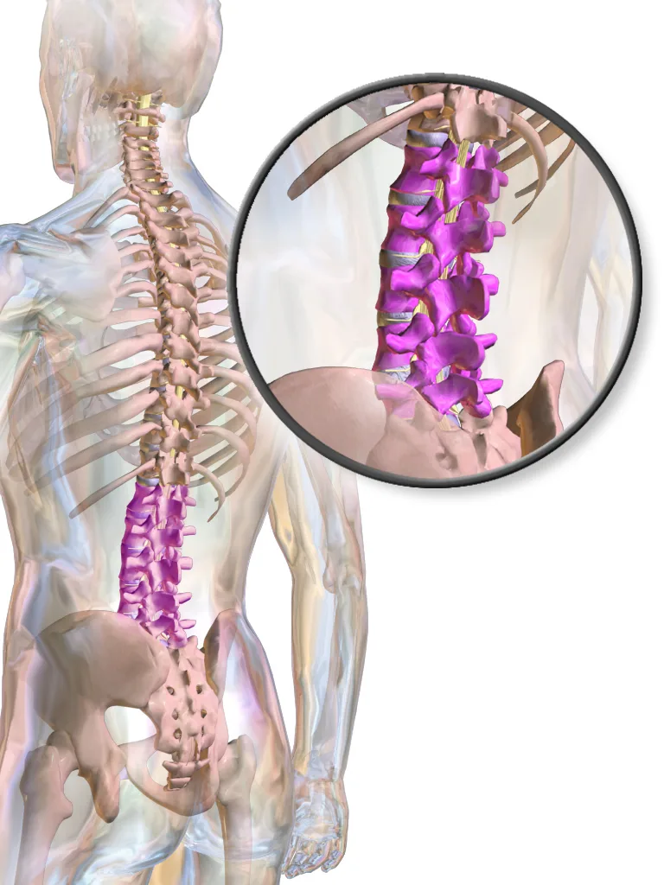
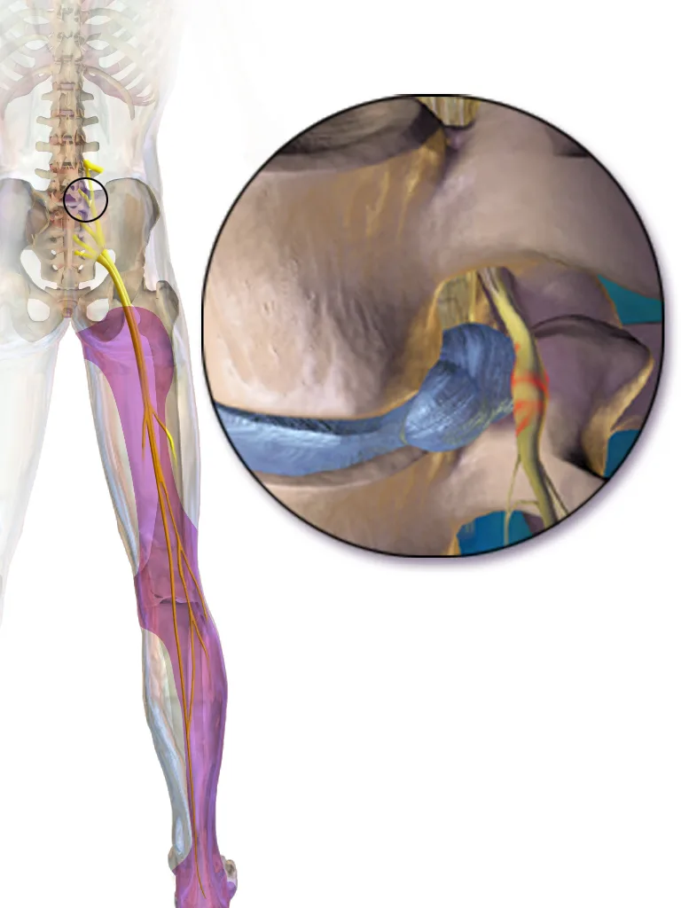

핵심 요약

- 허리통증은 요추 주변 여러 구조의 원인으로 발생하며 약 85% 정도는 특정 병리를 식별하기 어려운 비특이성 요통으로 분류됩니다.[^3][^4]
- 배뇨·배변 장애나 양측 하지의 진행성 근력 약화 등 적색기 신호가 있으면 응급 또는 빠른 전문 평가와 영상 검사를 고려합니다.[^4][^5][^6]
- 비특이성 요통은 통상 6주 이내 자연 회복되는 경우가 많으며 활동 유지, 운동치료, NSAIDs 등 보존적 치료가 원칙입니다.[^3][^4][^8]

## 정의
허리통증은 단일 진단명이 아니라 요추 주변 구조의 다양한 원인으로 발생하는 통증을 가리키는 임상 용어입니다. 환자에 따라 디스크·척추관·신경근·관절·근육·인대 등 여러 구조가 원인이 될 수 있고, 영상 소견과 증상이 늘 일치하지는 않습니다 [^4]. 약 85% 정도는 특정 병리를 영상이나 검사로 명확히 식별하기 어려운 **비특이성 요통(non-specific low back pain)** 으로 분류됩니다 [^3]. 전 세계적으로 가장 흔한 근골격계 호소 증상이며, 2020년 기준 약 6.19억 명이 허리통증을 겪고 있고 장애로 인한 건강수명 손실(YLDs) 1위 원인으로 보고됩니다 [^7].

<figure class="entity-figure entity-figure--portrait">
  
  <figcaption markdown="span">허리뼈(요추) 위치: 뒤에서 본 척추 · 분홍색 다섯 개 허리뼈와 그 아래 엉치뼈·골반그림: BruceBlaus, <a href="https://commons.wikimedia.org/wiki/File:Blausen_0618_LumbarSpine.png" rel="nofollow noopener" target="_blank">Wikimedia Commons</a>, <a href="https://creativecommons.org/licenses/by/3.0" rel="nofollow noopener" target="_blank">CC BY 3.0</a></figcaption>
</figure>

## 흔한 원인
허리통증은 원인에 따라 크게 네 갈래로 구분합니다.

- **비특이성 요통**: 가장 흔한 형태. 영상에서 특정 병리를 짚기 어렵고, 자세·근막·관절 부담·심리사회적 요인이 복합적으로 관여합니다. 통상 6주 이내 자연 회복되는 경우가 많습니다 [^3][^4].
- **요추 신경근병증**(radiculopathy): 추간판 탈출이나 척추관 협착으로 신경근이 압박되면서 허리통증과 함께 한쪽 다리로 내려가는 방사통이 동반되는 형태. 자세한 정보는 [허리디스크](/conditions/lumbar-disc-herniation/), [척추관 협착](/conditions/spinal-stenosis/) 항목을 참고하세요 [^1][^5].
- **구조적 원인**: 압박골절(고령·골다공증), 척추전방전위증, [척추측만증](/conditions/scoliosis/) 같은 척추 변형 등.
- **그 외 적색기 질환**: 감염·종양·마미증후군처럼 빈도는 낮지만 빠른 평가가 필요한 상태 [^4][^6].

위험 요인으로는 직업적 부담(반복 굽힘·들어올리기·앉은 자세 장시간), 흡연, 비만, 신체 활동 부족, 심리사회적 스트레스가 보고됩니다 [^7].

**허리통증 원인 분류 비교** [^1][^3][^4][^5][^6]
{: .entity-table-caption}

| 구분 | 주요 원인·병리 | 특징 및 경과 |
| --- | --- | --- |
| 비특이성 요통 | 자세·근막·관절 부담·심리사회적 요인 | 약 85% 차지, 통상 6주 이내 자연 회복 |
| 요추 신경근병증 | 추간판 탈출·척추관 협착에 의한 신경근 압박 | 한쪽 다리로 내려가는 방사통 동반 |
| 구조적 원인 | 압박골절·척추전방전위증·척추측만증 | 고령·골다공증 및 척추 변형 관련 |
| 적색기 질환 | 감염·종양·마미증후군 | 빈도는 낮으나 빠른 평가 필요 |

## 레드플래그
다음 신호는 응급 평가 또는 빠른 전문 평가가 필요합니다 [^4][^6]:

- 배뇨·배변 장애, 회음부 감각 저하 — 마미증후군 의심, **응급** [^6]
- 양측 하지의 진행성 근력 약화 — **응급** [^6]
- 외상 후 심한 허리통증 (특히 고령·골다공증) — 압박골절 가능성 [^4]
- 발열·체중 감소·야간 통증·암 병력 — 감염·전이 평가 [^4]
- 50세 이상 신규 발생 통증, 코르티코스테로이드 장기 사용 [^4]

이 외에는 비특이성 요통이 가장 흔하며, 자세를 바꾸거나 움직일 때 악화·완화되는 둔통·뻣뻣함이 주된 양상입니다. 신경근 압박이 있으면 한쪽 다리로 내려가는 방사통·저림·당김이 함께 나타나는 경우가 많습니다 [^1][^2].

<figure class="entity-figure entity-figure--portrait">
  
  <figcaption markdown="span">허리 신경근 압박과 다리 방사통: 아래 허리에서 튀어나온 디스크가 신경근을 누르는 자리(확대 원) · 엉덩이에서 발까지 이어지는 통증 범위(보라색)그림: BruceBlaus, <a href="https://commons.wikimedia.org/wiki/File:Sciatica.png" rel="nofollow noopener" target="_blank">Wikimedia Commons</a>, <a href="https://creativecommons.org/licenses/by-sa/4.0" rel="nofollow noopener" target="_blank">CC BY-SA 4.0</a></figcaption>
</figure>

## 평가
허리통증의 평가는 병력 청취와 신체검사가 중심입니다. 통증의 위치·악화 인자·red flag 유무·심리사회적 요인을 함께 확인합니다. NICE NG59는 **비전문 진료 환경에서 routine 영상 검사를 권고하지 않으며**, 전문 진료 환경에서도 영상 결과가 치료 방침을 바꿀 가능성이 있을 때만 영상 검사를 고려하도록 제시합니다 [^4]. 영상 소견이 흔히 발견되지만 환자 증상과 늘 인과 관계가 있는 것은 아니라는 점이 그 근거입니다 [^4].

신경학적 결손이 진행하거나 red flag가 의심되면 MRI·CT 등 영상 검사를 우선 고려합니다 [^4][^5]. 한국 임상진료지침(2025)은 신경근병증이 동반된 환자에서 manual muscle testing, 감각 검사, 하지직거상검사(SLR), Lasegue·crossed Lasegue sign을 진단 검사로 권고합니다 [^5].

NICE는 또한 STarT Back 같은 위험 분류 도구를 첫 진료 시점에 활용해 만성화 위험에 따라 치료 강도를 조정하도록 제시합니다 [^4].

## 치료 옵션
비특이성 요통은 **보존적 치료가 원칙**이며, 활동 유지와 자가 관리 교육이 1차 권고입니다. NICE NG59는 자가 관리 교육·일상 활동 유지를 모든 환자에게 권고하고, 환자 특성에 맞춘 운동 프로그램(group exercise 포함), 운동을 포함한 패키지 안에서의 도수치료, 인지행동 접근의 심리 치료를 함께 권고합니다 [^4]. The Lancet 2018 시리즈도 같은 방향으로, 생물심리사회적(biopsychosocial) 틀 안에서 비약물 치료를 우선 적용하도록 제시합니다 [^3].

약물치료는 다음과 같이 정리됩니다 [^4]:

- **NSAIDs**: 1차 약제. 위장·간·심혈관 위험을 평가한 뒤 최저 용량·최단 기간 사용
- **파라세타몰(아세트아미노펜) 단독**: 허리통증 단독 치료로 권고하지 않음
- **마약성 진통제**: routine 사용 권고 안 함. 급성 통증에 NSAIDs 금기인 경우에 한해 약한 마약성 진통제 단기 검토
- **가바펜티노이드·항경련제**: 허리통증 치료로 권고하지 않음

신경근병증이 동반된 환자의 약물·시술 적응은 [허리디스크](/conditions/lumbar-disc-herniation/) 항목을 참고하세요. 임상에서는 환자 평가 후 보존 치료를 우선하고, 만성·반복성 통증에 대해 운동·도수치료, [윈백 고주파(TECAR/RF) 물리치료](/treatments/tecar-rf-therapy/), 국소 근막성 통증에 대한 체외충격파(ESWT)를 함께 평가하며, 신경근병증이 명확한 경우 영상 검사와 시술 적응을 검토합니다 [^1][^2].

전 세계 22개 가이드라인을 비교한 2024년 review도 급성·아급성·만성 모든 단계에서 NSAIDs·운동치료·활동 유지가 공통 1차 권고이며, "수동적 안정·약물 위주에서 능동적 치료로 전환"이 일관된 흐름이라고 정리합니다 [^8].

### 경과·예후
비특이성 요통의 상당수는 6주 이내 자연 호전됩니다 [^3]. 다만 일부 환자는 통증이 만성화되거나 반복되며, 심리사회적 요인·작업 부담·통증 행동이 만성화에 관여합니다 [^3]. 신경근병증이 동반된 경우 회복 양상은 원인 질환에 따라 다르며 [허리디스크](/conditions/lumbar-disc-herniation/)·[척추관 협착](/conditions/spinal-stenosis/) 항목을 참고하세요. 전 세계적으로 허리통증 유병자 수는 2020년 약 6.19억 명에서 2050년 약 8.43억 명으로 증가가 전망되며, 인구 고령화와 직업적 부담·흡연·고체질량지수 같은 위험 요인이 주된 요인으로 보고됩니다 [^7].

---

## Citations
<!-- LINKARE:CLINIC-CITATIONS (자동관리·편집금지) -->
### 자사 임상 자료
[^1]: [안심튼튼 — 허리디스크 원인, 증상, 진단](https://ansimpainfree.kr/blog/lumbar-disc-herniation)
[^2]: [안심튼튼 — 허리디스크 증상, 허리보다 다리가 먼저 아픈 이유](https://ansimpainfree.kr/knowledge/leg-pain-before-back-pain-herniated-disk)
<!-- /LINKARE:CLINIC-CITATIONS -->

### 외부 권위 출처
[^3]: [Foster NE, Anema JR, Cherkin D, et al.; Lancet Low Back Pain Series Working Group. Prevention and treatment of low back pain: evidence, challenges, and promising directions. Lancet. 2018;391(10137):2368-2383. PMID 29573872. DOI 10.1016/S0140-6736(18)30489-6](https://pubmed.ncbi.nlm.nih.gov/29573872/)
[^4]: [NICE Guideline NG59 — Low back pain and sciatica in over 16s: assessment and management (2016, last updated 2020)](https://www.nice.org.uk/guidance/ng59/chapter/recommendations)
[^5]: [Lee JJ et al. Evidence-Based Clinical Practice Guidelines for Patients With Lumbar Disc Herniation With Radiculopathy in South Korea. Neurospine. 2025](https://pmc.ncbi.nlm.nih.gov/articles/PMC12242740/)
[^6]: [AANS — Cauda Equina Syndrome (Patient Information)](https://www.aans.org/patients/conditions-treatments/cauda-equina-syndrome/)
[^7]: [GBD 2021 Low Back Pain Collaborators. Global, regional, and national burden of low back pain, 1990-2020, its attributable risk factors, and projections to 2050. Lancet Rheumatol. 2023;5(6):e316-e329. PMID 37273833. DOI 10.1016/S2665-9913(23)00098-X](https://pubmed.ncbi.nlm.nih.gov/37273833/)
[^8]: [Zhou T, Salman D, McGregor AH. Recent clinical practice guidelines for the management of low back pain: a global comparison. BMC Musculoskelet Disord. 2024;25:344. PMID 38693474. DOI 10.1186/s12891-024-07468-0](https://pmc.ncbi.nlm.nih.gov/articles/PMC11061926/)

## Changelog
- 2026-07-04 v7: 내용 업데이트.
- 2026-04-23 v2: 내용 업데이트.
- 2026-04-23 v3: 내용 업데이트.
- 2026-04-25 v4: 내용 업데이트.
- 2026-05-03 v5: 내용 업데이트.
- 2026-05-03 v6: 내용 업데이트.