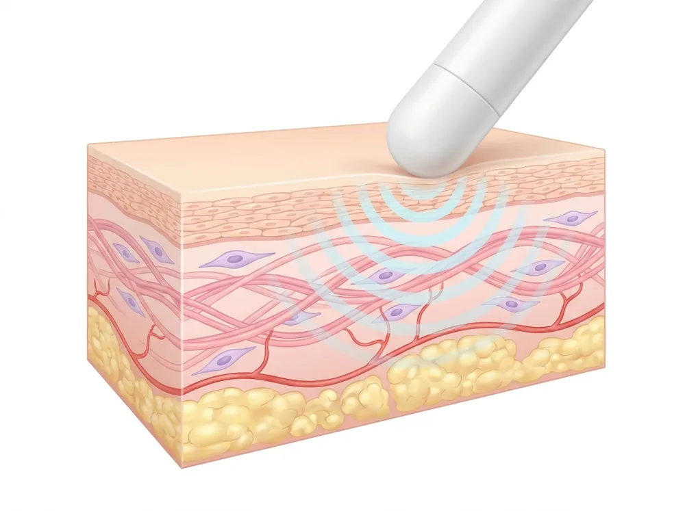

## 적응증

저강도 충격파 안면 리프팅은 음향 에너지(저강도 반복 체외충격파)를 안면부 진피·피하 조직에 전달해 조직 회복 반응과 콜라겐 재형성을 유도하는 비침습 시술입니다. 다음과 같은 경우에 검토 옵션으로 논의됩니다.

- 피부 탄력 저하·윤곽 처짐 초기 단계로, 수술적 거상이나 실리프팅까지는 고려하지 않는 경우
- 열에너지 기반 리프팅(초음파·고주파)의 시술 중 통증·열감이나 회복 기간 부담으로 비열성 옵션을 찾는 경우
- 다른 안면 시술(보툴리눔 톡신·필러 등)과 병행해 윤곽·탄력 관리를 함께 하려는 경우

안면 한정 임상 근거는 아직 누적 단계이며, 환자별 피부 상태·기대 수준에 따라 적응 여부가 달라집니다.

안면에 직접 적용한 임상 보고로는 안면 타이트닝 목적으로 집속형·방사형 음향파를 함께 적용한 333명 연구[^1]와, 25~60세 20명에게 6주 동안 3회 비열성 고주파수 충격파를 적용해 피부 결·피하지방·피부 탄력 변화를 평가한 연구[^2]가 있습니다.

성형외과 영역 전체로 보면 체외충격파 임상 연구는 셀룰라이트·체형 관리·피부 회춘, 화상·흉터, 당뇨발 궤양·만성 창상 등의 주제로 나뉘어 보고되어 왔습니다[^3].

## 작동 원리

체외충격파는 물리적 음향 에너지를 조직에 전달해 생체 신호로 치환하는 에너지 변환 원리로 작동합니다. 근골격 영역의 체외충격파(ESWT)와 같은 물리 기전을 공유하되, 안면 리프팅은 통증 치료보다 낮은 강도의 반복 자극으로 진피·피하 조직의 미세 자극과 회복 반응(미세순환·콜라겐 재형성)에 초점을 둡니다.

<figure class="entity-figure">
  
  <figcaption markdown="span">피부 단면과 음향 충격파 전달: 표피 · 진피(콜라겐 섬유) · 피하지방AI로 생성한 교육용 그림 · Linkbase 편집(해부 검수)</figcaption>
</figure>

- **비열성(non-thermal)** — 열로 조직을 응고시키는 초음파(HIFU)·고주파(RF) 방식과 달리, 음향 충격파는 기계적 자극으로 회복 반응을 유도해 열 손상 위험이 상대적으로 낮습니다.
- **에너지 전달 깊이 조절** — 장비에 따라 깊이별 적용 모듈을 두어 표적 조직 깊이를 달리할 수 있습니다.
- **다점 전달 방식** — 일부 장비는 한 번의 조사로 여러 지점에 분산 전달해 시술 면적을 넓힙니다.

안면 임상 연구에서는 음향파 치료를 피부와 피하조직에 열 없이 침투해 세포와 그 대사에 작용하고, 조직의 혈류와 림프 흐름을 활성화하는 방식으로 설명합니다[^1].

동물 실험에서는 이 설명을 뒷받침하는 조직 변화가 관찰되었습니다. 염소의 위턱·아래턱 부위 안면 피부에 저에너지 집속형 충격파(0.15 또는 0.45 mJ/mm², 1,000발)를 1회 적용하고 4일 뒤 조직을 분석한 연구에서, 두 강도 모두 진피 두께, 미세혈관 수와 밀도, 1형 콜라겐 합성이 증가했습니다[^4]. 콜라겐 양은 낮은 강도(0.15 mJ/mm²)에서, 미세혈관 수는 높은 강도(0.45 mJ/mm²)에서 가장 많았습니다[^4].

쥐 피부에 충격파를 1~2회 적용한 연구에서도 적용군은 비적용군보다 콜라겐 함량, 미세혈관 밀도, 표피·진피 두께가 유의하게 높았고 피하지방층 두께는 줄었습니다[^5]. 연구진은 섬유모세포 성장인자(FGF2) 발현 증가를 동반한 새 콜라겐 생성과 새 혈관 형성을 주요 작용 기전으로 제시했습니다[^5].

다만 두 결과는 동물 피부에서 얻은 것이므로, 사람 안면 피부에서 같은 정도의 조직 변화가 일어나는지는 따로 확인해야 합니다.

## 임상 근거

저강도 체외충격파의 조직 회복·콜라겐 자극 기전은 근골격(족저근막염·건병증)·셀룰라이트·창상 치유 영역에서 보고되어 왔으나, **안면 리프팅 적응증 한정의 무작위대조시험·메타분석 근거는 현재 누적 단계**입니다.

### 안면 적용 연구

- **집속형·방사형 음향파 병용 안면 타이트닝** (Kimura·Tanaka, *Lasers Surg Med* 2021, n=333): 집속형 음향파 2,000~3,000발(0.45~0.88 mJ/mm², 3~5 Hz)과 방사형 음향파 4,000발(4 bar, 21 Hz)을 1개월 간격으로 3회 넘게 시행하고, 마지막 시술 12개월 뒤 3차원 영상과 환자 5점 척도로 평가했습니다. 사진에서 피부 결·맑기·처짐이 개선되었고, 관자·뺨·턱 바깥쪽에서 피부 표면이 위쪽으로 이동한 벡터가 주로 관찰되었으며, 환자의 79%가 「좋음」 또는 「매우 좋음」으로 응답했습니다[^1].
- **비열성 고주파수 충격파 안면 회춘** (New·Cai, *Lasers Med Sci* 2025, n=20): 6주 동안 3회 시술한 뒤 표준 사진·피부 분석기·초음파 영상으로 평가한 결과 피부 결은 유의하게 개선되었으나(p=0.010) 주름(p=0.069)과 모공(p=0.232)은 통계적 유의성에 이르지 못했습니다. 피하지방 감소와 피부 탄력에는 긍정적인 변화가 보고되었습니다[^2].

### 성형·미용 영역 전반

- **성형외과 영역 체외충격파 문헌고찰** (Wigley 등, *Aesthet Surg J* 2023, 46편 n=1,496): 포함된 연구 모두 주요 지표 개선을 보고했지만, 적용 방식이 제각각이고 연구 방법의 결함과 기술 기준 차이가 있어 어느 특정 적용에 대해서도 효과를 뒷받침할 근거는 아직 충분하지 않다고 결론지었습니다[^3].
- **셀룰라이트 메타분석** (Knobloch·Kraemer, *Int J Surg* 2015, 임상시험 11건·여성 297명, 이 중 무작위대조시험 5건·123명): 집속형·방사형 충격파 모두 셀룰라이트 개선 효과가 보고되었고, 주 1~2회·총 6~8회 일정이 주로 연구되었습니다[^6].
- **음향파 치료와 피부 탄력** (Christ 등, *Aesthet Surg J* 2008, 셀룰라이트 여성 59명): 3~4주 동안 6~8회 시술한 뒤 피부 탄력 측정값이 치료 종료 시점에 73% 높아졌고, 3개월·6개월 추적에서는 각각 95%·105% 개선되었습니다. 초음파 평가에서는 진피와 피하조직의 콜라겐·탄력섬유 망 밀도가 높아졌습니다[^7].
- **최근 성형외과 영역 종설** (Knobloch, *Wien Med Wochenschr* 2026): 셀룰라이트는 15편이 넘는 임상 연구에서 6~8회 시술로 25~35% 개선이 보고되었고, 안면 노화 영역에서는 방사형 충격파가 모공 크기를 80% 줄이고 피부 톤을 개선했다는 보고가 있다고 정리했습니다[^8].

셀룰라이트·결합조직 약화 부위에서 얻은 결과는 피부 두께와 조직 구성이 다른 안면에 그대로 옮겨 적용할 수 없습니다.

## 언제 고려

- 비열성·짧은 다운타임 옵션을 우선하는 초기 탄력 저하 환자
- 열 기반 리프팅의 통증·열감·회복 부담을 피하려는 환자
- 단독 시술보다 톡신·필러 등과의 병행으로 윤곽·탄력을 함께 관리하려는 경우

표준화된 안면 리프팅 가이드라인은 정립 단계가 아니므로, 기대 수준·피부 상태에 따른 전문의 평가 후 검토가 권장됩니다.

성형외과 영역 문헌고찰도 체외충격파의 적응증을 구체적으로 정하려면 근거를 더 쌓는 연구가 필요하다고 보았습니다[^3].

체중 감량 약물(GLP-1 수용체 작용제) 사용 뒤 안면 볼륨이 줄고 피부가 처진 경우에는, 체외충격파를 포함한 에너지 기반 장비의 기존 설정이 효과적이거나 안전한지 아직 알려져 있지 않으며, 장비별 시술 기준을 정하기 전에 이 환자군을 대상으로 한 전향적 대조 연구가 필요하다고 정리한 문헌 고찰이 있습니다[^9].

## 기대효과

- 콜라겐 재형성·미세순환 자극을 통한 점진적 탄력·윤곽 변화 — 즉각적 거상 효과가 아닌 누적형
- 비열성 방식으로 시술 중 통증·열감 부담이 상대적으로 낮음
- 마취 불필요, 짧은 회복으로 일상 복귀 가능

효과의 정도·지속 기간은 피부 상태·시술 횟수·개인차에 따라 달라지며, 단회 시술로 모든 변화가 나타나는 것은 아닙니다. 안면 한정 효과 크기의 임상 근거는 누적 단계입니다.

두 안면 임상 연구 모두 피부 결의 개선을 보고했습니다[^1][^2]. 333명 연구에서는 결과가 부종 반응 없이 최대 12개월까지 유지되었다고 보고했습니다[^1]. 20명 연구에서 시술 중·후 통증 점수(VAS)는 평균 2.8로, 연구진은 견디기 쉬운 수준으로 평가했습니다[^2].

반면 20명 연구에서 주름과 모공의 변화는 통계적으로 유의하지 않았습니다[^2]. 따라서 피부 결·탄력·주름·모공 같은 노화 징후가 모두 같은 정도로 좋아진다고 기대하기는 어렵습니다.

셀룰라이트 부위 연구에서는 피부 탄력 값이 치료 종료 시점보다 3개월·6개월 추적 시점에 더 높게 측정되어, 변화가 시술 후에도 점진적으로 이어지는 양상을 보였습니다[^7].

## 한계/주의점

- **안면 한정 근거의 한계** — 근골격·피부 일반 근거 대비 안면 리프팅 적응증 한정의 고위계 임상 근거는 아직 부족. 효과를 단정하거나 보장하는 표현은 부적절.
- **누적형 효과** — 즉각적·극적 거상을 기대하기 어려우며, 회차·간격에 따른 점진적 변화. 기대 수준 사전 조율 필요.
- **흔한 반응** — 시술 부위 일시적 발적·민감감 — 대부분 경미·일시적.
- **주의 환자군** — 안면 시술 부위 피부 질환·감염, 임신, 출혈 경향, 안면부 금속·이식물 보유 시 전문의 사전 평가 필요.
- **개인차 면책** — 효과·반응은 개인차가 있을 수 있습니다.

근거 수준을 보면, 20명 안면 연구는 표본이 작고 시술 횟수가 적으며 추적 기간이 짧다는 한계를 스스로 밝히고, 더 큰 규모와 더 긴 추적 연구가 필요하다고 했습니다[^2]. 성형외과 영역 문헌고찰은 연구 방법의 결함과 장비 기술 기준의 차이를 결론 해석의 주요 제약으로 지적했습니다[^3]. 셀룰라이트 메타분석에서는 연구별 보고 품질 점수가 22~82점으로 편차가 컸고, 1년을 넘는 장기 추적 자료가 없었습니다[^6].

안전성 면에서 보고된 이상반응은 대부분 경미하고 일시적이었습니다. 20명 안면 연구에서는 일시적 홍반과 가벼운 부기가 저절로 가라앉았고[^2], 333명 안면 연구에서도 합병증은 경미하고 일시적이었으며 지속되는 부작용은 관찰되지 않았습니다[^1]. 셀룰라이트 연구에서는 시술 중 가벼운 통증(59명 중 3명)과 약한 피부 발적이 보고되었고[^7], 성형외과 영역 문헌고찰에서도 이상반응을 보고한 연구 범위 안에서는 중대한 이상반응이 없었습니다[^3].

약물 관련 체중 감량으로 안면 볼륨이 줄어든 경우에는 불필요하게 깊은 에너지 전달을 피하고 시술 깊이를 보수적으로 조절하는 방안이 연구 과제로 제안되었으나, 이는 가설 단계이며 임상 권고나 표준 진료가 아니라고 명시되어 있습니다[^9].

## Citations

### 외부 권위 출처
[^1]: [Kimura K, Tanaka Y. Facial Tightening Effects, Following Focused and Radial Acoustic Wave Therapy Assessment, Using a Three-Dimensional Digital Imaging. Lasers Surg Med. 2021;53(5):630-639. PMID 33211338. DOI 10.1002/lsm.23353](https://pubmed.ncbi.nlm.nih.gov/33211338/)
[^2]: [New H, Cai S. Analysis of the clinical application and treatment effects of Ultra-Pulse Shockwave technology in facial rejuvenation. Lasers Med Sci. 2025;40(1):131. PMID 40055255. DOI 10.1007/s10103-025-04395-x](https://pubmed.ncbi.nlm.nih.gov/40055255/)
[^3]: [Wigley CH, Janssen TJ, Mosahebi A. Shock Wave Therapy in Plastic Surgery: A Review of the Current Indications. Aesthet Surg J. 2023;43(3):370-386. PMID 36226364. DOI 10.1093/asj/sjac262](https://pubmed.ncbi.nlm.nih.gov/36226364/)
[^4]: [Alshihri A, Kämmerer PW, Heimes D, et al. Extracorporeal Shock Wave Stimulates Angiogenesis and Collagen Production in Facial Soft Tissue. J Surg Res. 2020;245:483-491. PMID 31446190. DOI 10.1016/j.jss.2019.06.077](https://pubmed.ncbi.nlm.nih.gov/31446190/)
[^5]: [de Lima Morais TM, Meyer PF, de Vasconcellos LS, et al. Effects of the extracorporeal shock wave therapy on the skin: an experimental study. Lasers Med Sci. 2019;34(2):389-396. PMID 30109536. DOI 10.1007/s10103-018-2612-8](https://pubmed.ncbi.nlm.nih.gov/30109536/)
[^6]: [Knobloch K, Kraemer R. Extracorporeal shock wave therapy (ESWT) for the treatment of cellulite--A current metaanalysis. Int J Surg. 2015;24(Pt B):210-217. PMID 26209782. DOI 10.1016/j.ijsu.2015.07.644](https://pubmed.ncbi.nlm.nih.gov/26209782/)
[^7]: [Christ C, Brenke R, Sattler G, et al. Improvement in skin elasticity in the treatment of cellulite and connective tissue weakness by means of extracorporeal pulse activation therapy. Aesthet Surg J. 2008;28(5):538-544. PMID 19083577. DOI 10.1016/j.asj.2008.07.011](https://pubmed.ncbi.nlm.nih.gov/19083577/)
[^8]: [Knobloch K. Extracorporeal shockwave therapy in plastic, hand, aesthetic, and reconstructive surgery. Wien Med Wochenschr. 2026;176(15-16):388-395. PMID 42479307. DOI 10.1007/s10354-026-01174-3](https://pubmed.ncbi.nlm.nih.gov/42479307/)
[^9]: [Cho CH, Koo S, Yoo K. Energy-Based Devices for GLP-1 Receptor Agonist-Associated Facial Aging: A Tissue-Specific Safety Framework. Clin Cosmet Investig Dermatol. 2026;19:628537. PMID 42893183. DOI 10.2147/CCID.S628537](https://pubmed.ncbi.nlm.nih.gov/42893183/)

## Changelog
- 2026-06-11 v0.1: 내용 업데이트.
- 2026-11-02: 공개 본문에 남아 있던 편집 메모(번역 금지·citation 0·보강 대기·과대 일반화 금지 지시)와 장비 브랜드 문장 삭제.
- 2026-11-14 v1: 외부 각주 보강 — 안면 임상 연구 2편(Kimura·Tanaka 2021 n=333, New·Cai 2025 n=20), 안면·피부 동물 실험 2편(Alshihri 2020 염소 안면, de Lima Morais 2019 쥐 피부), 성형외과 영역 문헌고찰(Wigley 2023)·셀룰라이트 메타분석(Knobloch·Kraemer 2015)·피부 탄력 연구(Christ 2008)·종설(Knobloch 2026), GLP-1 관련 안면 노화 에너지 장비 문헌고찰(Cho 2026)로 6개 섹션에 근거 문장 추가. 기존 문장은 그대로 두고 새 문단만 덧붙임(PMID 9건 eutils esummary로 제목·저자·연도 대조). source_count_external 0→9.
