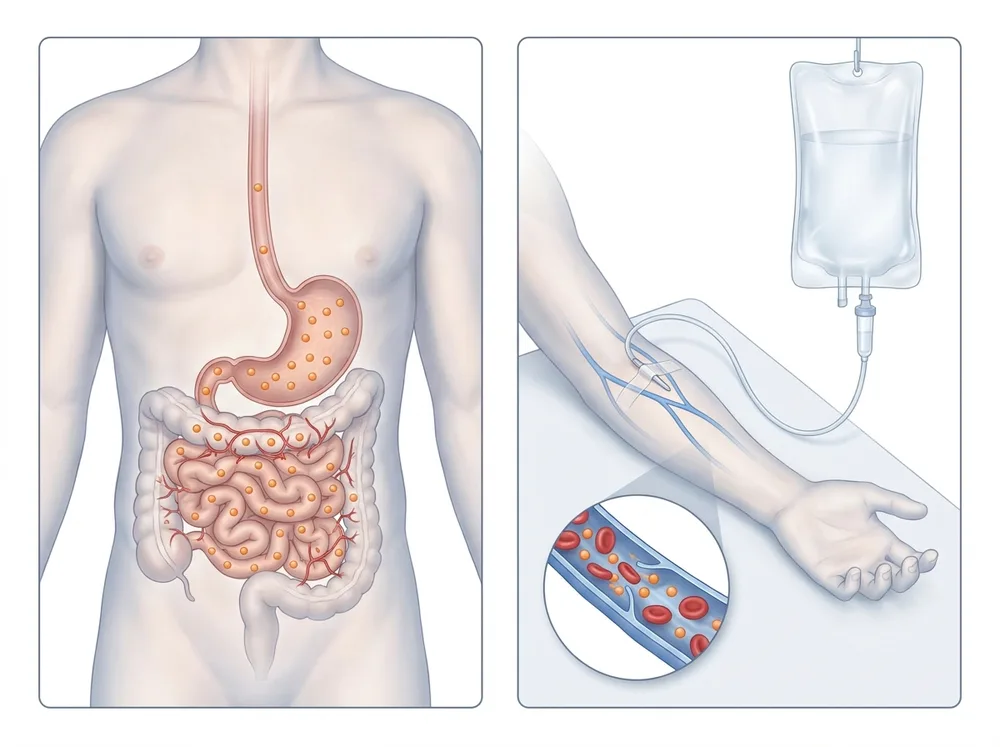

핵심 요약

- 영양 정맥수액은 위장 흡수의 한계를 우회하거나 빠른 혈중 농도 도달이 필요한 환자군에서 검토되는 비수술 기능의학 접근입니다.
- 제제별로 알레르기, 저칼륨·고혈압·부종, 용혈 위험 등이 다르고, 2~4주 이상 피로가 지속되면 전문의 상담으로 원인을 먼저 확인해야 합니다[^1].
- 수면·운동·식이·기존 약물 치료와 병행하는 보조 도구로 운영되며, 시술 전 복용 약물과 기저 질환의 사전 평가가 필요합니다.
- 근거 강도는 제제별로 다릅니다. 마이어스 칵테일은 섬유근육통 파일럿 시험에서 위약과 통계적 차이가 확인되지 않았고 [^2], 정맥 글리시리진은 만성 C형 간염에서 위약보다 ALT를 더 낮췄지만 치료를 끝내면 그 효과가 사라졌습니다 [^3].

## 적응증

영양 정맥수액은 위장 흡수의 한계 또는 빠른 혈중 농도 도달이 임상적으로 의미 있는 환자군에서 검토되는 비수술 기능의학(functional medicine) 접근입니다. 본 문서는 한국 임상 현장에서 사용되는 4가지 범주를 중심으로 정리합니다.

### 만성 피로·번아웃·회복기

장기간 누적 피로, 운동 후 회복 지연, 만성 통증 회복기, 갱년기·근감소 동반 피로 등에서 영양수액이 보조 옵션으로 검토됩니다. 미토콘드리아 에너지 대사(TCA cycle)의 보조인자(NAD+·비타민 B군·코엔자임 Q10)를 함께 보충해 세포 단위 에너지 회복을 지원한다는 가설이 기능의학 임상 흐름에서 사용됩니다.

변형 마이어스 칵테일은 마그네슘·칼슘·비타민 B군·비타민 C로 구성된 정맥 제제로, 피로(만성피로증후군 포함)·섬유근육통 등 여러 상태에 사용한 저자의 임상 경험과 관련 연구를 정리한 보고가 있습니다 [^4]. 섬유근육통에서는 보완대체의학 영역에서 널리 쓰이는 접근이지만 효능은 불확실하다고 평가되었습니다 [^2].

### 항산화·면역 보조

고용량 비타민 C(IVC, intravenous vitamin C)는 경구로 도달할 수 없는 혈중 농도를 만들어 항산화·면역 보조 영역에서 활용됩니다. 효과 표현은 적응증·용량·환자 상태에 따라 차이가 크며 단정적 효능 표현은 의료광고법상 제한됩니다.

미국 보완대체의학 학회 참석자 설문에서 정맥 비타민 C의 흔한 사용 이유는 감염·암·피로였습니다 [^5].

### 간 보호·항염

글리시리진(감초 주성분, 일본 SNMC 제제 계열)은 만성 간 기능 부담·피로형 간염 영역에서 간 보호·항염 보조로 한국·일본 임상에서 사용됩니다.

일본에서는 글리시리진 요법이 만성 C형 간염에 널리 쓰이는 것으로 보고되며 [^6], 유럽 시험은 인터페론 치료에 반응하지 않았거나 반응 가능성이 낮은 만성 C형 간염 환자를 대상으로 진행되었습니다 [^3][^6][^7].

### 만성 간질환·갱년기 보조 (라이넥)

라이넥(Laennec)은 일본 Japan Bio Products의 인태반 유래 가수분해 제제(hydrolyzed placenta extract)로, 한국 식약처에서 만성 간질환(B형 간염 보조) 영역에 처방 적응증이 있습니다. 만성 피로·갱년기 보조 영역에서 한국·일본 임상에서 사용되며, 자하거(紫河車, 한약 분류)와는 제조사·정제 방식·허가 적응증이 분리됩니다.

인태반 추출물의 경우 의학적으로 설명되지 않는 만성 피로 환자를 대상으로 한 위약 대조 시험은 정맥이 아닌 피하주사로 시행되었으며, 초록에 제품명은 명시되어 있지 않습니다 [^8]. 만성 간질환에서는 사람 태반 추출물 10 mL을 주 1~2회 정맥 투여한 30례 보고가 있으나, 초록에 대조군이 제시되지 않은 단일 의원의 증례 보고입니다 [^9].

**영양 정맥수액 4가지 범주 비교**
{: .entity-table-caption}

| 구분 | 주요 성분 | 사용 영역 | 주의점 |
| --- | --- | --- | --- |
| 마이어스 계열 | NAD+·비타민 B·비타민 C·미네랄 | 만성 피로·번아웃·회복기 보조 | 미네랄과 기존 복용 약물·보충제 상호작용 평가, 임상 RCT 근거 차이 |
| 고용량 비타민 C | 비타민 C (IVC) | 항산화·면역 보조 | G6PD 결핍증(용혈 위험) 금기, 신결석 병력·만성 신부전 신중 검토 |
| 글리시리진 | 감초 주성분 (SNMC 제제 계열) | 만성 간 기능 부담·피로형 간염 간 보호·항염 보조 | 장기·고용량 시 저칼륨·고혈압·부종 위험, 간·신질환·고혈압 사전 평가 필수 |
| 라이넥 | 인태반 유래 가수분해 제제 (펩타이드·아미노산 등) | 만성 간질환(B형 간염 보조)·만성 피로 보조 | 알레르기·아나필락시스 주의, 임신 중 일반적으로 비권장, 자하거와 분리 |

## 작동 원리

영양수액은 위장관(GI) 흡수를 우회해 표적 분자의 혈중 농도를 즉시 끌어올리는 경로입니다. 분자별 작동 원리는 다음과 같이 정리됩니다.

<figure class="entity-figure">
  
  <figcaption markdown="span">경구 경로와 정맥 경로 비교: 위·소장을 거치는 흡수(왼쪽)와 팔 정맥으로 혈액에 바로 들어가는 수액 성분(오른쪽)AI로 생성한 교육용 그림 · Linkbase 편집(해부 검수)</figcaption>
</figure>

### 미토콘드리아 에너지 대사 (TCA cycle 보조)

세포 에너지(ATP)는 미토콘드리아의 TCA cycle(Krebs cycle) + 전자전달계에서 생성됩니다. NAD+는 TCA cycle의 핵심 보조인자(coenzyme)로, NADH ↔ NAD+ 비율이 산화·환원 균형과 에너지 대사 효율에 직결됩니다. 비타민 B군(특히 B1·B2·B3·B5·B6·B12)은 TCA cycle 및 보조 회로의 효소 보조인자로 작용하고, 비타민 C는 카르니틴 합성(지방산 미토콘드리아 진입)과 항산화 회로에 관여합니다. 코엔자임 Q10은 전자전달계 보조인자입니다.

영양수액 시술에서 NAD+·비타민 B·비타민 C·미네랄을 함께 주입하는 마이어스 칵테일 계열의 임상 근거는 이 회로의 보조인자를 동시에 보충해 세포 에너지 회복을 지원한다는 가설에 근거합니다.

NAD+는 산화·환원 반응의 조효소로 에너지 대사의 중심에 있으며, 시르투인·CD38·PARP(poly(ADP-ribose) polymerase) 같은 효소의 필수 보조인자이기도 합니다 [^10]. 노화에 따라 조직·세포의 NAD+ 수치가 점차 낮아진다는 점은 설치류와 사람을 포함한 여러 모델 생물에서 보고되었지만, 효과적인 회복 방법과 안전성, 노화 중인 사람에서의 이득 여부는 아직 밝혀야 할 과제로 남아 있습니다 [^10]. 이 종설의 초록은 정맥 NAD+ 수액의 임상 효과를 직접 다루지 않습니다 [^10].

### 고용량 비타민 C (IVC) 약동학

비타민 C는 경구 투여 시 장관 흡수율이 1~2g을 넘어가면 급격히 떨어져 혈중 농도가 일정 수준 이상으로 올라가지 않습니다. 정맥 투여는 이 한계를 우회해 경구 도달 불가능한 혈중 농도를 만듭니다. 항산화·면역 보조 외 영역(예: 항암 보조)의 효과 근거는 영역별 차이가 크며, 단정적 효능 표현은 의료광고법상 제한됩니다.

건강한 자원자 7명의 입원 연구에서 비타민 C 200 mg 단회 투여의 생체이용률은 완전했지만, 단회 500 mg 이상에서는 생체이용률이 낮아지고 흡수된 양이 배설되었습니다 [^11]. 혈장은 하루 1000 mg에서 완전히 포화되었습니다 [^11].

건강한 자원자 17명의 연구에서 1.25 g 투여 시 평균 최고 혈장 농도는 경구 134.8 µmol/L, 정맥 885 µmol/L였습니다 [^12]. 약동학 모델은 경구 최대 내약 용량(4시간마다 3 g)에서 220 µmol/L, 정맥 50 g에서 13,400 µmol/L를 예측했으며, 이 고용량 수치는 환자 자료로 확인되지 않았습니다 [^12].

### 글리시리진 (감초)

글리시리진은 효소(11β-HSD2) 억제·항염·항바이러스 작용이 보고되며, 일본·한국 임상에서 만성 간 부담·피로 영역에 사용됩니다. 장기·고용량 사용 시 미네랄코르티코이드 유사 작용으로 저칼륨·고혈압·부종 위험이 보고되며 환자별 사전 평가가 필요합니다.

감초 유발 고혈압 증례를 다룬 짧은 종설에 따르면, 글리시리진산의 가수분해 대사물인 글리시레틴산이 코르티솔의 말초 대사를 억제하고, 코르티솔이 알도스테론과 같은 친화력으로 미네랄코르티코이드 수용체에 결합합니다 [^13]. 그 결과 나트륨·수분 저류, 고혈압, 저칼륨혈증, 알칼리증, 레닌-알도스테론계 억제가 나타날 수 있으며, 이는 경구 감초 섭취를 바탕으로 한 설명입니다 [^13].

### 라이넥 (Laennec, 인태반 유래)

라이넥은 인태반 가수분해 추출물로, 다양한 펩타이드·아미노산·성장인자 단편을 포함합니다. 한국·일본 임상에서 만성 간질환 보조에서는 간세포 회복·항염 지지, 갱년기 장애에서는 자율신경 균형·만성 피로 보조 영역에서 사용됩니다. 정확한 단일 활성 분자가 규명된 것이 아니라 복합 추출물로 작동하며, 표준 PubMed 임상 자료는 일본 학회·한국 식약처 자료가 주를 이룹니다. 한약 분류의 자하거(紫河車)와는 제조사·정제·허가가 다릅니다.

태반 추출물은 유래·사용 부위·제조법에 따라 조성이 다르고, 항산화·항염·면역 조절 같은 공통 생물 활성이 어느 정도 보고되었지만 생물학적 효과와 구성 성분의 관계는 아직 정확하고 포괄적으로 규명되지 않았습니다 [^14]. 이 종설에는 제약사 소속 저자가 참여했습니다 [^14].

## 임상 근거

본 stub은 v0.1 골격 단계이며, 본 섹션은 차후 SOP 보강 라운드에서 PubMed 직접 검증된 citation으로 채워질 예정입니다. 참고 자료 후보는 다음과 같습니다.

- **마이어스 칵테일 임상 근거** — Gaby 2002 *Alternative Medicine Review* 임상 리뷰, Massey 2007 *Journal of Alternative and Complementary Medicine* 섬유근육통 RCT.
- **고용량 비타민 C 약동학** — Padayatty 2010 *PLoS ONE* 약동학·약리 자료.
- **글리시리진 간 보호** — 일본 SNMC(Stronger Neo-Minophagen C) 만성 간염 임상 자료.
- **라이넥(Laennec) 만성 간질환·갱년기** — 일본 Japan Bio Products 라이넥 만성 간질환 적응증 임상 자료(일본 학회·한국 식약처 허가 자료).
- **NAD+ TCA cycle 보조인자** — NAD+/NADH 비율과 미토콘드리아 에너지 대사 종설 자료.

기능의학(functional medicine) 분야의 임상 가이드라인은 Institute for Functional Medicine(IFM) 표준 프로토콜, Linus Pauling Institute(고용량 비타민 C) 자료 등이 외부 권위 출처로 검토 대상입니다.

### 마이어스 칵테일

- **섬유근육통 파일럿 RCT** (Ali 등, *J Altern Complement Med* 2009, n=34): 주 1회 8주 정맥 미량영양소 요법과 락트산 링거액 위약을 비교한 결과, 두 군 모두 치료 전보다 호전되었으나 어떤 결과 지표에서도 군 간 통계적 유의 차이는 없었습니다. 연구진은 높은 위약 반응과 작은 표본을 그 이유의 일부로 들었고, 위약 대비 효능은 아직 불확실하다고 결론지었습니다 [^2].

### 고용량 비타민 C

- **암 환자 체계적 고찰** (Fritz 등, *Integr Cancer Ther* 2014, 37개 연구: RCT 2건, 비대조 시험 15건, 관찰 연구 6건, 증례 보고 14건): 용량은 1회 1 g에서 200 g 이상까지 다양했고 보통 주 2~3회 투여되었습니다. 고품질 임상 근거가 제한적이어서 기존 근거는 예비적이며 결론으로 볼 수 없다고 평가되었습니다 [^15].
- **사용 실태 조사** (Padayatty 등, *PLoS One* 2010): 응답자 199명 중 172명이 정맥 비타민 C를 투여했으며, 평균 용량은 4일마다 28 g, 환자당 총 22회였습니다. 효능이 아니라 사용 규모와 부작용을 조사한 연구입니다 [^5].

### 글리시리진

- **3상 RCT** (Manns 등, *J Viral Hepat* 2012, n=379): 인터페론·리바비린 기반 치료에 반응하지 않은 만성 C형 간염 환자에서 12주 후 ALT 50% 이상 감소 비율은 주 5회군 28.7%, 주 3회군 29.0%, 위약군 7.0%였습니다(각각 P<0.0001). 이후 40주 공개 비교를 거친 52주 시점의 괴사염증 개선 비율은 주 5회군 44.9%, 주 3회군 46.0%였습니다 [^7].
- **투여 빈도 비교** (van Rossum 등, *Am J Gastroenterol* 2001): 4주 치료 종료 시 ALT 평균 감소율은 주 3회군 26%, 주 6회군 47%였고(위약 대비 모두 P<0.001), 치료를 끝내자 ALT 감소 효과가 사라졌습니다 [^3].
- **1/2상 RCT** (van Rossum 등, *J Gastroenterol Hepatol* 1999, n=57): 주 3회 4주 투여로 ALT는 평균 26% 감소해 위약군 6%보다 컸지만, HCV-RNA에는 효과가 없었고 바이러스 제거도 관찰되지 않았습니다 [^6].

### 인태반 추출물

- **피하주사 RCT** (Park 등, *Biol Pharm Bull* 2016, n=78): 주 3회 6주 피하주사를 생리식염수와 비교했을 때, 만성피로증후군 하위군에서는 FSS(P=0.0242)·VAS(P=0.0009)·MFI(P=0.0159) 점수가 위약군보다 더 감소했으나 특발성 만성 피로 하위군에서는 유의한 차이가 없었습니다 [^8].
- **증례 보고** (Lee, *World J Clin Cases* 2025, 30례): 정맥 투여 후 간 기능과 지방간 개선이 보고되었습니다. 초록에 대조군은 제시되지 않았습니다 [^9].

## 언제 고려

다음과 같은 환자군에서 영양수액이 검토 옵션으로 논의됩니다.

- 장기 누적 피로·운동 후 회복 지연·번아웃 양상 환자
- 갱년기·근감소·만성 통증 회복기에서 보조 영양 지원이 필요한 환자
- 경구 영양제 흡수 한계·소화기 흡수 장애·약물 상호작용으로 경구 옵션이 제한된 환자
- 만성 간 부담 양상(피로형·기능성 부담)에서 글리시리진 보조 검토
- 운동 후 회복·항산화·면역 보조에서 고용량 비타민 C 검토

본 시술은 단독 치료보다 수면·운동·식이·기존 약물 치료와의 종합 관리 흐름에서 보조 도구로 운영되는 것이 일반적입니다.

충분히 쉬어도 피로가 2~4주 이상 지속되거나, 집중력 저하·근육 무거움·운동 후 심한 탈진감이 반복되거나, 간 기능·빈혈·갑상샘 기능·염증 수치에 이상 가능성이 있으면 전문의 상담으로 원인을 먼저 확인해야 합니다[^1].

연구가 다룬 환자군은 제제마다 좁게 정해져 있습니다. 마이어스 칵테일 시험은 미국류마티스학회(ACR) 기준의 섬유근육통 성인을 [^2], 정맥 글리시리진 3상 시험은 인터페론 기반 치료에 반응하지 않은 만성 C형 간염 환자를 대상으로 했습니다 [^7]. 인태반 추출물 피하주사 시험에서는 만성피로증후군 하위군과 특발성 만성 피로 하위군의 결과가 달랐습니다 [^8].

## 기대효과

영양수액의 체감과 효과는 환자 기저 상태·옵션 선택·세션 빈도에 따라 달라집니다. 임상에서 보고되는 일반적 양상은 다음과 같습니다.

- **체감 시점** — 시술 직후~며칠 사이 피로·집중력·수면 양상의 변화가 보고되는 경우가 있으나, 환자별 차이가 큽니다.
- **세션 흐름** — 1회 단발 시술보다 1주 간격 3~5회 또는 월 1~2회 유지 세션으로 운영되는 패턴이 일반적입니다.
- **단일 치료의 한계** — 영양수액 단독으로 만성 피로·갱년기·만성 통증의 근본 회복을 보장하지는 않으며, 수면·운동·식이·기존 치료와의 병행이 임상에서 권장됩니다.

효과 표현은 의료광고법상 단정·보장 표현이 제한되며, 본 문서는 임상에서 보고되는 경향을 정리한 참고 자료입니다.

마이어스 칵테일 시험에서 8주 시점 치료군은 압통점·통증·우울·삶의 질이 치료 전보다 호전되었고 위약군은 압통점만 호전되었습니다. 치료 종료 4주 뒤에도 치료군은 압통점·통증·삶의 질, 위약군은 압통점의 호전이 유지되었지만, 군 간 통계적 차이는 확인되지 않았습니다 [^2].

정맥 글리시리진의 ALT 감소는 치료 종료 후 사라졌습니다 [^3][^6]. 암 환자에서 고용량 비타민 C는 삶의 질과 피로·오심·불면 등 화학요법 관련 독성을 개선할 가능성이 제시되었지만, 근거는 예비적입니다 [^15].

## 한계/주의점

### 근거의 한계

- **적응증별 근거 차이** — 고용량 비타민 C 약동학·글리시리진 간 보호는 국제 임상 자료가 누적되어 있으나, 마이어스 칵테일·라이넥의 임상 RCT 근거는 영역별·제제별 차이가 크며 표준 프로토콜은 정립 중입니다.
- **효과 표현의 광고법 제한** — 항노화·항암 보조·만성 피로 회복 등 단정적 효능 표현은 의료광고법상 제한 영역입니다. 본 문서·임상 안내는 "임상에서 보고되는 경향" 톤으로 정리됩니다.
- **국가별 제제 차이** — 라이넥(인태반 유래)·SNMC(글리시리진)는 한국·일본 시장 특유의 제제 카테고리이며 국제 학술 데이터베이스의 임상 자료가 영역별로 제한적입니다. 한약 분류의 자하거와는 제제·허가가 분리됩니다.
- **소규모 시험 중심** — 마이어스 칵테일 시험은 34명 규모의 파일럿이며 [^2], 정맥 비타민 C의 고품질 임상 근거는 제한적입니다 [^15].
- **투여 경로 차이** — 글리시리진의 혈압·칼륨 메타분석은 경구 섭취 연구이고 [^16], 인태반 추출물의 위약 대조 피로 시험은 피하주사 연구여서 [^8], 정맥 수액에 그대로 옮겨 적용하는 데는 한계가 있습니다.

### 부작용·금기

- **흔한 부작용** — 주사 부위 자극·일시적 어지러움·주사 직후 두통 등 — 대부분 경미·일시적.
- **드문 심각한 부작용** — 알레르기·아나필락시스(특히 라이넥·복합 제제), 정맥염, 주사 부위 혈관통.
- **글리시리진 장기·고용량 주의** — 저칼륨·고혈압·부종 위험 (미네랄코르티코이드 유사 작용). 만성 간질환·신질환·고혈압 환자에서 사전 평가 필수.
- **고용량 비타민 C 금기** — G6PD 결핍증(용혈 위험), 신결석 병력·만성 신부전 환자에서 신중 검토.
- **임신·수유** — 적응증별·제제별 별도 평가 필요. 라이넥은 임신 중 일반적으로 권장되지 않으며, 산과 협진을 통해 결정됩니다.
- **금속 함유 보충제 상호작용** — 철·구리·칼슘 등 미네랄 함유 영양수액은 기존 복용 약물·보충제와의 상호작용을 사전 평가합니다.
- **고용량 비타민 C 보고 현황** — 자료가 있는 9,328명 중 101명에서 부작용이 보고되었고 대부분 경미했으며(무기력·피로 59명, 정신 상태 변화 21명, 정맥 자극·정맥염 6명), 문헌에는 위험군 환자의 사망 2건을 포함한 심각한 이상 사례가 있습니다 [^5].
- **비타민 C 관련 용혈** — 증례 14건 분석에서 71.4%가 G6PD 결핍으로 진단되었고, 이전 용혈 병력이 보고된 환자는 2명이었습니다. 용량은 하루 1~200 g, 57.1%가 정맥 제제였으며, 78.6%에서 3일 내 합병증이 나타났습니다. 절반에서 급성 신손상·파종혈관내응고·옥살산증·메트헤모글로빈혈증 등이 동반되었고 사망은 1건이었습니다 [^17].
- **비타민 C 관련 신장 손상** — 자궁내막암으로 정맥 비타민 C 100 g을 주 1회 6주 투여받은 74세 환자에서 옥살산칼슘 결정을 동반한 급성 세뇨관 손상이 발생해 평생 혈액투석이 필요해진 증례가 보고되었습니다 [^18].
- **글리시리진산의 혈압·칼륨 영향** — 글리시리진산 하루 100 mg 이상을 경구로 지속 섭취한 18개 연구(n=337) 메타분석에서 수축기 혈압은 5.45 mmHg(95% CI 3.51~7.39), 이완기 혈압은 3.19 mmHg(95% CI 0.10~6.29) 올랐고 혈장 칼륨은 0.33 mmol/L 낮아졌습니다 [^16]. 혈압 상승은 하루 용량과 상관을 보였으며, 기존 심혈관 질환자에게 특히 중요한 결과로 제시되었습니다 [^16].
- **정맥 글리시리진 내약성** — 만성 C형 간염 시험들에서는 중대한 부작용이 관찰되지 않았거나 대체로 내약성이 좋았다고 보고되었습니다 [^3][^6][^7].

### 환자 안내

- 시술 시점에 **복용 중인 약물·보충제, 알레르기 병력, 만성 질환(간·신·심혈관), 임신·수유 여부**를 의료진에게 전부 알릴 것.
- 1회 단발 시술의 체감은 환자별 차이가 크며, 임상에서 보고되는 효과는 일반적으로 3~5회 이상 세션 누적 후 평가됩니다.
- 시술 직후 어지러움·구토·두통 등 이상 증상이 30분 이상 지속되면 즉시 의료진과 상의가 필요합니다.
- 의료진은 암이나 만성·난치 질환 환자에게 정맥 비타민 C 사용 여부를 묻고, 예상치 못한 위해·약물 상호작용·이득을 살피도록 권고됩니다 [^5].

### 다른 치료와의 병행

영양수액은 단독 시술보다 수면·운동·식이·기존 약물 치료, 그리고 만성 통증 영역에서는 도수치료·체외충격파·신경차단·NAD+ 수액 등과 단계적·병행 흐름으로 운영되는 것이 임상에서 일반적입니다.

정맥 비타민 C는 젬시타빈·에를로티닙 또는 파클리탁셀·카보플라틴 병용에서 독성을 늘리거나 항종양 효과를 방해하지 않는 것으로 보이나, 이 평가는 예비 근거에 바탕합니다 [^15].

---

## Citations
### 자사 임상 자료
<!-- LINKARE:CLINIC-CITATIONS (자동관리·편집금지) -->
[^1]: [더웰스의원 — 영양수액과 세포 에너지 대사 — NAD+·마이어스·라이넥·글리시리진의 TCA 사이클 회복 원리](https://thewells.kr/blog/nad-tca) · 근거: "TCA 사이클은 세포가 에너지를 만드는 핵심 회로이며, 미토콘드리아 안에서 이 회로가 제대로 돌지 않으면 피로와 직결됩니다."
<!-- /LINKARE:CLINIC-CITATIONS -->

### 외부 권위 출처
(stub v0.1 단계 — 본 섹션은 차후 SOP 보강 라운드에서 PubMed 직접 검증 citation으로 채워질 예정. 후보 출처는 "임상 근거" 섹션 참조.)
관련 임상 자료는 별도 문서에서 정리합니다.

[^2]: [Ali A, Njike VY, Northrup V, et al. Intravenous micronutrient therapy (Myers' Cocktail) for fibromyalgia: a placebo-controlled pilot study. J Altern Complement Med. 2009;15(3):247-257. PMID 19250003. DOI 10.1089/acm.2008.0410](https://pubmed.ncbi.nlm.nih.gov/19250003/)
[^3]: [van Rossum TG, Vulto AG, Hop WC, et al. Glycyrrhizin-induced reduction of ALT in European patients with chronic hepatitis C. Am J Gastroenterol. 2001;96(8):2432-2437. PMID 11513186. DOI 10.1111/j.1572-0241.2001.04049.x](https://pubmed.ncbi.nlm.nih.gov/11513186/)
[^4]: [Gaby AR. Intravenous nutrient therapy: the "Myers' cocktail". Altern Med Rev. 2002;7(5):389-403. PMID 12410623](https://pubmed.ncbi.nlm.nih.gov/12410623/)
[^5]: [Padayatty SJ, Sun AY, Chen Q, et al. Vitamin C: intravenous use by complementary and alternative medicine practitioners and adverse effects. PLoS One. 2010;5(7):e11414. PMID 20628650. DOI 10.1371/journal.pone.0011414](https://pubmed.ncbi.nlm.nih.gov/20628650/)
[^6]: [van Rossum TG, Vulto AG, Hop WC, et al. Intravenous glycyrrhizin for the treatment of chronic hepatitis C: a double-blind, randomized, placebo-controlled phase I/II trial. J Gastroenterol Hepatol. 1999;14(11):1093-1099. PMID 10574137. DOI 10.1046/j.1440-1746.1999.02008.x](https://pubmed.ncbi.nlm.nih.gov/10574137/)
[^7]: [Manns MP, Wedemeyer H, Singer A, et al. Glycyrrhizin in patients who failed previous interferon alpha-based therapies: biochemical and histological effects after 52 weeks. J Viral Hepat. 2012;19(8):537-546. PMID 22762137. DOI 10.1111/j.1365-2893.2011.01579.x](https://pubmed.ncbi.nlm.nih.gov/22762137/)
[^8]: [Park SB, Kim KN, Sung E, et al. Human Placental Extract as a Subcutaneous Injection Is Effective in Chronic Fatigue Syndrome: A Multi-Center, Double-Blind, Randomized, Placebo-Controlled Study. Biol Pharm Bull. 2016;39(5):674-679. PMID 26911970. DOI 10.1248/bpb.b15-00623](https://pubmed.ncbi.nlm.nih.gov/26911970/)
[^9]: [Lee SW. Liver function improvement after human placental extract injections in patients with chronic liver disease: Thirty case reports. World J Clin Cases. 2025;13(23):102937. PMID 40821402. DOI 10.12998/wjcc.v13.i23.102937](https://pubmed.ncbi.nlm.nih.gov/40821402/)
[^10]: [Covarrubias AJ, Perrone R, Grozio A, et al. NAD(+) metabolism and its roles in cellular processes during ageing. Nat Rev Mol Cell Biol. 2021;22(2):119-141. PMID 33353981. DOI 10.1038/s41580-020-00313-x](https://pubmed.ncbi.nlm.nih.gov/33353981/)
[^11]: [Levine M, Conry-Cantilena C, Wang Y, et al. Vitamin C pharmacokinetics in healthy volunteers: evidence for a recommended dietary allowance. Proc Natl Acad Sci U S A. 1996;93(8):3704-3709. PMID 8623000. DOI 10.1073/pnas.93.8.3704](https://pubmed.ncbi.nlm.nih.gov/8623000/)
[^12]: [Padayatty SJ, Sun H, Wang Y, et al. Vitamin C pharmacokinetics: implications for oral and intravenous use. Ann Intern Med. 2004;140(7):533-537. PMID 15068981. DOI 10.7326/0003-4819-140-7-200404060-00010](https://pubmed.ncbi.nlm.nih.gov/15068981/)
[^13]: [Heikens J, Fliers E, Endert E, et al. Liquorice-induced hypertension--a new understanding of an old disease: case report and brief review. Neth J Med. 1995;47(5):230-234. PMID 8544895. DOI 10.1016/0300-2977(95)00015-5](https://pubmed.ncbi.nlm.nih.gov/8544895/)
[^14]: [Alimu Y, Yamamoto T, Nakahata Y. Biological effects of human placental extracts - variations in manufacturing methods and compositions. Front Pharmacol. 2025;16:1707890. PMID 41451368. DOI 10.3389/fphar.2025.1707890](https://pubmed.ncbi.nlm.nih.gov/41451368/)
[^15]: [Fritz H, Flower G, Weeks L, et al. Intravenous Vitamin C and Cancer: A Systematic Review. Integr Cancer Ther. 2014;13(4):280-300. PMID 24867961. DOI 10.1177/1534735414534463](https://pubmed.ncbi.nlm.nih.gov/24867961/)
[^16]: [Penninkilampi R, Eslick EM, Eslick GD. The association between consistent licorice ingestion, hypertension and hypokalaemia: a systematic review and meta-analysis. J Hum Hypertens. 2017;31(11):699-707. PMID 28660884. DOI 10.1038/jhh.2017.45](https://pubmed.ncbi.nlm.nih.gov/28660884/)
[^17]: [Juneja D, Jain R, Nasa P. Vitamin C-induced Hemolysis: Meta-summary and Review of Literature. Indian J Crit Care Med. 2022;26(2):224-227. PMID 35712748. DOI 10.5005/jp-journals-10071-24111](https://pubmed.ncbi.nlm.nih.gov/35712748/)
[^18]: [Roy S, Chourasia P, Sangani V, et al. Megadose Vitamin C Prescription Through Alternative Medicine Leading to End-Stage Renal Disease: Case Study and Literature Review. J Investig Med High Impact Case Rep. 2023;11:23247096231158954. PMID 36914980. DOI 10.1177/23247096231158954](https://pubmed.ncbi.nlm.nih.gov/36914980/)

## Changelog
- 2026-05-31 v0.1b-stub: 내용 업데이트.
- 2026-05-21 v0.1a: 내용 업데이트.
- 2026-05-21 v0.1: 내용 업데이트.
- 2026-10-20 v2: 언제 고려 enrich
- 2026-11-02: 라이넥 「갱년기」 적응증 삭제(식약처 허가 효능·효과는 만성 간질환 간기능 개선), 글리시리진 11β-HSD2 「간 내」 삭제.
- 2026-11-07 v3: 외부 근거 보강 — NCBI eutils로 PMID를 조회해 확인한 논문 17편을 섹션별 새 문장으로 추가, source_count_external 0→17, quality_status review→draft.
