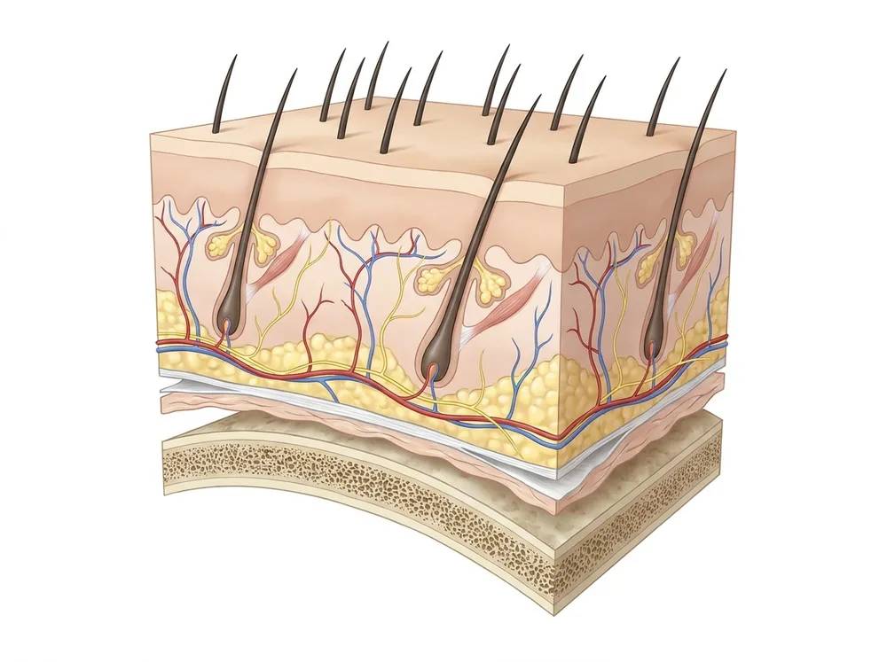

## 적응증
재생주사치료는 초기~중기 남성형·여성형 탈모와 원형 탈모에 효과적입니다. [^1]

<figure class="entity-figure">
  
  <figcaption markdown="span">두피 층 구조: 모발·모낭·피지샘·혈관·피하지방·머리뼈AI로 생성한 교육용 그림 · Linkbase 편집(해부 검수)</figcaption>
</figure>

이 항목의 외부 근거는 재생주사치료 가운데 두피에 주사하는 자가 혈소판 풍부 혈장(platelet-rich plasma, PRP) 연구를 중심으로 정리합니다. PRP 제제 자체와 두피 외 적응증은 [PRP 주사](/treatments/prp-injection/), 엑소좀 기반 시술은 [엑소좀 치료](/treatments/exosome-therapy/) 항목에서 다룹니다.

### 안드로겐성 탈모
- 피부과 시술 영역의 PRP 연구를 검토한 체계적 고찰에서 가장 강한 근거 수준을 보인 적응증은 안드로겐성 탈모였습니다 [^2].
- 연구 30편(687명)을 분석한 체계적 고찰·메타분석은 PRP가 남녀 [안드로겐성 탈모](/conditions/androgenetic-alopecia/) 환자의 모발 밀도와 모발 굵기를 개선한다고 보고했습니다 [^3].

### 원형 탈모
- [원형 탈모](/conditions/alopecia-areata/)에서는 PRP가 스테로이드를 쓰지 않는 치료 선택지로 연구되고 있습니다 [^4].
- 원형 탈모 621명과 일차성 반흔성 탈모 19명을 포함한 연구 32편의 체계적 고찰에서, 원형 탈모 치료에 PRP 단독 치료가 우월한 효능을 보인 연구는 5편, 병변 내 스테로이드 주사와 비슷한 효능을 보인 연구는 6편이었습니다 [^5].

## 분자 기전
- 세포·동물 실험에서 활성화한 PRP는 모낭의 모유두세포 증식을 늘리고 ERK·Akt 신호 전달을 자극했으며, 모발 성장을 촉진하는 FGF-7과 β-카테닌의 발현을 모유두세포에서 높였습니다 [^6].
- 같은 연구에서 활성화한 PRP를 피하 주사한 쥐는 대조군보다 휴지기에서 성장기로 더 빨리 넘어갔습니다 [^6].
- 안드로겐성 탈모 환자의 반두피(half-head) 무작위 위약대조 시험에서는 마지막 PRP 시술 2주 뒤 조직 검사에서 기준선보다 표피 두께와 모낭 수가 늘었고, 표피의 Ki67 양성 각질형성세포와 모낭 팽대부(bulge) 세포 증가, 모낭 주변 작은 혈관의 경미한 증가가 관찰됐습니다 [^7].

위 기전 자료는 세포·동물 실험과 소규모 임상 조직 관찰에서 나온 것으로, 사람 두피에서 어떤 성분이 결정적으로 작용하는지는 연구가 더 필요합니다.

## 임상 evidence

### 안드로겐성 탈모
- **체계적 고찰·메타분석** (Evans 등, *J Dermatolog Treat* 2022, 연구 30편 n=687, 그중 RCT 10편): 29편이 유익한 결과를 보고했고, RCT 메타분석에서 PRP는 모발 밀도와 모발 굵기를 높였습니다 [^3].
- **체계적 고찰·메타분석** (Cruciani 등, *Blood Transfus* 2023, 대조 시험 27편 n=1,117 — 안드로겐성 탈모 18편 713명, 원형 탈모 9편 404명): 생리식염수 주사와 비교해 중기 추적에서 모발 밀도가 cm²당 25.6개 더 늘었으나(95% CI 2.62~48.57), 비일관성과 비뚤림 위험 때문에 근거의 질은 낮음으로 평가됐습니다 [^8].
- **반두피 무작위 위약대조 시험** (Gentile 등, *Stem Cells Transl Med* 2015, 23명 등록·3명 제외, 2년 추적): 30일 간격 3회 시술 후 목표 부위 모발 수가 평균 33.6개, 총 모발 밀도가 기준선보다 cm²당 평균 45.9개 늘었고, 시술 기간 중 부작용은 관찰되지 않았습니다 [^7].
- **미녹시딜 병용 메타분석** (Xiao 등, *Aesthetic Plast Surg* 2024, RCT 6편 n=343): PRP와 미녹시딜을 함께 쓴 군은 미녹시딜 또는 PRP 단독군보다 모발 밀도(WMD 9.14, 95% CI 6.57~11.70)와 모발 직경(WMD 4.72, 95% CI 3.21~6.23)이 더 개선됐고, 환자 만족도도 더 높았습니다 [^9].

### 원형 탈모
- **메타분석** (Meznerics 등, *Biomedicines* 2022, RCT 4편 정량 분석): PRP와 트리암시놀론 아세토니드 치료 사이에 SALT 점수 변화의 유의한 차이는 없었습니다(평균차 −2.04, 95% CI −4.72~0.65, I² 80.4%) [^4].
- 위 Cruciani 메타분석에서는 원형 탈모에서 PRP 주사가 트리암시놀론 주사보다 모발 재성장 환자 비율을 높이는지 불분명했고, 근거의 질은 매우 낮음으로 평가됐습니다 [^8].

## 언제 고려
기존 약물치료로 충분한 효과를 보지 못하거나, 모낭 자체의 회복이 필요한 경우 재생주사치료를 고려할 수 있습니다. [^1]

재생주사를 검토하기 전에 탈모 유형(안드로겐성·원형·반흔성 등)을 먼저 구분합니다. 탈모 유형마다 쌓인 근거의 양과 비교 대상 치료가 다르기 때문입니다.

- 원형 탈모 메타분석은 반점형 원형 탈모의 1차 치료가 트리암시놀론 아세토니드이지만 그 효과가 환자마다 크게 다르다는 점을 PRP 연구의 배경으로 제시했습니다 [^4].
- 원형 탈모와 일차성 반흔성 탈모에서 PRP는 기존 치료로 결과가 좋지 않았던 환자에게 유망한 치료로 평가됐지만, 질 높은 근거가 부족해 치료 권고로 확정되지는 않았습니다 [^5].

## 기대효과
재생주사치료는 모발 밀도와 두께 개선, 모낭 재생, 염증 감소 등의 효과를 기대할 수 있습니다. [^1]

- 안드로겐성 탈모 메타분석에서 PRP와 함께 보고된 변화는 모발 밀도와 모발 굵기의 증가입니다 [^3].
- 생리식염수 주사 대비 모발 밀도 증가를 보인 근거는 질이 낮음으로 평가됐습니다 [^8]. 따라서 개인별 효과 크기는 시술 전에 단정하기 어렵고, 같은 지표로 경과를 비교해 판단합니다.
- 중등도 안드로겐성 탈모 40명을 무작위 배정한 임상시험(Hausauer·Jones, *Dermatol Surg* 2018)에서는 6개월 시점 두 군 모두 모발 수가 유의하게 늘었고, 월 1회씩 3회 시술 후 3개월 뒤 추가 시술한 군이 3개월 간격 2회 시술군보다 더 빠르고 크게 개선됐습니다(평균 변화율 29.6% vs 7.2%). 모발 굵기도 두 군 모두 유의하게 늘었고 군 간 차이는 없었으며, 참여자의 82%가 만족 또는 매우 만족이라고 답했습니다 [^10].
- 반두피 위약대조 시험에서는 마지막 시술 후 12개월이 지나 4명이 다시 진행하는 탈모를 보고했고 16개월 시점에 더 뚜렷해져, 이들은 재시술을 받았습니다 [^7].

## 한계/주의점
재생주사치료는 표준화된 프로토콜이 부족하고 장기 추적 연구가 필요합니다. 또한, 탈모는 진행성 질환이므로 정기적인 유지 시술이 필요합니다. [^1]

### 근거의 한계
- 탈모 PRP 연구는 PRP 종류(활성화·비활성화)와 시술 일정이 제각각이고 결과 보고 방식도 달라, 메타분석에서 모든 결과를 합쳐 분석할 수 없었습니다 [^8].
- 같은 메타분석은 탈모에서 PRP의 이점을 보여주는 근거가 제한적이고 대부분 질이 낮다고 결론지었습니다 [^8].
- 피부과 영역 PRP 연구 전반에는 대규모 무작위 대조시험이 부족하고, 연구 변수의 이질성이 크며, 제조 프로토콜이 구체적이지 않아 임상 결과에 영향을 줄 수 있다는 점이 지적됐습니다 [^2].
- 안드로겐성 탈모 PRP 단독 치료 시험 25편의 네트워크 메타분석에서는 시술 횟수와 간격, 화학적 활성화 여부, 원심분리 횟수, 환자의 나이·성별, 시술 방식(전체 두피·반두피)이 6개월 시점 모발 밀도 변화와 관련됐습니다 [^11].
- 같은 분석에서 시술 횟수가 많고 시술 간격이 짧을수록, 그리고 화학적으로 활성화한 PRP, 2회 원심분리, 젊은 연령, 여성, 전체 두피 시술에서 효과가 더 큰 경향이 있었습니다 [^11].

### 부작용·금기
- 메타분석들에서 PRP 주사와 관련된 심각한 부작용은 보고되지 않았습니다 [^3][^8].
- 시술 간격을 비교한 임상시험에서 두 시술 방식은 안전하고 견딜 만한 수준이었으며, 평균 통증 점수는 2.1이었습니다 [^10].
- 혈액 응고 장애가 있거나 항응고제·항혈소판제를 복용 중인 경우, 두피에 감염이나 활동성 염증이 있는 경우에는 시술 전에 의료진과 상의합니다.

### 환자 안내
- 탈모 PRP 연구 19편(원형 탈모 3편 71명, 안드로겐성 탈모 16편 389명)을 검토한 체계적 고찰은 월 1회 간격 3~4회 시술을 제안했고, 표준 치료 프로토콜을 마련하려면 PRP 분리 과정을 자세히 기술한 연구가 필요하다고 정리했습니다 [^12].
- 효과는 사진, 모발 밀도·굵기 측정 같은 같은 지표를 시술 전후로 비교해 평가합니다.
- 복용 중인 약, 출혈 경향, 최근 두피 시술 이력을 시술 전에 의료진에게 알립니다.

### 다른 치료와의 병행
- 안드로겐성 탈모에서 PRP와 미녹시딜을 함께 쓴 군이 각각의 단독 치료보다 모발 밀도·직경과 환자 만족도가 더 개선됐다는 메타분석이 있습니다 [^9].
- 재생주사를 시작하더라도 기존 [탈모 약물 치료](/treatments/hair-loss-medication/)를 유지할지는 탈모 유형과 경과를 보고 의료진과 상의해 정합니다.

---

## Citations
<!-- LINKARE:CLINIC-CITATIONS (자동관리·편집금지) -->
### 자사 임상 자료
[^1]: [thewells.kr/blog/hair-loss-regeneration-injection-treatment](https://thewells.kr/blog/hair-loss-regeneration-injection-treatment)
<!-- /LINKARE:CLINIC-CITATIONS -->

### 외부 권위 출처
[^2]: [Hausauer AK, Humphrey S. The Physician's Guide to Platelet-Rich Plasma in Dermatologic Surgery Part I: Definitions, Mechanisms of Action, and Technical Specifications. Dermatol Surg. 2020;46(3):348-357. PMID 31714381. DOI 10.1097/DSS.0000000000002147](https://pubmed.ncbi.nlm.nih.gov/31714381/)
[^3]: [Evans AG, Mwangi JM, Pope RW, et al. Platelet-rich plasma as a therapy for androgenic alopecia: a systematic review and meta-analysis. J Dermatolog Treat. 2022;33(1):498-511. PMID 32410524. DOI 10.1080/09546634.2020.1770171](https://pubmed.ncbi.nlm.nih.gov/32410524/)
[^4]: [Meznerics FA, Illés K, Dembrovszky F, et al. Platelet-Rich Plasma in Alopecia Areata-A Steroid-Free Treatment Modality: A Systematic Review and Meta-Analysis of Randomized Clinical Trials. Biomedicines. 2022;10(8):1829. PMID 36009377. DOI 10.3390/biomedicines10081829](https://pubmed.ncbi.nlm.nih.gov/36009377/)
[^5]: [Tejapira K, Yongpisarn T, Sakpuwadol N, et al. Platelet-rich plasma in alopecia areata and primary cicatricial alopecias: A systematic review. Front Med (Lausanne). 2022;9:1058431. PMID 36507528. DOI 10.3389/fmed.2022.1058431](https://pubmed.ncbi.nlm.nih.gov/36507528/)
[^6]: [Li ZJ, Choi HI, Choi DK, et al. Autologous platelet-rich plasma: a potential therapeutic tool for promoting hair growth. Dermatol Surg. 2012;38(7 Pt 1):1040-1046. PMID 22455565. DOI 10.1111/j.1524-4725.2012.02394.x](https://pubmed.ncbi.nlm.nih.gov/22455565/)
[^7]: [Gentile P, Garcovich S, Bielli A, et al. The Effect of Platelet-Rich Plasma in Hair Regrowth: A Randomized Placebo-Controlled Trial. Stem Cells Transl Med. 2015;4(11):1317-1323. PMID 26400925. DOI 10.5966/sctm.2015-0107](https://pubmed.ncbi.nlm.nih.gov/26400925/)
[^8]: [Cruciani M, Masiello F, Pati I, et al. Platelet-rich plasma for the treatment of alopecia: a systematic review and meta-analysis. Blood Transfus. 2023;21(1):24-36. PMID 34967722. DOI 10.2450/2021.0216-21](https://pubmed.ncbi.nlm.nih.gov/34967722/)
[^9]: [Xiao C, Zhang GH, Li HQ, et al. Meta-Analysis of Efficacy of Platelet-Rich Plasma Combined with Minoxidil for Androgenetic Alopecia. Aesthetic Plast Surg. 2024;48(21):4554-4566. PMID 38789807. DOI 10.1007/s00266-024-04054-6](https://pubmed.ncbi.nlm.nih.gov/38789807/)
[^10]: [Hausauer AK, Jones DH. Evaluating the Efficacy of Different Platelet-Rich Plasma Regimens for Management of Androgenetic Alopecia: A Single-Center, Blinded, Randomized Clinical Trial. Dermatol Surg. 2018;44(9):1191-1200. PMID 30141776. DOI 10.1097/DSS.0000000000001567](https://pubmed.ncbi.nlm.nih.gov/30141776/)
[^11]: [Gupta AK, Bamimore M. Platelet-Rich Plasma Monotherapies for Androgenetic Alopecia: A Network Meta-Analysis and Meta-Regression Study. J Drugs Dermatol. 2022;21(9):943-952. PMID 36074501. DOI 10.36849/JDD.6948](https://pubmed.ncbi.nlm.nih.gov/36074501/)
[^12]: [Hesseler MJ, Shyam N. Platelet-Rich Plasma and Its Utilities in Alopecia: A Systematic Review. Dermatol Surg. 2020;46(1):93-102. PMID 31211715. DOI 10.1097/DSS.0000000000001965](https://pubmed.ncbi.nlm.nih.gov/31211715/)

## Changelog
- 2026-04-23 v2: 적응증 new, 언제 고려 new, 기대효과 new, 한계/주의점 new
- 2026-11-21 v3: 외부 문헌 11편(PRP 탈모 메타분석·네트워크 메타분석·RCT·체계적 고찰, 모유두세포 기전 연구)으로 적응증·분자 기전·임상 evidence·언제 고려·기대효과·한계/주의점 보강, source_count_external 0→11. 기존 본문 문장과 자사 인용 블록은 그대로 유지.
