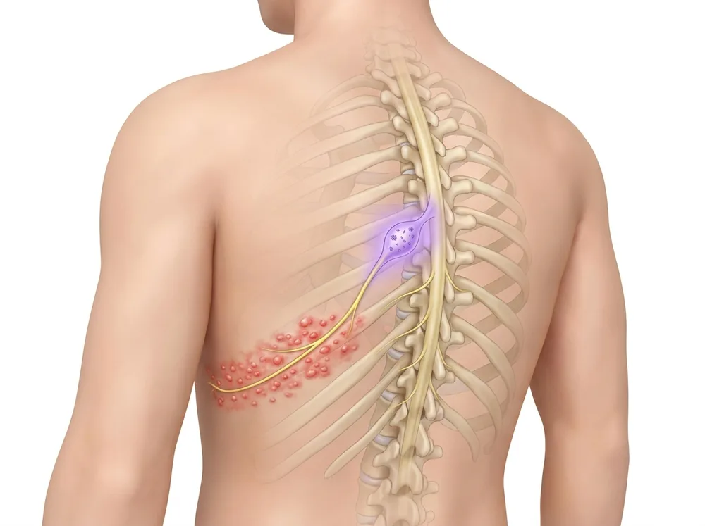
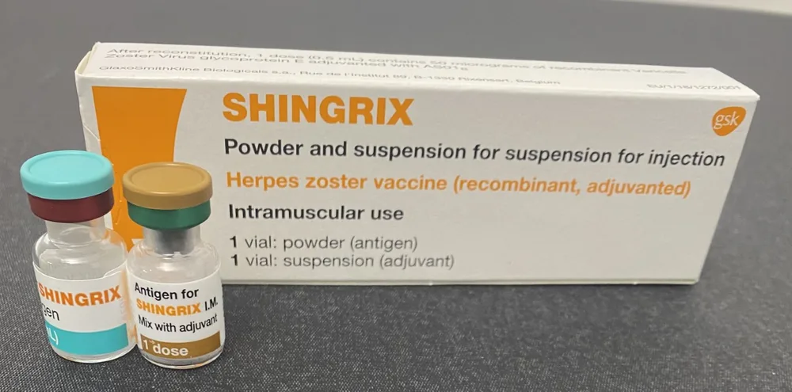

핵심 요약

- 대상포진 백신은 잠복 수두대상포진 바이러스의 재활성화를 예방하며, 재조합 사백신인 Shingrix가 임상 표준입니다.
- 미국 CDC 기준으로 50세 이상 성인과 19세 이상 면역억제·면역저하 성인이 접종 권고 대상입니다[^1][^6].
- 2~6개월 간격의 2회 근육내 주사를 완료하면 대상포진 발생을 약 87~97% 줄이고 PHN 위험을 88.8%까지 낮춥니다[^2][^3][^4].

## 정의·종류
대상포진 백신은 잠복 수두대상포진 바이러스(VZV)의 재활성화를 예방하는 능동 면역 수단입니다. 현재 가장 널리 사용되는 백신은 **Shingrix(재조합 대상포진 백신, recombinant zoster vaccine, RZV)**입니다.

<figure class="entity-figure">
  
  <figcaption markdown="span">대상포진 재활성화 경로: 바이러스가 잠복한 척추 옆 신경절(보라색) → 신경(노란색) → 같은 쪽 피부의 띠 모양 물집AI로 생성한 교육용 그림 · Linkbase 편집(해부 검수)</figcaption>
</figure>

- **Shingrix (RZV, GSK)** — **재조합 사백신(비생백신, recombinant non-live subunit vaccine)**. VZV 당단백 E 항원 + AS01B 보조제로 구성되며 살아있는 바이러스 입자가 없어 **면역억제 환자에서도 사용 가능**. **2회 접종**(2~6개월 간격, 근육내 주사)
- **Zostavax (ZVL, Merck)** — 약독화 생백신. 미국에서는 단종, 일부 국가에서 제한적 잔존. 면역억제 환자 금기. 임상시험에서 60세 이상 약 51%, 70세 이상 약 38% 수준의 예방률이 보고되었고, 접종 후 5년 전후로 면역 효과가 의미 있게 감소하는 것으로 알려져 있습니다 [^5]

근거 정리는 임상 표준이 된 **Shingrix(RZV) 중심**입니다.

<figure class="entity-figure">
  
  <figcaption markdown="span">Shingrix 구성: 항원(분말) 병 · 보조제(현탁액) 병사진: Whispyhistory, <a href="https://commons.wikimedia.org/wiki/File:Shingrix.jpg" rel="nofollow noopener" target="_blank">Wikimedia Commons</a>, <a href="https://creativecommons.org/licenses/by-sa/4.0" rel="nofollow noopener" target="_blank">CC BY-SA 4.0</a></figcaption>
</figure>

**대상포진 백신 종류 비교** [^1][^2][^3][^5]
{: .entity-table-caption}

| 구분 | Shingrix (RZV) | Zostavax (ZVL) |
| --- | --- | --- |
| 백신 형태 | 재조합 사백신(비생백신) | 약독화 생백신 |
| 면역억제 환자 | 19세 이상 사용 가능 | 금기 |
| 예방 효과 | 50세 이상 97.2%, 70세 이상 91.3% | 60세 이상 약 51%, 70세 이상 약 38% |
| 효과 지속성 | 11년차 82.0% 유지 | 접종 후 5년 전후 의미 있게 감소 |

## 적응증·접종 권고

### 미국 CDC·ACIP 권고 (표준)
- **50세 이상 면역적격 성인** — 모두 권고 [^6]
- **19세 이상 면역억제 또는 면역저하 성인** — 면역억제·면역저하(질환 또는 치료) 성인에서도 권고[^1]
- **2회 접종**: 1차 후 2~6개월 간격으로 2차

### 한국에서의 활용
한국에서도 Shingrix는 식약처 허가를 받아 임상에서 활용되고 있으며, 50세 이상에서 권고됩니다. 구체적 급여·국가 예방접종 사업 포함 여부는 진료 시점 의료진과 확인합니다.

### 대상포진 이력자도 권고
대상포진을 이미 앓은 환자에서도 재발 위험이 있으므로 Shingrix 접종이 권고됩니다 — 일반적으로 발진 회복(통증·발진 완전 소실) 후 시점에 의료진과 상담 후 접종 시기를 결정합니다.

### 과거 Zostavax 접종자
과거에 Zostavax(약독화 생백신)를 접종한 환자도 시간이 지나면서 면역 효과가 감소하므로, 일정 간격을 둔 뒤 Shingrix로 추가 접종하는 것이 가능합니다. 구체적 간격은 진료 시점 의료진과 결정합니다 [^5].

싱그릭스는 2차 접종을 완료해야 충분한 보호 효과가 형성됩니다. 일정이 어렵다면 처음부터 2회를 마칠 수 있는 시기에 시작하는 편이 합리적입니다[^5].

## 임상 evidence

### 단기 효과 (ZOE-50/70 임상시험)
- **ZOE-50** (Lal 등, *NEJM* 2015, n=15,411, 50세 이상 성인): 백신 효과(VE) 대상포진에 대해 **97.2%** (위약 대비)[^2]
- **ZOE-70** (Cunningham 등, *NEJM* 2016, n=13,900, 70세 이상): VE 대상포진 **91.3%** (95% CI 86.8~94.5), **PHN VE 88.8%** (95% CI 68.7~97.1)[^2]
- 두 임상 통합 분석에서 70세 이상에서도 안전성·효과 모두 유지

### 장기 효과 (ZOE-LTFU 11년 추적)
**Strezova 등 2025 *eClinicalMedicine*** ZOE-LTFU 최종 분석(11년 추적): 1차 접종 후 11년 시점까지 추적한 결과[^3].
- 50세 이상 통합 VE: **87.7%** (95% CI 84.9~90.1)
- 11년차 VE 유지: **82.0%** (95% CI 63.0~92.2)
- ZOE-LTFU 기간 중 PHN에 대한 VE: **87.5%**
- RZV 관련 중대 이상반응은 보고되지 않음 — 장기 안전성 확인

<figure class="entity-figure entity-chart" role="img" aria-label="Shingrix 예방 효과 막대그래프">
  
Shingrix 대상포진 예방 효과 (위약 대비)

  

50세 이상ZOE-50 임상시험

97.2%

  

70세 이상ZOE-50·70 통합 분석

91.3%

  

70세 이상 · 대상포진 후 신경통ZOE-50·70 통합 분석

88.8%

  

50세 이상 · 11년 전체ZOE-LTFU 장기 추적

87.7%

  

접종 11년째 해ZOE-LTFU 장기 추적

82.0%

  <figcaption markdown="span">Shingrix 예방 효과(70세 이상 = ZOE-50·70 통합 분석) [^2][^3]그래프: Linkbase · Lal 2015, Cunningham 2016 (N Engl J Med), Strezova 2025 (eClinicalMedicine) 초록 수치</figcaption>
</figure>

### 면역억제 환자
면역억제·면역저하 성인에서도 RZV가 안전하고 효과적이라는 별도 임상시험 데이터가 누적되어, CDC는 19세 이상 면역억제 성인에 대한 권고를 추가했습니다[^1].

## 시술 절차
1. **사전 평가** — 활동성 대상포진·심한 급성 질환·과거 알레르기 병력 확인
2. **근육 내 주사** — 보통 삼각근(어깨 근육) 부위
3. **2차 접종 일정 안내** — 2~6개월 간격
4. **시술 후 관찰** — 즉각적 부작용(현기증·알레르기) 모니터링

<figure class="entity-figure entity-steps" role="img" aria-label="Shingrix 2회 접종 일정: 1차 접종 뒤 2개월에서 6개월 사이 2차 접종">
  
Shingrix 접종 일정: 2회, 근육 주사

  <ol class="entity-steps-list">
    <li><b>1차 접종</b>0개월</li>
    <li class="entity-steps-range"><b>2차 접종</b>2~6개월 사이</li>
  </ol>
  <figcaption markdown="span">Shingrix 접종 일정 · 보통 어깨 삼각근 근육 주사도식: Linkbase</figcaption>
</figure>

## 부작용·주의점

### 흔한 부작용 (반응원성)
ZOE-50/70 RCT에서 위약 대비 빈도가 높은 부작용:
- **주사 부위 반응** — 통증, 발적, 부종 (가장 흔함)
- **전신 반응** — 근육통, 피로감, 두통, 오한, 발열, 위장 증상 (보통 24~72시간 내 호전)
- 70세 이상에서 부작용 빈도가 50대보다 약간 낮은 경향

이러한 일시적 반응은 백신의 강한 면역 활성화에 따른 정상적 반응이며, 대부분 1~3일 내 호전됩니다 — 사전 안내가 환자 만족도에 중요합니다[^2].

### 중대 이상반응
ZOE-50/70·ZOE-LTFU 11년 추적에서 RZV와 인과관계가 명확한 중대 이상반응은 보고되지 않았습니다[^2][^3]. 매우 드물게 길랭-바레 증후군 등 면역 매개 신경 합병증 가능성이 시판 후 감시에서 보고되어 모니터링되고 있습니다.

### 금기·주의 환자군
- 백신 성분(VZV 당단백 E·AS01B 보조제)에 심한 알레르기 병력
- 활동성 대상포진(발진·통증 회복 전) — 회복 후 접종 시점 의료진과 결정
- 임신 여성(자료 제한적, 수유 시 의료진과 상의)

## 환자 안내
- **PHN의 가장 효과적인 예방은 백신**입니다 — 대상포진 발생 자체를 약 87~97% 줄이고, 발생하더라도 PHN 위험을 88.8%까지 감소시킵니다[^2][^3][^4]
- 50세 이상은 대상포진 이력 여부와 관계없이 접종 권고
- 면역억제·면역저하 환자도 19세 이상에서 접종 가능 (RZV는 살아있는 바이러스가 없는 재조합 사백신)
- 2차 접종 일정을 놓치지 않도록 사전 일정 관리
- 백신 선택 시 고려 요소 — 임상에서는 나이·면역 상태·과거 접종 이력·비용을 함께 검토합니다. Shingrix 2회 접종은 1회 접종 백신 대비 일정 부담이 있으나 효과 지속 기간(11년 추적 82% 유지)과 PHN 예방 효과(88.8%)를 함께 고려하면 환자별 트레이드오프가 달라집니다 [^5]

관련 entity:
- [zoster](../conditions/zoster.md) — 대상포진 진단·치료 흐름
- [postherpetic-neuralgia](../conditions/postherpetic-neuralgia.md) — PHN
- [antiviral-medicine](./antiviral-medicine.md) — 발생 시 항바이러스 치료

---

---

## Citations
### 자사 임상 자료
<!-- LINKARE:CLINIC-CITATIONS (자동관리·편집금지) -->
[^5]: [안심튼튼 — 싱그릭스 vs 조스터박스 대상포진 예방접종 백신 비교](https://ansimpainfree.kr/blog/shingles-vaccine-singrrix-vs-shingrix)
<!-- /LINKARE:CLINIC-CITATIONS -->

### 외부 권위 출처
[^1]: Clinical Considerations for Shingrix Use in Immunocompromised Adults Aged ≥19 Years. *CDC.* 2024 update. URL: [cdc.gov/shingles/hcp/vaccine-considerations/immunocompromised-adults](https://www.cdc.gov/shingles/hcp/vaccine-considerations/immunocompromised-adults.html) — 19세 이상 면역억제 권고
[^2]: Lal H, Cunningham AL, Godeaux O, et al. Efficacy of an Adjuvanted Herpes Zoster Subunit Vaccine in Older Adults (ZOE-50). *N Engl J Med.* 2015;372(22):2087-2096. DOI: [10.1056/NEJMoa1501184](https://www.nejm.org/doi/full/10.1056/NEJMoa1501184) // Cunningham AL, Lal H, Kovac M, et al. Efficacy of the Herpes Zoster Subunit Vaccine in Adults 70 Years of Age or Older (ZOE-70). *N Engl J Med.* 2016;375(11):1019-1032. DOI: [10.1056/NEJMoa1603800](https://www.nejm.org/doi/full/10.1056/NEJMoa1603800)
[^3]: Strezova A, Diez-Domingo J, Al Shawafi K, et al. Final analysis of the ZOE-LTFU trial to 11 years post-vaccination: efficacy of the adjuvanted recombinant zoster vaccine against herpes zoster and related complications. *eClinicalMedicine.* 2025;83:103241. PMID 40630610. DOI: [10.1016/j.eclinm.2025.103241](https://www.thelancet.com/journals/eclinm/article/PIIS2589-5370(25)00173-7/fulltext) — 11년 추적, ≥50세 VE 87.7% (11년차 82.0% 유지), PHN VE 87.5%
[^4]: Adriaansen EJM, Jacobs JG, Vernooij LM, et al. 8. Herpes zoster and post herpetic neuralgia. *Pain Practice.* 2025;25(1):e13423. PMID 39364882. DOI: [10.1111/papr.13423](https://onlinelibrary.wiley.com/doi/full/10.1111/papr.13423) — PHN 예방의 가장 효과적인 수단으로 백신 강조
[^6]: [CDC. Shingles Vaccine Recommendations. Recombinant zoster vaccine is recommended for adults aged 50 years and older and for adults aged 19 years and older who are or will be immunodeficient or immunosuppressed](https://www.cdc.gov/shingles/hcp/vaccine-considerations/index.html)

## Changelog
- 2026-05-09 v2: 내용 업데이트.
- 2026-05-03 v1: 내용 업데이트.
- 2026-10-20 v3: 적응증·접종 권고 enrich
