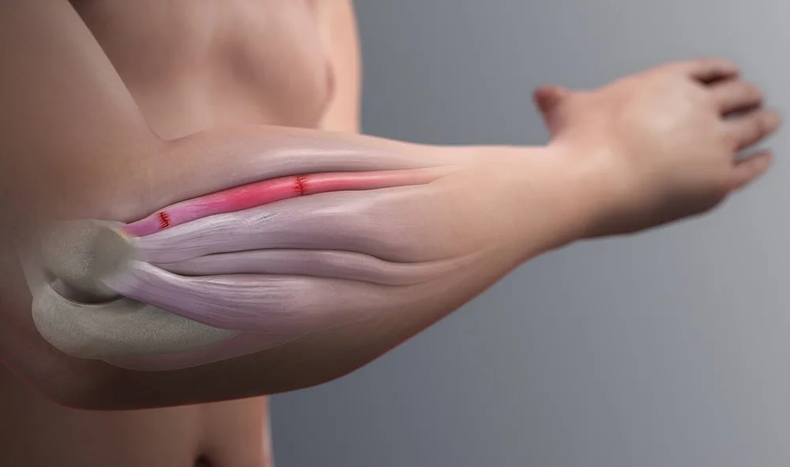

## 적응증
외측상과염은 팔꿈치 바깥쪽 뼈 돌출 부위에 붙은 힘줄이 손상되는 질환으로, 주로 손목을 펴거나 물건을 쥐는 동작을 반복하는 사람들에게 발생합니다. [^1]

<figure class="entity-figure">
  
  <figcaption markdown="span">외측상과염의 손상 자리: 팔꿈치 바깥쪽 뼈 돌출부(외측 상과)에서 시작하는 손목 폄 근육 힘줄의 붉은 손상 표시그림: Scientific Animations, <a href="https://commons.wikimedia.org/wiki/File:Tennis_Elbow_Tendon_Injury.jpg" rel="nofollow noopener" target="_blank">Wikimedia Commons</a>, <a href="https://creativecommons.org/licenses/by-sa/4.0" rel="nofollow noopener" target="_blank">CC BY-SA 4.0</a></figcaption>
</figure>

## 언제 고려
외측상과염은 보존적 치료로 호전되지 않을 때 주사 치료나 시술을 고려합니다. 수술은 12개월 이상 보존 치료에도 호전이 없을 때 고려합니다. [^1]

## 기대효과
보존적 치료는 대부분의 외측상과염 환자에게 효과적이며, 시간이 걸리더라도 회복을 기대할 수 있습니다. 스테로이드 주사는 단기간에 불편함을 줄여줍니다. [^1]

## 한계/주의점
스테로이드 주사는 장기적으로 재발률이 높으며, 반복 사용 시 힘줄을 약화시킬 수 있습니다. 주사 후 무리한 활동은 재발을 초래할 수 있습니다. [^1]

---

## Citations
<!-- LINKARE:CLINIC-CITATIONS (자동관리·편집금지) -->
### 자사 임상 자료
[^1]: [ansimpainfree.kr/blog/lateral-epicondylitis-symptoms-diagnosis](https://ansimpainfree.kr/blog/lateral-epicondylitis-symptoms-diagnosis)
<!-- /LINKARE:CLINIC-CITATIONS -->

## Changelog
- 2026-04-23 v2: 적응증 new, 언제 고려 new, 기대효과 new, 한계/주의점 new
