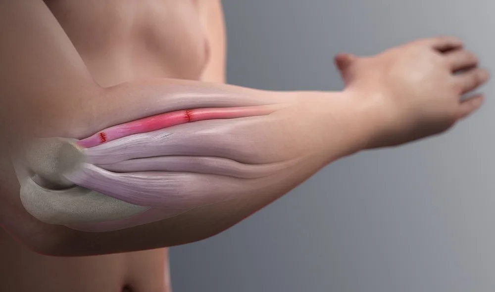

## 적응증
외측상과염은 팔꿈치 바깥쪽 뼈 돌출 부위에 붙은 힘줄이 손상되는 질환으로, 주로 손목을 펴거나 물건을 쥐는 동작을 반복하는 사람들에게 발생합니다. [^1]

<figure class="entity-figure">
  
  <figcaption markdown="span">외측상과염의 손상 자리: 팔꿈치 바깥쪽 뼈 돌출부(외측 상과)에서 시작하는 손목 폄 근육 힘줄의 붉은 손상 표시그림: Scientific Animations, <a href="https://commons.wikimedia.org/wiki/File:Tennis_Elbow_Tendon_Injury.jpg" rel="nofollow noopener" target="_blank">Wikimedia Commons</a>, <a href="https://creativecommons.org/licenses/by-sa/4.0" rel="nofollow noopener" target="_blank">CC BY-SA 4.0</a></figcaption>
</figure>

이 항목은 [외측상과염](/conditions/lateral-epicondylitis/)에 쓰이는 경과 관찰, 물리치료·운동치료, 약물, 보조기, 주사, 체외충격파, 수술의 외부 근거를 정리합니다.

- 2022년 발표된 물리치료 영역의 외측상과염 임상진료지침은 이 질환이 흔히 저절로 좋아지는 질환으로 설명되지만, 재발이 잦고 병가가 길어질 수 있어 효과적인 비수술 치료가 필요하다고 정리했습니다 [^2].
- 같은 지침은 힘줄의 조직·구조 변화, 이와 관련된 운동 조절 장애, 통증 처리 방식의 변화가 모두 증상에 관여할 수 있다고 보고, 물리치료 현장의 평가 방법과 치료 중재를 함께 다룹니다 [^2].
- 6주 이상 증상이 이어진 외측상과염 환자 185명을 무작위 배정한 연구는, 이 질환을 흔히 스테로이드 주사나 물리치료로 치료하는 반면 네덜란드 진료지침은 경과 관찰(wait-and-see)을 권고한다는 점을 연구 배경으로 제시했습니다 [^3].

## 임상 evidence

### 스테로이드 주사
- **체계적 고찰·메타분석** (Coombes 등, *Lancet* 2010, 힘줄병증 주사 치료 RCT 41편 n=2,672): 외측상과염 통합 분석에서 스테로이드 주사는 치료하지 않은 경우보다 단기(약 4주) 통증 감소 효과가 컸지만(SMD 1.44, 95% CI 1.17~1.71), 중기(약 26주)에는 치료하지 않은 쪽이 오히려 나았고(SMD −0.40, 95% CI −0.67~−0.14) 장기(52주 이상)에도 같은 방향이었습니다(SMD −0.31, 95% CI −0.61~−0.01) [^4].
- **무작위 대조시험** (Smidt 등, *Lancet* 2002, n=185): 6주 시점 성공률은 스테로이드 주사군 92%, 물리치료군 47%, 경과 관찰군 32%였지만 주사군의 재발률이 높았고, 52주 시점 성공률은 주사군 69%, 물리치료군 91%, 경과 관찰군 83%였습니다 [^3].
- **무작위 대조시험** (Bisset 등, *BMJ* 2006, n=198): 스테로이드 주사는 6주 시점 효과가 유의하게 더 좋았지만 이후 재발이 많아 성공 사례 65명 중 47명이 다시 나빠졌고, 장기 결과는 물리치료군보다 유의하게 나빴습니다 [^5].
- **2×2 요인 설계 위약대조 시험** (Coombes 등, *JAMA* 2013, 6주 넘게 지속된 한쪽 외측상과염 n=165): 스테로이드 주사군은 위약 주사군보다 1년 시점 '완전 회복 또는 많이 호전' 비율이 낮았고(83% vs 96%, RR 0.86, 99% CI 0.75~0.99), 1년 재발률은 높았습니다(54% vs 12%) [^6].

### 물리치료·운동치료
- 위 Bisset 시험에서 팔꿈치 도수 기법(mobilisation with movement)과 운동을 결합한 물리치료 8회는 첫 6주 동안 경과 관찰보다 나았고, 52주 시점에는 두 군 사이 차이가 없었으며 두 군 모두 대부분 성공적인 결과를 보고했습니다 [^5]. 물리치료군은 경과 관찰군·주사군보다 소염진통제 같은 추가 치료를 덜 찾았습니다 [^5].
- 위 Coombes 2013 시험에서 1년 시점 '완전 회복 또는 많이 호전' 비율은 물리치료를 받은 군과 받지 않은 군 사이에 차이가 없었습니다(91% vs 88%) [^6].
- **체계적 고찰** (Hoogvliet 등, *Br J Sports Med* 2013, 체계적 고찰 1편·RCT 12편, 모두 외측상과염): 스트레칭과 근력 강화 운동이 초음파·마찰 마사지보다 단기 효과가 낫다는 중등도 근거가 있었고, 손목·아래팔의 스트레칭과 가동술에 경추·흉추 도수 교정을 더하면 단기·중기 효과가 있다는 중등도 근거가 있었습니다 [^7].
- **체계적 고찰** (Cullinane 등, *Clin Rehabil* 2014, 연구 12편, 그중 무작위 시험 8편 n=334): 편심성 운동을 포함한 모든 치료군에서 통증·기능·악력이 기준선보다 개선됐고, 7편은 편심성 운동을 포함한 치료가 포함하지 않은 치료보다 통증·기능·악력 중 하나 이상에서 더 나았다고 보고했습니다 [^8].

운동 처방 전반은 [운동치료](/treatments/exercise-therapy/), 관절 가동 기법은 [도수치료](/treatments/manual-therapy/) 항목에서 다룹니다.

### 소염진통제
- **코크란 체계적 고찰** (Pattanittum 등, 2013, 시험 15편 n=759): 바르는 [소염진통제](/treatments/anti-inflammatory-analgesics/)는 위약보다 단기 통증을 더 줄였다는 낮은 질의 근거가 있었고(3편 153명, 0~10점 척도 평균차 −1.64, 95% CI −2.42~−0.86), 먹는 소염진통제의 이점에 관한 근거는 질이 낮고 서로 엇갈렸습니다 [^9].

### 보조기
- **코크란 체계적 고찰** (Struijs 등, 2002, RCT 5편): 시험 수가 적고 결과 지표와 장기 결과가 제한적이어서, 외측상과염에서 보조기의 효과에 대해 확정적인 결론을 내릴 수 없었습니다 [^10].

### 자가혈·PRP 주사
- **코크란 체계적 고찰** (Karjalainen 등, 2021, 연구 32편 n=2,337): 자가혈 또는 [PRP 주사](/treatments/prp-injection/)는 위약 주사와 비교해 3개월 시점 통증·기능을 임상적으로 의미 있게 개선하지 못할 가능성이 높았습니다(중등도 확실성 근거). 3개월 평균 통증은 위약군 3.7점(0~10점)보다 0.16점 낮은 수준이었고(95% CI 0.60점 낮음~0.29점 높음, 8편 523명), 6개월과 12개월 시점에도 임상적으로 중요한 이점은 관찰되지 않았습니다 [^11].
- **무작위 대조시험** (Gosens 등, *Am J Sports Med* 2011, 만성 외측상과염 n=100, 2년 추적): 백혈구가 풍부한 PRP 주사군은 스테로이드 주사군보다 치료 성공(재시술 없이 통증 VAS 또는 DASH 점수 25% 이상 감소) 비율이 높았고, 스테로이드 주사군의 DASH 점수는 기준선 수준으로 돌아간 반면 PRP 군은 유의하게 개선된 상태였습니다(as-treated 분석) [^12].
- **다기관 무작위 대조시험** (Mishra 등, *Am J Sports Med* 2014, 증상이 3개월 이상이고 기존 치료에 실패한 만성 외측상과염 n=230): 국소마취 후 힘줄에 바늘 자극(needling)만 한 대조군과 비교해 12주 시점 통증 개선(55.1% vs 47.4%)과 성공률은 유의한 차이가 없었고, 24주 시점(추적 119명)에는 백혈구가 풍부한 PRP 군의 통증 개선이 더 컸습니다(71.5% vs 56.1%) [^13].

### 체외충격파
- **코크란 체계적 고찰** (Buchbinder 등, 2005, 위약대조 시험 9편 n=1,006, 스테로이드 주사 비교 시험 1편 n=93): 13개 통합 분석 중 11개에서 [체외충격파](/treatments/eswt/)는 위약보다 유의한 이점을 보이지 않았고, 저자들은 체외충격파가 외측상과염의 통증과 기능에 거의 또는 전혀 이점이 없다고 결론지었습니다 [^14].
- 같은 고찰에 포함된 스테로이드 주사 비교 시험 1편에서는 치료 종료 3개월 뒤 통증이 50% 이상 줄어든 비율이 스테로이드 주사군에서 더 높았습니다(84% vs 60%) [^14].

### 수술
- **위약 수술 대조 무작위 시험** (Kroslak·Murrell, *Am J Sports Med* 2018, 증상 6개월 초과·비수술 치료 2가지 이상 실패 n=26): 짧은노쪽손목폄근(ECRB)의 퇴행 부위를 잘라내는 수술군과 피부 절개 후 ECRB를 노출만 한 위약 수술군 모두 6개월과 2.5년 시점 통증과 기능이 개선됐지만, 어느 시점·지표에서도 두 군 사이 유의한 차이는 없었습니다 [^15].
- **코크란 체계적 고찰** (Buchbinder 등, 2011, 시험 5편 n=191, 증상 5개월 이상·보존 치료 실패): 연구 수가 적고 수술 방법과 비교군이 제각각이며 표본이 작아, 외측상과염 [수술](/treatments/surgery/)의 효과를 지지하거나 반박할 근거가 부족했습니다 [^16].

## 언제 고려
외측상과염은 보존적 치료로 호전되지 않을 때 주사 치료나 시술을 고려합니다. 수술은 12개월 이상 보존 치료에도 호전이 없을 때 고려합니다. [^1]

- 스테로이드 주사와 물리치료, 경과 관찰을 비교한 무작위 시험의 연구진은 스테로이드 주사의 단기 이점이 6주 뒤에 오히려 뒤집히고 재발률이 높아 이 치료를 신중하게 써야 하며, 중장기적으로는 도수 기법과 운동을 결합한 물리치료가 주사의 합리적인 대안이 될 수 있다고 결론지었습니다 [^5].
- 2000~2012년 새로 진단된 외측상과염 환자를 살핀 미국 인구 기반 연구에서 2년 이내 재발률은 8.5%였고, 6개월 시점에 증상이 남아 있던 환자 약 10명 중 1명이 수술을 받았습니다 [^17]. 연구진은 발병 후 6개월이 지나도 증상이 해소되지 않으면 경과가 길어질 수 있고 수술이 필요할 수 있다고 해석했습니다 [^17].
- 다만 수술의 효과를 뒷받침하는 무작위 시험 근거는 아직 제한적입니다 [^15][^16].

## 기대효과
보존적 치료는 대부분의 외측상과염 환자에게 효과적이며, 시간이 걸리더라도 회복을 기대할 수 있습니다. 스테로이드 주사는 단기간에 불편함을 줄여줍니다. [^1]

- 치료 방식에 따라 효과가 나타나는 시점이 다릅니다. 스테로이드 주사는 6주 전후의 단기 효과가 가장 컸지만, 52주 시점에는 물리치료보다 결과가 나빴습니다 [^3][^5].
- 1년 시점에는 경과 관찰군이나 위약 주사군에서도 대부분 호전을 보고했습니다. 52주 성공률은 경과 관찰군 83%였고 [^3], 다른 시험에서 위약 주사군의 96%가 1년 시점 '완전 회복 또는 많이 호전'에 해당했습니다 [^6].
- PRP 주사의 효과는 비교 대상에 따라 다르게 보고됐습니다. 위약 주사와 비교한 코크란 고찰에서는 임상적으로 의미 있는 이점이 없었고 [^11], 스테로이드 주사와 비교한 2년 추적 시험 [^12]과 바늘 자극만 한 대조군과 비교한 시험의 24주 시점 [^13]에서는 PRP 군의 결과가 더 좋았습니다.

## 한계/주의점
스테로이드 주사는 장기적으로 재발률이 높으며, 반복 사용 시 힘줄을 약화시킬 수 있습니다. 주사 후 무리한 활동은 재발을 초래할 수 있습니다. [^1]

### 근거의 한계
- 자가혈·PRP 주사 시험 대부분은 배정 은폐가 불충분하고 참여자 눈가림이 없어 선택·수행·검출 비뚤림 위험이 있었습니다 [^11].
- 운동치료·가동술 연구는 이질성이 커 통합 분석을 할 수 없었고, 스트레칭·근력 강화 운동과 경추·흉추 도수 교정을 제외한 중재는 근거가 제한적이거나 엇갈리거나 없었습니다 [^7].
- 편심성 운동만 따로 떼어 효과를 본 연구는 질이 낮은 1편뿐이었고, 이 연구에서는 다른 치료보다 통증 개선이 유의하지 않았습니다 [^8].
- 소염진통제 시험은 대부분 표본이 작았고 추적 기간 중앙값이 2주로 짧았습니다 [^9].
- 주사 치료의 효과는 힘줄병증 부위마다 달라, 한 부위의 결과를 다른 부위로 일반화하지 않아야 한다는 점이 지적됐습니다 [^4].
- 체외충격파 코크란 고찰은 2004년까지 발표된 시험을 검색한 결과입니다 [^14].
- 위약 수술 대조 시험은 목표 인원(군당 40명)을 채우기 전에 중단됐습니다 [^15].

### 부작용·금기
- 힘줄병증 주사 시험에서 스테로이드 주사를 맞은 991명 가운데 심각한 부작용은 1명(0.1%, 힘줄 파열)이었습니다 [^4].
- 코크란 고찰은 자가혈·PRP 주사가 위약 주사보다 부작용 위험을 높이지 않을 수 있다고 보았지만(낮은 확실성 근거, 19% vs 17%), 주사 치료 자체가 통증을 일으키고 작은 감염 위험이 있다고 지적했습니다 [^11].
- PRP 무작위 시험 2편에서는 의미 있는 합병증이 보고되지 않았습니다 [^12][^13].
- 체외충격파의 부작용은 경미했으며 주로 일시적 통증, 피부 발적, 메스꺼움이었고, 대부분 치료 중단이나 용량 조절이 필요하지 않았습니다 [^14].
- 바르는 소염진통제에서는 발진 같은 경미한 부작용이 보고됐고(2.5% vs 위약 1.3%), 먹는 소염진통제는 한 시험에서 위장관 부작용 위험 증가와 관련됐습니다 [^9].

### 환자 안내
- 스테로이드 주사·물리치료·경과 관찰을 비교한 연구진은 환자가 각 치료의 장단점을 충분히 안내받아야 하며, 물리치료로 얻는 상대적 이득이 작아 물리치료와 경과 관찰 사이의 선택은 이용 가능한 자원에 따라 달라질 수 있다고 정리했습니다 [^3].
- 치료 효과는 통증, 악력, 일상 동작의 불편 정도 같은 지표를 치료 전후로 비교해 판단합니다.

### 다른 치료와의 병행
- 2×2 요인 설계 시험에서 4주 시점 위약 주사에 물리치료를 더한 군은 물리치료를 받지 않은 군보다 '완전 회복 또는 많이 호전' 비율이 높았지만(39% vs 10%), 스테로이드 주사에 물리치료를 더한 군과 스테로이드 주사 단독군 사이에는 차이가 없었습니다(68% vs 71%) [^6].
- 운동치료·가동술 체계적 고찰은 도수 기법의 단기 진통 효과가 더 적극적인 스트레칭·근력 운동을 가능하게 해 더 빠른 회복으로 이어질 수 있다는 해석을 제시했습니다 [^7].
- 편심성 운동 체계적 고찰은 편심성 운동을 여러 치료를 묶은 복합 치료 프로그램의 일부로 포함하는 것을 지지했습니다 [^8].

---

## Citations
<!-- LINKARE:CLINIC-CITATIONS (자동관리·편집금지) -->
### 자사 임상 자료
[^1]: [ansimpainfree.kr/blog/lateral-epicondylitis-symptoms-diagnosis](https://ansimpainfree.kr/blog/lateral-epicondylitis-symptoms-diagnosis)
<!-- /LINKARE:CLINIC-CITATIONS -->

### 외부 권위 출처
[^2]: [Lucado AM, Day JM, Vincent JI, et al. Lateral Elbow Pain and Muscle Function Impairments. J Orthop Sports Phys Ther. 2022;52(12):CPG1-CPG111. PMID 36453071. DOI 10.2519/jospt.2022.0302](https://pubmed.ncbi.nlm.nih.gov/36453071/)
[^3]: [Smidt N, van der Windt DA, Assendelft WJ, et al. Corticosteroid injections, physiotherapy, or a wait-and-see policy for lateral epicondylitis: a randomised controlled trial. Lancet. 2002;359(9307):657-662. PMID 11879861. DOI 10.1016/S0140-6736(02)07811-X](https://pubmed.ncbi.nlm.nih.gov/11879861/)
[^4]: [Coombes BK, Bisset L, Vicenzino B. Efficacy and safety of corticosteroid injections and other injections for management of tendinopathy: a systematic review of randomised controlled trials. Lancet. 2010;376(9754):1751-1767. PMID 20970844. DOI 10.1016/S0140-6736(10)61160-9](https://pubmed.ncbi.nlm.nih.gov/20970844/)
[^5]: [Bisset L, Beller E, Jull G, et al. Mobilisation with movement and exercise, corticosteroid injection, or wait and see for tennis elbow: randomised trial. BMJ. 2006;333(7575):939. PMID 17012266. DOI 10.1136/bmj.38961.584653.AE](https://pubmed.ncbi.nlm.nih.gov/17012266/)
[^6]: [Coombes BK, Bisset L, Brooks P, et al. Effect of corticosteroid injection, physiotherapy, or both on clinical outcomes in patients with unilateral lateral epicondylalgia: a randomized controlled trial. JAMA. 2013;309(5):461-469. PMID 23385272. DOI 10.1001/jama.2013.129](https://pubmed.ncbi.nlm.nih.gov/23385272/)
[^7]: [Hoogvliet P, Randsdorp MS, Dingemanse R, et al. Does effectiveness of exercise therapy and mobilisation techniques offer guidance for the treatment of lateral and medial epicondylitis? A systematic review. Br J Sports Med. 2013;47(17):1112-1119. PMID 23709519. DOI 10.1136/bjsports-2012-091990](https://pubmed.ncbi.nlm.nih.gov/23709519/)
[^8]: [Cullinane FL, Boocock MG, Trevelyan FC. Is eccentric exercise an effective treatment for lateral epicondylitis? A systematic review. Clin Rehabil. 2014;28(1):3-19. PMID 23881334. DOI 10.1177/0269215513491974](https://pubmed.ncbi.nlm.nih.gov/23881334/)
[^9]: [Pattanittum P, Turner T, Green S, et al. Non-steroidal anti-inflammatory drugs (NSAIDs) for treating lateral elbow pain in adults. Cochrane Database Syst Rev. 2013;2013(5):CD003686. PMID 23728646. DOI 10.1002/14651858.CD003686.pub2](https://pubmed.ncbi.nlm.nih.gov/23728646/)
[^10]: [Struijs PA, Smidt N, Arola H, et al. Orthotic devices for the treatment of tennis elbow. Cochrane Database Syst Rev. 2002;(1):CD001821. PMID 11869609. DOI 10.1002/14651858.CD001821](https://pubmed.ncbi.nlm.nih.gov/11869609/)
[^11]: [Karjalainen TV, Silagy M, O'Bryan E, et al. Autologous blood and platelet-rich plasma injection therapy for lateral elbow pain. Cochrane Database Syst Rev. 2021;9(9):CD010951. PMID 34590307. DOI 10.1002/14651858.CD010951.pub2](https://pubmed.ncbi.nlm.nih.gov/34590307/)
[^12]: [Gosens T, Peerbooms JC, van Laar W, et al. Ongoing positive effect of platelet-rich plasma versus corticosteroid injection in lateral epicondylitis: a double-blind randomized controlled trial with 2-year follow-up. Am J Sports Med. 2011;39(6):1200-1208. PMID 21422467. DOI 10.1177/0363546510397173](https://pubmed.ncbi.nlm.nih.gov/21422467/)
[^13]: [Mishra AK, Skrepnik NV, Edwards SG, et al. Efficacy of platelet-rich plasma for chronic tennis elbow: a double-blind, prospective, multicenter, randomized controlled trial of 230 patients. Am J Sports Med. 2014;42(2):463-471. PMID 23825183. DOI 10.1177/0363546513494359](https://pubmed.ncbi.nlm.nih.gov/23825183/)
[^14]: [Buchbinder R, Green SE, Youd JM, et al. Shock wave therapy for lateral elbow pain. Cochrane Database Syst Rev. 2005;2005(4):CD003524. PMID 16235324. DOI 10.1002/14651858.CD003524.pub2](https://pubmed.ncbi.nlm.nih.gov/16235324/)
[^15]: [Kroslak M, Murrell GAC. Surgical Treatment of Lateral Epicondylitis: A Prospective, Randomized, Double-Blinded, Placebo-Controlled Clinical Trial. Am J Sports Med. 2018;46(5):1106-1113. PMID 29498885. DOI 10.1177/0363546517753385](https://pubmed.ncbi.nlm.nih.gov/29498885/)
[^16]: [Buchbinder R, Johnston RV, Barnsley L, et al. Surgery for lateral elbow pain. Cochrane Database Syst Rev. 2011;2011(3):CD003525. PMID 21412883. DOI 10.1002/14651858.CD003525.pub2](https://pubmed.ncbi.nlm.nih.gov/21412883/)
[^17]: [Sanders TL Jr, Maradit Kremers H, Bryan AJ, et al. The epidemiology and health care burden of tennis elbow: a population-based study. Am J Sports Med. 2015;43(5):1066-1071. PMID 25656546. DOI 10.1177/0363546514568087](https://pubmed.ncbi.nlm.nih.gov/25656546/)

## Changelog
- 2026-04-23 v2: 적응증 new, 언제 고려 new, 기대효과 new, 한계/주의점 new
- 2026-11-21 v3: 외부 문헌 16편(물리치료 임상진료지침, 코크란 체계적 고찰 5편, 스테로이드 주사·물리치료·PRP·위약 수술 무작위 시험 6편, 주사 치료·운동치료 체계적 고찰 3편, 인구 기반 코호트 1편)으로 적응증·임상 evidence·언제 고려·기대효과·한계/주의점 보강, source_count_external 0→16. 기존 본문 문장과 자사 인용 블록은 그대로 유지.
